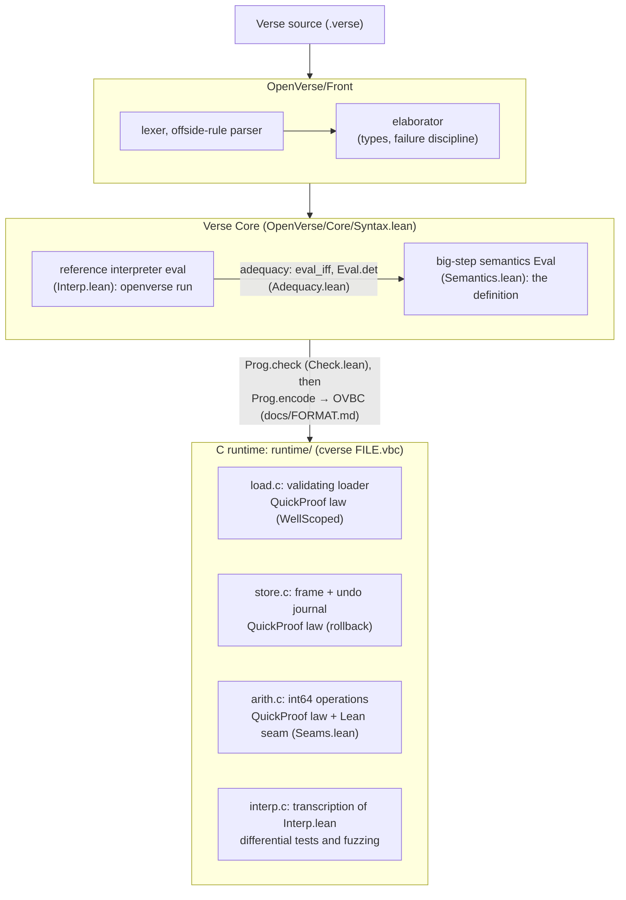

# openverse

A clean-room **reference implementation of Verse**, the functional logic
programming language of Epic Games (Unreal Editor for Fortnite, Unreal Engine
6). The semantics is defined and proved in **Lean 4**, and a C runtime is
checked against it. The handwritten C components for integer arithmetic,
program loading, and the rollback of variables and output are proved with
**QuickProof** (VST + CompCert in Coq); the object store and the value heap
are checked by differential testing and fuzzing.

[](https://github.com/rudi-cilibrasi/openverse/actions/workflows/check.yml)

- **Try it** in the [online playground](https://rudi-cilibrasi.github.io/openverse-docs/demo/):
  this compiler and runtime as WebAssembly, in your browser.
- **Step inside your code** in the [3D simulator](https://rudi-cilibrasi.github.io/openverse-docs/sim/)
  ([openfort-sim](https://github.com/rudi-cilibrasi/openfort-sim)).
- **Learn it** from two books, [*Verse Logic*](https://rudi-cilibrasi.github.io/openverse-docs/verse-logic/)
  and [*The Little Verser*](https://rudi-cilibrasi.github.io/openverse-docs/little-verser/),
  whose every program and Lean statement is checked against this repository
  ([openverse-docs](https://github.com/rudi-cilibrasi/openverse-docs)).

## How it fits together

Verse source is elaborated into Verse Core, whose big-step semantics is the
definition of every program's meaning. The C runtime loads the same programs
in a binary format and runs them.



## What is proved

**In Lean** (`lake build`; [`docs/CLAIMS.md`](docs/CLAIMS.md) has the exact statement and axioms of each, as Lean prints them). The theorems use only Lean's standard axioms (`propext`, `Quot.sound`, and `Classical.choice` for some), with no `sorry`:

| Theorem | File | Statement |
|---|---|---|
| `eval_iff` | `Core/Adequacy.lean` | the reference interpreter computes exactly the big-step semantics: `Eval P s e r s' ↔ ∃ n, eval P n s e = some (r, s')` |
| `eval_fuel_irrelevant` | `Core/Adequacy.lean` | fuel decides only *whether* the interpreter finishes, never *what* it returns |
| `Eval.det`, `Runs.det` | `Core/Adequacy.lean` | Verse Core is deterministic: one outcome, one output |
| `Prog.run_sound`, `Prog.run_complete` | `Core/Adequacy.lean` | running `Main` with enough fuel is exactly `Runs` |
| `evalB_sound`, `evalB_complete`, `Prog.runB_sound` | `Core/Bounded.lean` | `openverse run` runs `evalB`, which is `eval` with a bound on its native recursion depth: whenever it does not stop for depth it computes exactly `eval`, and with a bound at least the fuel it never stops for depth |
| `ite_rollback` | `Core/Derived.lean` | once an `if` condition fails, the `if` behaves as its `else` branch from the **original** state (rollback) |
| `notE_ok`, `notE_notE_ok` | `Core/Derived.lean` | `not e` always discards `e`'s effects; `not not e` is a pure test (Book of Verse §5.5) |
| `optionE_none`, `optionE_some`, `orE_right`, `logicE_ne_fail` | `Core/Derived.lean` | `option{}`, `or` and `logic{}` behave as the book says, including rollback |
| `Eval.no_fail`, `call_no_fail`, `Runs.no_fail` | `Core/Effects.lean` | **`<decides>` soundness**: a function without `<decides>` never fails |
| `Eval.scoped_ok`, `Runs.scoped_ok` | `Core/Scoping.lean` | a program that the C loader accepts never raises a slot or call error, and frames keep their size |
| `Eval.typed`, `Runs.typed` | `Core/TypeSafety.lean` | **type safety**: a typed program never raises a type error, every heap it builds is well typed (each object's fields have its class's types), and `Main` returns a value of its declared type. Types may contain type variables, which each call instantiates, and references to objects of a set of classes |
| `hasTy_sub` | `Core/TypeSafety.lean` | **subtyping is sound**: a value of a type is a value of every type above it (references to more classes; arrays, options and tuples covariantly), so upcasts cost nothing |
| `Typed.subst` | `Core/TypeSafety.lean` | **the substitution lemma**: a typing with type variables holds at every instance, so a generic function is checked once, not once per instantiation |
| `tc_sound`, `Prog.checkTypes_sound` | `Core/TypeCheck.lean` | the bidirectional type checker that the front end runs on every program it emits is sound |
| `Prog.check_ok` | `Core/Check.lean` | `Prog.check` establishes the hypotheses of `<decides>` soundness and scoping |
| `Eval.no_control`, `Runs.no_control` | `Core/Control.lean` | a `break` never escapes its loop (no control errors) |
| `Eval.no_writes`, `Prog.accepted_no_writes` | `Core/Writes.lean`, `Core/Guarantees.lean` | **heap effects**: a function without `<writes>` (`<computes>`, `<reads>`, `<allocates>`) leaves every existing object as it was |
| **`Prog.accepted`** | `Core/Guarantees.lean` | **every program the front end accepts** has one outcome and one output; it never raises a slot, call, type or control error, so the only runtime errors left are integer overflow and `Err()`; `Main`'s value has its type; and it never fails unless `Main` is `<decides>` |
| `add_seam` … `modulo_seam`, `apply_*` | `Core/Seams.lean` | each int operation equals the C99 formula that the QuickProof law `arith_exact` asserts |

**In Coq, with QuickProof** (`proofs/quickproof/`; a separate evidence class,
"proved under CompCert's C semantics", not Lean theorems):

| Law | C under test | Status |
|---|---|---|
| `arith_exact` | `runtime/src/arith.c` | **PROVED**: `qp verify` PASS, 10 axioms (standard + VST malloc). With `Seams.lean`, the nine int operations compute `Prim.apply` on every pair of 64-bit inputs |
| `store_rollback_model` | `runtime/src/store.c` | **PROVED**: `qp verify` PASS, 12 axioms (standard + VST malloc). For any 32 operations on up to 3 nested contexts, 4 slots, and journal and output capacities up to 8, rollback restores the slots and the output, and commit keeps them, against a naive snapshot model |
| `loader_wellscoped` | `runtime/src/load.c` | **PROVED**: `qp verify` PASS, 13 axioms (standard + VST malloc). For every buffer of up to 4 KiB, `vx_load` reads only inside it; when it accepts, the program is well formed and `Prog.WellScoped`, so its Verse Core semantics raises no slot or call error (`Eval.scoped_ok`) |

See [`proofs/quickproof/README.md`](proofs/quickproof/README.md) for each law
and what a QuickProof result relies on.

**By testing**: the C interpreter is a transcription of `Interp.lean` and is
not proved. It is compared with the Lean interpreter on the Verse test suite
(`scripts/test-verse.sh --c`) and on random programs (`scripts/fuzz-diff.sh`),
and it runs under ASan/UBSan.

## Using it

```sh
lake build                                  # Lean: proofs, front end, reference interpreter
make -C runtime                             # C runtime: runtime/build/cverse
.lake/build/bin/openverse run tests/verse/hello.verse
.lake/build/bin/openverse emit tests/verse/hello.verse -o /tmp/hello.vbc
runtime/build/cverse /tmp/hello.vbc
scripts/test-verse.sh --c                   # both implementations on the test suite
scripts/fuzz-diff.sh 1000                   # differential fuzzing on random programs
scripts/check.sh                            # all of the above, plus the C unit tests and QuickProof pins
scripts/check-quickproof.sh --check         # QuickProof: qp check and qp verify (needs Docker)
```

```verse
Half(N:int)<decides>:int =
    Mod[N, 2] = 0
    Quotient[N, 2]

Main():void =
    var Attempts:int = 0
    if (set Attempts += 1, Attempts > 100):   # fails: the write is rolled back
        Print("unreachable")
    Print("Attempts = {Attempts}")            # Attempts = 0
    for (I := 1..6, H := Half[I]) { Print("{I} / 2 = {H}") }
```

## Documentation

| Page | What it covers |
|---|---|
| [`docs/LANGUAGE.md`](docs/LANGUAGE.md) | the supported Verse subset, and the reading taken wherever the Book of Verse is silent or contradicts itself |
| [`docs/DESIGN.md`](docs/DESIGN.md) | the decisions behind the code: Verse Core, rollback, fuel, translation validation, classes and the heap, the C runtime |
| [`docs/CLAIMS.md`](docs/CLAIMS.md) | the statement and axioms of every theorem, as Lean prints them (generated) |
| [`docs/SEAMS.md`](docs/SEAMS.md) | where the Lean theorems meet the QuickProof laws about the C runtime |
| [`docs/FORMAT.md`](docs/FORMAT.md) | OVBC, the binary format the runtime loads, and the exit codes |
| [`proofs/quickproof/README.md`](proofs/quickproof/README.md) | the laws about the C runtime, their status, and how to re-check them |
| [`docs/research/book-of-verse-digest.md`](docs/research/book-of-verse-digest.md) | the Book of Verse, quoted rule by rule |

## Trust

Trusted, besides Lean's kernel:
- the statement of the semantics (`Core/Semantics.lean`, `Core/Prims.lean`),
  which is the reference;
- for floats (#127), Lean's `Float`, whose operations are C's `double`
  arithmetic (`@[extern]`): the semantics of `+ - * /` and the orderings on
  floats is IEEE's as the machine computes it, and that of `Sqrt`, `Exp`,
  `Ln`, `Pow` and the trigonometric functions is the C library's (`libm`),
  which the reference interpreter and `cverse` share on one machine;
- the front end. It is not verified, but each of its outputs is checked by
  `Prog.check` and `Prog.checkTypes`, with a certificate of slot and function
  types. Both checks are proved to establish what the theorems assume, so
  `Prog.accepted` holds of every program the front end emits;
- for the QuickProof results, QuickProof's own trusted base (Coq, VST,
  CompCert's Clight semantics, `clightgen`; see
  `proofs/quickproof/README.md`), and the reading that each C law formula and
  its Lean restatement are the same formula (`docs/SEAMS.md`);
- the gap between CompCert's C and the GCC build of `cverse`.

Verse, Unreal Engine and Fortnite are trademarks of Epic Games. openverse is
an independent implementation written from the public
[Book of Verse](https://verselang.github.io/book/) and the
[Verse Calculus paper](https://doi.org/10.1145/3607845) (Augustsson et al., ICFP 2023),
and uses no Epic code.
