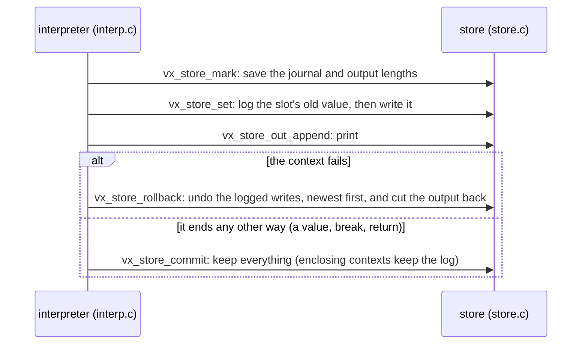
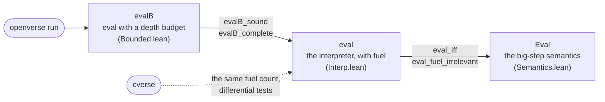
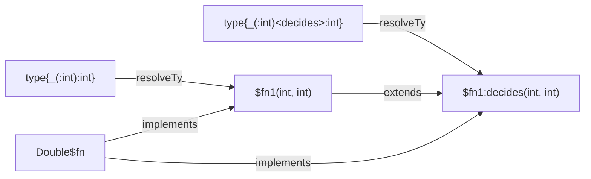
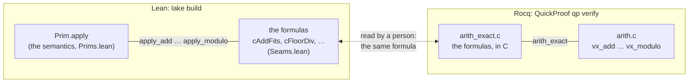

# Design of openverse

openverse is a reference implementation of Verse. "Reference" means the
meaning of every accepted program is fixed by a definition that can be read,
proved about, and run. That definition is the big-step semantics of Verse
Core in Lean. Everything else, the front end and the C runtime, is checked
against it. This page records the decisions behind the shape of the code.

**Contents**

- Semantics: [Two languages, one semantics](#two-languages-one-semantics) · [Failure and rollback](#failure-and-rollback) · [Choice](#choice-iteration-over-alternatives) · [Fuel](#fuel)
- Front end: [Translation validation](#translation-validation-instead-of-a-verified-front-end) · [Modules](#modules-a-renaming-before-elaboration) · [Type aliases](#type-aliases-a-substitution-before-elaboration) · [Floats](#floats-canonical-bits) · [Rationals](#rationals-helpers-written-in-verse) · [Generic functions](#generic-functions-polymorphic-verse-core) · [Function values](#function-values-hidden-interfaces-and-classes) · [Concurrency](#concurrency-suspends-functions-as-frames)
- Classes and the heap: [Classes as references](#classes-as-references) · [Typing the heap](#typing-the-heap) · [Typed defaults](#why-every-slot-starts-with-a-typed-default)
- C runtime: [The binary format and the loader](#the-binary-format-and-the-loader) · [Two semantics, one seam](#two-semantics-one-seam) · [Objects in the C runtime](#objects-in-the-c-runtime)
- [Readings of the Book](#readings-of-the-book)

## Two languages, one semantics

Surface Verse is large and changing (the Book of Verse tracks a development
branch). Verse Core (`OpenVerse/Core/Syntax.lean`) is small: literals, slot
reads and writes, sequencing, 59 primitives, calls, `if`, single-generator
`for`, `loop`, `break`, `return`, `Print`, and five heap operations (`new`,
field `get` and `set`, `tag`, `isTag`). Every surface construct is a
*derived form*:

- `not`, `or`, `and`, `option{}` and `logic{}` are built from `if`
  (`Core/Derived.lean`), and the rollback laws the Book states are theorems
  about these definitions;
- multi-generator `for` is nested single-generator `for` plus `flatten`,
  and, when its clauses do something before its last generator, a search
  that resumes them (see [What a `for` undoes](#what-a-for-undoes-one-search));
- a choice `a | b` is a `for` over its alternatives' indices (see
  [Choice](#choice-iteration-over-alternatives));
- comparison chains use temporaries, so each operand is evaluated once;
- structs are tuples, enums are ints, and maps are arrays of pairs in
  insertion order;
- a generic function is one Core function with type variables, and a
  hidden argument per type parameter.

Keeping Core small keeps the proofs and the C runtime small. All 59
primitives are one Lean function (`Prim.apply`) and one C file
(`runtime/src/prims.c`).

## Failure and rollback

Verse's failure is not an exception. A failable expression in a failure
context either succeeds, or fails and leaves no trace. The semantics makes
this literal. The state is the current frame together with a global part
that calls share, the output and the heap (#20), and the rules for a failure
context (`Eval.ite_fail`, `EvalFor.skip`) restart from the state *before* the
context. So writes to slots and to the heap, and allocations, are rolled back
by the same rule, with no journal in the semantics.

Output is rolled back as well. A `Print` in a condition that fails is not
observed, which is the reading of "nothing changes" in Book §6.3.

Because Verse has no closures and frames are not shared, a callee cannot
write its caller's frame. So rollback only ever restores slots of the frames
that are live. The C runtime implements this with one value stack and an
undo journal (`runtime/src/store.c`):

- writes are logged only inside failure contexts;
- a mark is a pair of lengths, journal and output;
- rolling back undoes entries newest first and truncates the output.



The QuickProof law `store_rollback_model` proves this against a naive
copy-the-whole-state model, for every sequence of 32 operations on up to 3
nested contexts (the bounds a VST proof needs; the code has no depth limit
of its own).

## What a `for` undoes: one search

The Book of Verse's tests fix what a `for` undoes
(`FlowControl/for.versetest` 317-392, `Range.versetest` 140, 159,
`SoftwareTransactionalMemory.versetest` 74-88; the cases, by hand, are in
[the readings audit](research/readings-audit.md#what-a-for-undoes)). One
definition covers every `for`:

- its clauses are a **search**, depth first in spatial order, of *steps*
  (code with one outcome: a filter, a binding, a `set`, a source or a
  range's bounds evaluated) and *choice points* (a generator's elements, a
  choice's alternatives, the values of a call of a function with several
  values, each binding names before the clauses after it);
- a failing step backtracks to the most recent choice point with an
  alternative left, undoing what was done since it took its current
  alternative or since the last success, whichever is later;
- reaching the body is a **success**, which commits: what the search did
  since the last success stays. The body runs outside every failure
  context; its failure is the `for`'s;
- when the search ends, what it did since the last success is undone.

So a *search step*, from one success to the next, is one transaction, and
each alternative tried in it a nested one. Read compositionally: a choice
point in a `for` fails when none of its alternatives reaches the body, as a
step does. A first-success context is the same search stopped at its first
success (`Expr.firstE`, `Expr.chooseFirst`, below); a `for` goes on after
each. Every kind of choice point is an instance: a range's bounds and a
source are steps, then a choice point over their elements; a choice is a
choice point over its alternatives, each alternative's own code inside it; a
call with several values is its arguments (steps) and the callee's body as
more of the search; an exclusive `if` is a step and its picked branch's
code; a refining cast a step; nothing in the clauses waits.

**The lowering (`ForLevel`, `Elab/For.lean`).** Verse Core can undo only
an `if`'s condition and a `forE`'s filter, and cannot re-enter nested
filters once it has left them, so a search step that stops at the body must
resume from slots. Each generator is a *level*: its source's value in a
slot `A`, the index `I` of the element the search is at, a flag `act` (that
element went through the last success, so the levels below it may have
more) and the element's code (`X := A[I]`, the binding `altE` makes for a
choice, then the filters after it). One search step is:

```
step = found := false; (if (not started) then (clauses before the first generator; A₁ := source₁; I₁ := -1; act₁ := false));
       level₁; found?
levelₖ = loop {                                   # each level's code once
    resuming := actₖ; actₖ := false
    if (not resuming) then (Iₖ += 1; if (Iₖ ≥ |Aₖ|) then break)
    if ((if (not resuming) then (bind Aₖ[Iₖ]; filters; Aₖ₊₁ := sourceₖ₊₁; Iₖ₊₁ := -1; actₖ₊₁ := false));
        levelₖ₊₁; found?)
    then (actₖ := true; break)
}
levelₙ = loop { Iₙ += 1; if (Iₙ ≥ |Aₙ|) then break; if (bind Aₙ[Iₙ]; filters) then (found := true; break) }
for = rounds of: for d in 1..size (not done) { if (step) then (started := true; array{body}) else (done := true; array{}) }
```

Each try of an element is an `if`'s condition, so a failure context of its
own, which undoes the element's code and the levels below it when they find
nothing; a resumed element keeps its names and is not run again, so what
it did, committed at the last success, stays; the step is one failure
context, so when the search ends what it did since the last success is
undone. The body runs in a round's `forE` body, between steps, outside
every failure context: nothing is journaled while it runs, it can wait (the
suspension lowering turns the round into a loop, as for any `for`), fail
or return. The rounds, each a `forE` over a range twice as long as the last,
collect the values in linear time, as `elabLoopGen`'s do for a lazily taken
call, and, as there, a nested continuation's failed outcome, which breaks
the nearest `loop` (`forOutcomeSlot`), is forwarded after the rounds. Every
level's code appears once. When nothing before the last generator's
elements can change what undoing would restore (`forClauseEffects`: a
`Print`, a field's `set`, a call, a write of a variable of the code around
or a `var` of the clauses), the nested `forE`s below are that search, and
the `for` keeps them, byte for byte.

**Which `for`s.** This serves every `for` whose generators are over ranges,
arrays, maps and strings and choices of values (#208, below: an index
generator whose element binds `altE`), with no call of a function with
several values in its clauses (`callsManyValued`) and no exclusive choice.
The others keep the lowerings of the [Choice](#choice-iteration-over-alternatives)
section below, which keep what a generator's clauses did once they succeed
(the old rule), entirely; what each needs to come under the search is in
[the readings audit](research/readings-audit.md#what-a-for-undoes), and
LANGUAGE.md says which `for`s follow which rule.

## Choice: iteration over alternatives

A choice `a₀ | … | aₙ₋₁` (#208) has several values, which the nearest
failure context takes: all of them in a `for`, the first success in an
`if` condition or `first{…}`. Verse Core has one outcome per expression,
and no choice. But a `for` already backtracks: each element's filter is a
failure context that is rolled back when it fails (`EvalFor.skip`). So a
choice is compiled to a `for` over the *indices* of its alternatives, with
slot `K` holding the index and `Expr.altE` selecting the alternative,
`if (K = 0) a₀ else if (K = 1) a₁ …`. The alternatives stay lazy: they are
not an `array{a₀, …}`, which would run `aₙ₋₁` before `a₀`'s value was used.

- **In a `for`**, `X := a₀ | …` is one more generator, over
  `#[0, …, n-1]`, whose filter binds `X := altE K as` before the clause's
  filters: one more level of [the search](#what-a-for-undoes-one-search).
- **For the first success**, the clauses are compiled to code that `break`s
  when they succeed, inside `Expr.firstE c = loop{c; fail}`. Each choice is
  `Expr.chooseFirst`: a `for` whose filter binds the alternative, runs the
  clauses after it, then fails. So with two choices:

  ```
  loop{ pre; for K₁ (X := alt K₁; mid; for K₂ (Y := alt K₂; rest; break) void; fail) void; fail }
  ```

  The inner `for` sits in the outer one's *filter*, not its body: when every
  inner alternative fails, the `fail` after it rolls the outer alternative
  back before the next one is tried. A body's effects would stay. The
  code is linear in the number of choices: nothing is copied per
  alternative, and `break` already passes `checkControl` inside a `loop`.
  No source `break` or `return` can be in the clauses: they are a failure
  context, which neither may leave (`checkJumps`, the Book of Verse's
  tests), so the `break`s in them are `firstE`'s own and those of loops of
  their own.
- **An alternative with values or clauses of its own** (#283), a call of a
  function with several values or a choice inside an expression
  (`A() | B()`, `Upto[1, 3] | 9`), cannot be selected by `altE`: its values
  come from its own lifted clauses. Such a choice is compiled alternative by
  alternative, the clauses after it copied into each. In a `for`, each
  alternative is a `for` of its own over its binding (lifted with a site of
  its own, so that the names made differ), the clauses after it and the
  body, and their values are concatenated (`elabFor` with `prepared`, so
  the clauses already lifted are not lifted again). For the first success,
  each is a `first{…}` of its binding, the clauses after it and the tuple of
  the names they bind (`$firstP`, as for #246's functions of their own),
  the alternatives a plain choice, and the names bound from the tuple of
  the one that succeeds. Only such choices are copied, once per alternative.
- **A choice or a call with several values in a `set`'s path** (#283), as
  `set A[0 | 1] = X`: `liftClauseM` binds the path's indices to names
  (`setPrefix`, as for a new value that needs code before it), lifts those
  bindings in order (`Choice.pathHas` says when), then lifts the new value;
  the `set` itself then reads the old value, for `op=`: the order `set`
  evaluates them in.
  An index's choice is then an ordinary binding, a generator in a `for`.
  When the clauses after such a choice have another one, so that the copies
  would double with each (#335), they become a function of their own,
  `$cont…`, which each alternative calls. It is `<decides>`, with the
  function's own effects. It takes the alternative's value and the names
  the clauses use (`Self` in a method; a `var` they set, copied in and
  out), and gives the tuple of the names they bind at their first success.
  The call is a clause of the alternative's `first{…}`, so that its
  failure goes back into the alternative's own values first, and the
  tuple is that `first{…}`'s value.
  - As #246's functions of their own, it is asked for by the first elaboration and made for the next. The first elaboration takes one alternative, for the names' types, and its code is not kept.
  - The immediate shared path retains copies when the selected binding is a `var`. Unsupported staged contexts retain their source fallback.
  - A method's `(super:)` calls carry `$sourceSuper` metadata with the source class, method slot and an explicit `Self` capture. Elaboration restores that lookup scope at the call, so overloads are selected using the helper's actual argument types and the source method's inherited implementations. The same metadata serves first-success helpers, `for` continuations and refining casts; it disappears before Verse Core checking and suspension lowering.
  - Heterogeneous composed alternatives can share a polymorphic continuation. Structural generalization retains common array, option, tuple, map and nominal heads, and abstracts the varying parts into fresh type parameters. Equal columns share a parameter (`tuple(int,int)` and `tuple(string,string)` become `tuple(T,T)`). A fresh parameter is comparable only if every alternative is comparable. The suffix must type check with those parameters; operations requiring a specific alternative's static type retain copies. A common class view is also safe when every use of the selected binding is a direct field access and every alternative gives those fields exactly the view's instantiated types. Method calls and bare values keep their original types.
  - Opaque receiver types can supply checked operation dictionaries for ordinary method calls. Each adapter invokes the method at the alternative's original receiver and parameter types. Argument and result columns extend the input's equations and comparable bounds. Dictionary objects carry any opened type witnesses; generated `$apply` methods recover them under the same checked protocol as bound-function values. Explicit arguments stay in the caller, preserving their order, rollback and suspension. A canonical dictionary family and one shared apply function serve each set of method contracts, so dispatch is compiled once per family. Only dictionary construction is an implementation allocation; user argument expressions retain their ordinary effects. Method-local type parameters are quantified at each dictionary invocation; class-dependent columns stay fixed on its object. Member discovery follows immutable unannotated alias chains in lexical order through blocks, `for` clauses and `if` conditions. It retains the actual alias values and source declarations, passing their abstract types only to disposable discovery probes. Aliases of checked method results and getters keep the initializer's result column, including columns distinct from the original receiver. They recover that type after discovering the initializer's operations; direct alias chains preserve it. Method-dependent families without a cached result retain copies. Child-scope aliases do not reach sibling expressions. Writes to mutable fields of reference classes use checked setter dictionaries, including field-only paths from a local. The terminal object is captured before evaluating the right-hand side, even when that expression replaces an intermediate reference. Compound writes pass the saved old value before the right-hand side; the adapter reuses `$withOld` to retain the original assignment operator and conversion checks. A prepared choice assignment retains its existing saved value. The right-hand side remains in the caller, including its effects and task scope. Plain writes through contiguous array/map indices after a mutable field also use dictionaries. Their keys evaluate before the terminal object is captured, then the RHS evaluates in the caller; the adapter reads the current array after the RHS so its heap updates survive. The checked setter remains failable and retains bounds checks and rollback. Compound writes through those indices also share. Compiler-only metadata saves the key, target object and old element before the RHS using Core temporaries, and elaborates the RHS in the original caller context without a new source block. The adapter reads the current array after the RHS and combines using its saved input without another leaf lookup. Legacy prepared assignments validate the current leaf in the caller before their remaining RHS expression and reuse the existing saved old value. This retains the order of arithmetic errors and bounds failures. All keys evaluate left to right before object capture; several keys travel in one typed tuple, retaining their positions through saved-value validation and reconstruction. The same dictionaries serve map fields and mixed array/map paths. Key columns retain their comparable bounds and their correlation with receiver/value columns; a single map insertion is nonfailing, while intermediate map reads, array indices and compound updates retain their failure checks. Keys and the RHS execute in the caller, including allowed waits for nonfailing insertion. Reference-backed paths with option queries, value fields or reference objects reached through indices also use checked dictionaries. Each alternative retains its own reference boundary, including paths whose final reference occurs at different depths. A capture dictionary traverses the prefix after all keys have evaluated; a saved-leaf dictionary performs pre-RHS reads and legacy validation; a write dictionary rebuilds only the value-container tail from the post-RHS state. The RHS remains in the source caller, including nonfailing compound assignments whose RHS suspends. Prefix permissions are charged only for mutable-field reads, preserving writes-only assignments through immutable prefixes. Keyless paths use an internal scalar transport argument. Empty-class paths, source assignments through call results and pure value-root writes retain their source lowering. When every instance of an abstract column is `int` or `rational`, checked conversion dictionaries supply integer RHS values at the original expected type, including elements in arrays and options. Defaults, refining branches, immediate continuations and waiting resumes retain that compiler evidence through explicit captures, while caller source locals stay outside a callee's default scope. Conversion methods use ordinary checked return conversions; their evidence also participates in helper and receiver-probe identity. Named arguments retain their source names when forwarded to the original method, while their supplied values are evaluated once in caller order. Operation discovery uses the ordinary call packer for tuple, array, unit and singleton parameters. Computed tuples remain one caller value; literal tuple fields remain separate where generic contextual inference needs them. When alternatives use different aggregate parameter shapes, checked adapters retain their own binders while the caller keeps the written field order. The same transport serves callable fields, whose values are read before argument producers. Regular and extracted method functions use the same receiver recognition when spreading contextual tuples; a top-level parameter named Self does not become a receiver. Omitted defaults still execute in the selected method's declaration and type scope, after all supplied arguments. Forwarding dictionaries carry the caller's default stack and loop/defer/default-check flags and use the existing task-borrowing protocol for default helpers; the ordinary source method still owns its body. Calls whose omitted-parameter types depend on method-local parameters, whose generic schema cannot be determined from supplied arguments and the expected result, and other suffix operations that the current abstraction cannot type retain copies.
  - Generic helper calls infer their input instance before their result is normalized to the caller's joined type. Generated packets join field by field, so an erased heterogeneous value does not erase flags, mutable copy-outs or other result fields. The last heterogeneous generator can need this normalization even without another composed choice after it; homogeneous last generators retain their existing path.
  - Constructor-instance discovery visits the original alternative contexts before heterogeneous sharing. Otherwise a disposable generic trial can hide the concrete instances needed by lifted field defaults.
  - Copies also remain inside a function of its own of a call taken lazily that allows fewer effects than the function the continuation was asked for in.
  - The key has the captured names' types: a `for`'s body copied once per alternative has one place but names of other types.
  - Discovering an omitted-method-default bridge restarts consumer discovery with those bridges retained. Their inferred effects are then visible before building typed stage interfaces, prefix functions and resume methods; a cached stage must not keep the permissions of an earlier probe. The source caller still checks the inferred helper effects against its own declaration. A refining prefix also retains the typed suffix trial’s effects when discarding its temporary slots, and each suffix method inherits the root plan’s permissions.
  - Lazy calls may occur in the alternatives or suffix. An effectful lazy call's `$first…` helper is keyed by its complete prepared producer and suffix, binding annotation, typed mutable inputs, referenced type aliases and interface-copy context. Replacing a suffix by a continuation call changes that helper's contract even when source positions and captured names stay the same. New continuation requests are installed before requesting effectful lazy helpers, avoiding obsolete copies of trial suffixes. Producer recursion remains a direct recursive helper call; values are still taken lazily with their original rollback boundaries.
  - The first elaboration elaborates every other alternative alone, without the clauses after it, for its type and for the continuations inside it, so nesting through inlined functions takes no more elaborations.
  - Code and compile time are now linear in the number of such choices in one condition: ten calls of a function with a `return` and a choice after it take 44 KB and 0.04 s, where copying took 2.3 MB and 16 s.
  - Each call is a non-tail call in a filter, so n of them nest n deep in the evaluator's depth budget.
  - A first-success helper's packet is the tuple of the names the clauses bind, the copies of the `var`s they set, then `true` (`firstResult`), which the caller unpacks (`firstUnpack`): no source return or break can leave the clauses, a failure context (`checkJumps`). (#283's packets for one, with an optional saved operand or a break flag, forwarded by the caller, are gone with the programs that had one.) In a suspending caller, cached condition slots are committed before private cancellation calls and the final return; cancellation callbacks reload their changes into the cache. Synchronization wraps the entire receiver-tag dispatch so its type refinement remains valid.
  In a `for` (phase 2), such a choice's alternatives are each a `for` of their own. When the clauses after it have another such choice, or an exclusive one, the continuation `$contf…` holds those clauses and the body, and gives the values (and the final values of the `var`s they set).
  - It runs `$forFirst`: `elabFor`'s filter of the first group, then its values. So it fails exactly where the copied form's failure would undo the alternative's own last clauses, since those and the first segment after them were one filter. A later generator that gives nothing does not make it fail, as in the copied form.
  - Each alternative's `for` binds its value, calls it as a clause, and its values are flattened.
  - Both kinds of continuation retain the type parameters of their inputs, results and written types, including a generic method's `Self`. Parameters not determined by the inputs take an explicit witness argument, so a suffix with an annotation such as `E:[]t` can be shared even when no captured value has type `t`. The generated body substitutes the context's type aliases, and the key includes the written type instances and interface-default copy tag.
  - This immediate protocol is used where the body passes `forBodySafe` (no suspension, non-rollback operation, escaping break, or unsupported marker). Waiting consumers use the staged protocol below; unsupported contexts retain copies (tim-6e's review of #335). Starting a task with `spawn` is immediate: the body check leaves its callee to `elabSpawn`, which checks caller arguments for waits and failure contexts before checking the callee in its task context. Prepared nested consumers, including lazy recursive groups and their generic/default bindings, remain inside the helper and are checked by their own elaboration. Body cleanup is local to that helper. Both non-failable and failable bodies may share lazy suffixes, including after a refining branch. Failable bodies and source returns use explicit outcomes, described below.
  - Method calls are classified from their typed code during the continuation trial. Names such as `Signal`, `Subscribe`, `Cancel` and `Await` alone do not imply suspension: event notification, subscription and subscription cancellation are immediate, transactional operations. A genuinely suspending method still needs a suspending source context and the staged continuation protocol below.
  - A continuation is keyed by what its code depends on (`contKey`, as `firstKey` and `refineTagOf`, over `Ctx.usedLocals`): the clauses' places, the locals they use with their types, the type variables they write as bound there, and the context. The key is the same in the trial that asks for it (`Ctx.trial`) and in the function of an enclosing continuation that the next round compiles the clauses in, so a continuation asked for in a trial is the one used, and nesting takes no more rounds. A generated local the clauses use is named by its place alone for this: a `for`'s return slot (`$forReturn…`, #437) was numbered by the locals in scope, which differ between the source and each continuation's function, so each level of `for`s nested with refining choices made the continuations inside it again (136 for 16 levels, 120 never called). A refining cast's lift asked for in a continuation's trial is not kept (`Ctx.keepsLifts`), in a `<suspends>` caller as in any: its tag has the continuation's own scope, which the trial does not (before, 3N + 3 lifts for N casts as clauses after two refining choices, N + 1 never called).
  - Continuations also share code inside parameter and field defaults, constructors, class blocks and cleanup. `FirstLift` and staged-resume metadata carry the source's lexical restrictions and active default-dependency stack. Effect inference and final elaboration restore them in each helper; helper keys include this context so a request checked in one scope cannot stand in for another. Moving code therefore retains restrictions on returns, suspension, spawning, repeated/concurrent execution and recursive default dependencies.
  - An exclusive choice's own paths (#314's returns, #331's `if`s, `exclIter`) do the same (phase 2b): when the clauses after it have another such choice, every path ends with a call of the continuation, in the path's part of the iteration's filter, so a failure of its first filter undoes the path as the copy's would, and the path's generators take the continuation's values as their body (`build` takes the body as an argument for this). The first elaboration compiles the first path with the clauses after it, for the values' type, and asks for the continuation; the next compiles every path with the call. Ten calls of a function with a `return` and a choice after it in one `for` take 13 KB and 0.01 s to compile, where copying took 1.2 MB and 0.4 s. Immediate consumers can also share in a `<suspends>` caller; waiting refining consumers use the staged protocol below.

Since the result is ordinary Verse Core, every theorem holds of it as it
stands, and the C runtime runs it unchanged. What is new is proved in
`Core/Derived.lean`:
- `altE_sel`: the alternative selected is the one the slot names;
- `chooseFirst_brk`: a choice breaks at its first alternative that
  succeeds, in the state it left, with the ones before it rolled back;
- `chooseFirst_none`: with none, it ends with no value;
- `firstE_of_brk` and `firstE_of_ok`: what those make of the context.

These lemmas are sufficient conditions about the Core forms. The
elaborator is meant to emit those forms (a `seq` of clauses, each later
choice in an earlier one's `inner`), but that it does is tested, not
proved, like the rest of the front end. The same goes for the reading for
`for` and the order of values across choices. The evidence is the tests
and `scripts/gen-choice.py`, a model of the readings written apart from
the compiler.

A choice inside an expression is first *lifted* out of its clause by
`Choice.prepare`, an A-normal form at the surface. The operands evaluated
before it are bound to fresh names (`$t := …`), then comes the choice
(`$c := a | b`), then the clause with `$c` in its place. Doing it at the
surface means the elaborator types the new names like any binding, so no
type inference over Core is needed. `option{…}`, `logic{…}`, `not` and the
left of `or` take a choice's first success by becoming `first{…}` of their
clauses.

Lifting goes into blocks and constructions too (#283). A block's clauses
become the clauses of the failure context it is in. Its locals are renamed
for the place (`$b…_Y`), so two blocks in one clause list stay apart. A
`$declNames` clause in front checks the original names with
`checkNewLocal` where the block was: the renaming must not get around the
no-shadowing rule. The block's last expression is the value. A block's
own `defer:`s go after its value (`Choice.deferLast`, #283): its other
statements, the value, a block of the `defer:`s in order, which runs them
where it ends, last registered first, with the elaborator's checks of a
`defer:`, then the value again. The value is bound to a name of its own
first, unless it reads nothing the block could change (`pureVal`:
literals, the block's constants, and tuples, arrays, maps and options of
those), so `(Y, false)` keeps the type its place gives it. A block ending
in a `defer:` has the block of them as its value, as it would have the
`defer:` (`void`, or the elaborator's "no value"). Each moved `defer:` has
the names its scope declares after it renamed (`$later'N`, shown as `N`,
`deferBodies`), so it cannot use them, as where it was. As LANGUAGE.md
lowers a `defer:` after the rest of its scope, they run as each value
leaves the block, and not for a value whose clauses fail. The same goes
for a non-returning function's own `defer:`s, after `$r0` in its `$inline`
template. A function whose values are taken lazily or computed at the call
(a recursive one, or one a recursive one's code calls) has its own
`defer:`s placed so before its body is analysed, after each leaf of its last
expression (`inlineFns`' `deferLastLeaves`, through its `if`s' branches, so
an `if` that ends it still picks its branch as the call's code, not each
value's), so they are code after its value, a return frame of its calls in
the lazy machine (`lastChoiceTail`), and a block in its code that
the normal form takes apart (`normAlt`, `frameOf?`) has its own placed so
too: before #283's last step the function's were refused, and a block's ran
once, as code of the path that selects it. Returning functions keep registrations until
`elimScopedReturns` normalizes their scopes. Each `ReturnScope` retains
its continuation and reached registrations. Branch fallthrough executes
that branch's cleanup before resuming the parent's continuation. A return
saves its operand at the declared result type, executes each active scope's
cleanup from the inside outward, then yields the saved value. Registrations
after an earlier return are reached only on fallthrough paths. Empty scope
fallthrough yields void, and a final registration is followed by a void
return. The existing plain-return shape remains for bodies without cleanup;
both paths use the same exclusive branch constructor, without adding a
generator boundary. The same block cleanup applies to a block as a branch
(`bifToExcl`) and a branch typed
apart as `option{…}` (`elabBranchAlts`), whose braces hold clauses. A
`defer:`'s body is no failure context that takes a choice
(`elabDefersCore` clears `inTaking`).

LANGUAGE.md also places a `defer:` before each `return` (after its value)
and `break` that leaves its scope. In a block whose `defer:`s `deferLast`
moves, each statement with an exit that can leave it (`leaves`) gets the
`defer:`s registered before it pending around it, `$deferExits(ds, s)`
(`pendingIn`, `deferExits`). The elaborator registers them around `s` as
`elabSeqIn` registers a `defer:` around the rest of its scope
(`Ctx.withDefer`), with nothing to run where `s` ends. So an exit in `s`
runs them after the cleanup of the scopes inside `s` it leaves and before
that of the scopes around the block, as for any scope, wherever `s`'s
clauses are compiled to: a continuation of their own runs them before it
gives the exit back (`elabRefineExit`), and the caller, which forwards it,
does not. The marker stays around what lifting makes of `s` (`liftE` puts
it around each clause lifted out of it), and a clause keeps its shape: a
binding its name, a choice its alternatives (each with the marker), and
the `if` of a choice of its branches its branches and conditions
(`deferExitsIf`; the conditions are a scope of their own, so `pendingIn`
places their own `defer:`s too, at their end, with the marker outside;
`bifToExcl` looks through the marker for a block as a branch). A statement
with no exit gets none, so the code of a block without one does not
change.

A construction evaluates its fields in its type's declaration order, so its
fields are first put in that order, which by itself changes nothing. Then
they are lifted as a call's arguments. `Choice` works on syntax, so the
elaborator passes the order in (`choiceOrder`, through `prepare`,
`hasChoice` and `takeFirst?`). Each field's entry also says whether its default is more than a literal.
Omitted computed defaults before the last choice become `$fieldDefault`
operands in that order. The elaborator uses the same home-class scope,
actual type arguments, cycle check and effect accounting as an ordinary
default. `$fieldValue` keeps an earlier explicit operand's expected field
type when it is bound before a choice. Allocation, class blocks and later
defaults remain in the final construction.

An implicit generic instance may come only from the original binding or
call's expected type. A discarded type probe keeps each construction whole
and checks its field choices with native typed consumers, including inline
and lazy templates. It records the actual instance with its source position,
active inline site, incoming lexical types, aliases and source/default scope.
The real pass checks compatible instances and requires a unique result.
Operands carry the contextual type metadata through continuation and refining
helpers, specialized before their lexical aliases disappear. Compile-time
inline scope markers carry the active call through nested consumers; helper
keys and requests retain that scope. The metadata creates no runtime locals
or extra written-type dependencies, while type substitution still updates
it when a branch is refined.
Where the order is not known (an eager `F$all` template), or a field is given
twice, the construction stays in place for its normal error.
A call's arguments are put in the order the call evaluates them,
positional ones then named ones as written, and a named one's value is
lifted like an argument. Every call path (direct, generic, a method's
dispatch to its overrides) evaluates in that order, and the defaults of
omitted named arguments come after them all, so none can run before a
lifted choice.
A block or construction kept with a choice inside becomes
`$noLift(why, e)`. `hasLiftable` treats it as false, so callers that lift
until nothing is left (`liftCmp`, `liftOps`) do not try it again and
again. The elaborator elaborates `e` with `liftWhy` set, and the choice's
refusal says why: a range it binds (which only a `for`
clause can), or a construction whose field order is unknown. A block's
renamed locals are `$b…'N`, and messages show `N` (`shownName`).
`hasLiftable` does not look inside a `.block` that is an argument of a `$…`
marker. That block is the body of `first{…}`, `spawn`, `branch`, `sync`,
`race`, `rush` or `defer:`, which take their choices themselves or run
apart.

A source profile is checked before any of these transformations
(`Front.SourceProfile.check`, at the `elabProgramCore` boundary). The
choice-free profile examines every loaded definition, nested default and
refinement condition, plus the optional entry expression. It rejects
source choice/generator constructs before helper generation, so ordinary
dispatch, function-value, refinement and scheduler helpers can retain their
internal loops and first-success forms. The profile is an admission rule;
it does not change the compiled code of an admitted program.

A `return` in such a function's body (#283) is taken out where the body
is inlined (`Choice.elimReturns`). An `if` with a `return` in a branch,
`S; if (C) { T } else { U }; R`, becomes the value
`S; if (C) then block{ T; R } else block{ U; R }`, a `return v` ending its
block with the value `v`. The rest is left out after a branch that always
returns, and the condition binds its names for its branch natively. A
branch's own names, and its condition's, are renamed for it (`$k…'N`), so
the rest copied into it may declare the same ones. No choice is added,
and that is the point. In a `for`, every choice is a generator, and what
came before a generator is kept when a later filter fails. Any encoding
with a choice (guarded alternatives, an option per branch then a choice
of "returned or not") makes the `if` such a boundary, where the program
had none. tim-e1's model found it twice in #312's review: prints in the
branch, then before the `if`, survived a rejected value. Even the
caller's earlier clauses would show it.

A block statement and a `case`'s arm with a `return` in them are taken out
the same way (#283), as the scopes they are: a block's statements go in its
place, its names renamed for it (`$k…b'N`), with its `defer:`s its own scope's
in `elimScopedReturns` (a `ReturnScope`, as an `if`'s branch has); a `case`
is the `if` chain that selects its arm (`Choice.caseIf`): `k := case (e) {
p₀ => 0, … }`, the same patterns, so the same failure or exhaustiveness, then
`if (k = 0) then a₀ else if … else aₙ`. A block or a `case` as the body's last
statement has its value, or its arms', returned in it (`tailReturns`). A
`return` in a `for` or a `loop` would need the loop to stop with the return's
values: a function of its own, as `nestFns` makes for a consumer, giving an
option of the operand and the `var`s it sets (a `for`'s body has no `break`),
whose call the body then returns from in an `if`; it is refused, saying so.

Recursive multi-value bodies normalize supported returns before recursion
classification. For lazy analysis, generated branch scopes carry
`$returnTail(block{…})`: only these scopes split into invocation prefixes
and tail leaves. An ordinary source value block stays inside its value's
rollback boundary, and so does an `if` in a branch's place with no choice
and no call of the group in it (`plainIfValues`, #283): it is made a block,
one value, so its conditions run in the consumer's failure context with
the value, as an inlined body's would, not once in the item's step, which
kept a rejected value's conditions' effects in a `for`. `elabLoopTailWith` compiles the selected path and saves
its branch locals in continuation items; a failing selected prefix fails
the invocation, without selecting else. Generic mutual-instance discovery
uses those same leaf contexts. Effect discovery includes every path's
prefix and condition. First-success helpers wrap each generated scope in
an internal taking boundary, so branch-block renaming cannot rename the
prepared consumer suffix and multiply helper identities. Eager array
lowering erases the markers to ordinary blocks. Original source bodies
still check return types/effects; recursive invocation cleanup remains
refused, including cleanup inside a returning branch.

When a branch, or the rest copied into it, has a choice of its own, the
`if` becomes an *exclusive choice* instead (#314):
`$excl(($k = 0) ⇒ block{T; R}, ($k = 1) ⇒ block{U; R})`, where at most one
alternative's guards can hold (`Choice.mkExcl`). Where the first success is
taken, it is the plain composed choice of `block{guards; rest}` (`prepare`
converts it, `exclToChoice`), since rollback there is right. A `for`
compiles it as the `if` it stands for (`elabFor`'s `exclIter`). The guards
become a selector in the iteration's filter. Each path's clauses up to its
first generator (the guards again, which bind the path's names, its
clauses with its value bound to the choice's name, then the `for`'s
clauses after it) go into that same filter under `if ($sel = i)`, so a
failure there rolls back to the iteration's generator. Each path's
generators go into the iteration's body under the selector, as arrays,
which are flattened. Top-level filters go through a one-element generator.
A `for` compiles it this way wherever its clauses go:
- in an alternative with several values of its own, which is a `for` of its own (#283), `keepExcl` is passed again;
- after a generator taken lazily (#246), the paths go into the filter of the one-element iteration that binds each value.

In a `for`, an `if` with choices in its branches (#235's `$branchChoice`) is such an exclusive choice too (#331, `Choice.bifToExcl` in `prepare` with `keepExcl`). Its condition becomes a selector, or an option of the names it binds, and its branches become the alternatives, so only the picked branch's own choice generates, as the owner decided on #331. With no type written, the `if` goes along as `$joinOf`, and `exclIter` binds the choice's name at the branches' join, which `elabBranchAlts` computes apart (that code is not kept), as the `if`'s value had it. An `else if` is the else branch's own `if`, converted in turn when its path is prepared. Its selector is named for its place and first condition binder, since generated cases can share a source position and result name. The names a condition binds are renamed for its branch (`$…'N`, shown as `N`), since the clauses after the `if` follow it in its path, where they are not in scope; `$declNames` keeps the no-shadowing check where the `if` is. For `set L = if …`, `$joinOf` carries `L`, at whose type the branches are taken, as `elabBranchAlts` takes them. The join is elaborated with `Ctx.typeOnly`, which uses no function of its own that an earlier round asked for (#275's `$first…`, #335's continuations): those are keyed by place, and there the path's clauses bind the renamed names.

A refining cast's condition stays with its branch (`keepBranches`, #417).
For a `for` whose body passes `forBodySafe`, `exclIter`
compiles the suffix and body once in a shared continuation, in their source
context. The selected branch calls it under `$forFirst`, copying mutable
captures back before traversing its returned array. This keeps nested
refinements from retaining capture names that an outer lift renamed for
copy-out. The array is assigned in the current filter and read by its body, so the
first segment still rolls back with the preceding generator and later
generators preserve their effects even when empty. `consumeBranches`
renames condition locals and selects an option of that array; querying
it after selection prevents failure of a branch's prefix from choosing
the else branch.

When a body may fail, `$forFirstOutcome` returns an option of its array,
along with the mutable copy-outs. A failed first filter still fails the
call; a failed body returns `none` normally. `FailCapture` converts only
uncaught failure into an early return of that packet, preserving writes
and output. It leaves existing conditions and filters transactional and
creates memoized outcome-returning versions of failable callees, including
recursive calls. Dispatch snapshots its receiver before evaluating
arguments and repeats the pure tag test to keep the checker's refinement.
An ordinary `option{body}` would incorrectly roll back the failing body's
effects. Nested producers propagate `none` through a private loop; the
source iteration unwraps it in its body, outside the filter. This stops
the entire consumer without swallowing failure or visiting later choices.
A lazy producer's internal loop intercepts this break before it reaches the
private outcome loop. On exit, that producer checks the outcome flag and
forwards a failed outcome's break before exposing its accumulated values.
Every nested lazy producer does the same, so an ordinary enclosing generator
cannot run another iteration after body failure. The check reads only the
flag; completed body effects and mutable copy-outs remain in place.

No source `break` can be among a `for`'s filters or first-success clauses,
failure contexts (`checkJumps`): the flag that carried one across lazy
producers and `firstE` (#283's `forBreakSlot`) is gone. Suspension lowering
preserves the control boundary when a `for` becomes an index loop: it
marks escaping breaks and forwards them after the generated loop. Failure
still rolls back the condition, and loops inside it keep their own breaks.
The pass introduces no Core operations or changes to either interpreter;
the resulting program passes the existing effect, scope, control and type
checks.

A source `for` with body returns has an optional return slot (none can be in
its clauses, a failure context, `checkJumps`). The body is
initially kept as written, so a copied body still returns directly. Moving
it into a continuation preserves that slot as a mutable capture and gives
the body a return handler. The handler saves the operand, runs body-local
defers, stores the return value, and returns the normal abort packet with
updated captures. Refining casts inside the body use their existing exit
protocol before forwarding the return to this handler. The source loop
stops its private producer loop, then performs the actual return, including
source defers. Its pre-existing escaping breaks are marked and forwarded
outside the private loop without running their cleanup twice. Bottom
element types round-trip through generated signatures as reserved `$never`.
The handler also encloses a moved continuation's clauses, which have no
return of their own. A new explicit loop owns its break target.
When the body has bottom type, its Core expression is followed by `void`,
as for tuple and array literal elements. This gives generated arrays an
inferred element type when suspension lowering saves them across a wait;
the exit still transfers control before that final `void` can run.
Nested consumers can discover continuations and refining branches in
separate rounds; their discovery bound follows source nesting, and each
round still has to add new requests.

Waiting consumers split preparation from execution. A generated
immediate `<decides>` prefix runs exactly the current filter's remaining
clauses, stopping before the next real generator's source/init or the body.
Failure still fails the caller's filter. Success supplies one typed
environment. The environment's
resume method runs outside that filter and uses the ordinary nested/lazy
loops, awaiting each body before requesting the next producer value.

The suffix prefix is declared in the unrefined context before selecting a
cast branch. Its generic signature therefore remains shared across those
branches. Each suffix has its own resume interface, so dispatch does not
test every environment in the whole consumer at every stage. Environment
fields retain selected bindings and opened/written-only type witnesses;
the base view retains result/copy-out types and all ordered ancestor-frame
arguments needed by borrowed captures. Registered private resume methods
read added type parameters from their receiver like ordinary opened overrides.

Ordinary composed and exclusive alternatives use the same shared suffix
prefix when their binding has a common type. Each alternative calls the
prefix in its original final filter and resumes the environment from its
body. A path already preparing an environment transfers its one artificial
flatten operation to that environment's worker; it never flattens the
environment array itself. This override is local to that consumer, so a
nested user `for` and array-valued source bodies retain their own rank.
Type-only suffix probes retain pending-wait evidence even when their
executable result is a placeholder, including nested function-value calls.

Both ordinary and refining staged suffix trials retain their typed heap
effects when their provisional slots and requests are discarded. Root and
tail resume interfaces inherit that evidence when an enclosing refining
lift infers its signature. Cached plans expose the same requirements to
parent probes. Generated helper permissions include those effects; the
original source function's effect constraints still apply.

Borrowed dependencies include read-only captures and are carried through
wrappers separately from copy-outs. Otherwise an intermediate wrapper
could lack the ancestor reference its nested resume needs. Borrowed locals
skip their synthetic snapshot initialization; prefix-local variables whose
owner is immediate become worker-owned locals. Environment keys include
their typed view, mutable flags and storage origins. Metadata names and
view types remain in syntax, so refining-lift renaming and type substitution
also update them. Staging is scoped to its owning consumer; a nested user
`for` in a prefix expression still executes normally.

Waiting outcomes are evaluated before their saved options are queried.
Legal waiting bodies cannot fail, so they need no `FailCapture` rewrite;
source exits already return packets. Immediate failable bodies retain that
rewrite. Source body permissions and repetition restrictions are checked
before extraction and restored at actual body entry. No new Core operation
or interpreter behavior is needed, and all existing Core checks still run.
First-success continuation exits retain their previous restrictions.
Ordinary casts still use the selector path above.

An `if` whose branches have more to lift than a choice of values (#283: a call of a function with several values, recursive or not, or a choice inside a branch's expression) is lifted whole too (`Choice.branchesLift`, which `hasLiftable` and `liftsAsIf` use). A block as a branch has its names renamed for its side (`$…'N`, `bifToExcl`), since the clauses after the `if` follow it in its path, with `$declNames` keeping the no-shadowing check, and its `defer:`s after its value (`deferLast`); a range it binds stays an expression, so an error, as in any lifted block (a range is only a `for`'s iterated expression; before #283's last step such a block, as a branch or not, was not lifted, refused with a message of its own). In a `for`, `bifToExcl` makes it the same exclusive choice, and `exclIter` lifts each branch's call or choice in its path, so the picked branch's own generators are the only ones (#331). Where the first success is taken, `prepare` makes it the choice of its branches, each guarded by the selector (`bifToExcl`, then `exclToChoice`), whose alternatives are lifted as any composed choice's (#296, #338). An `if` whose branches the elaborator takes as they are (`plainBranches`) keeps `elabBranchAlts`, so that code does not change, and so does an `F$all`'s body (`gensOf`, `guardBranches := false`), whose `arrOfE` gives the picked branch's array, whatever is in it. A `case` with something to lift in an arm (#283) is lifted as the `if` chain that selects its arm (`Choice.caseIf`, from `liftE`): its scrutinee lifted first, then a block of its selector, `K := case (e) { p₀ => 0, … }` with the arms' own patterns, and the chain `if (K = 0) then a₀ else if …`, each `if` at its arm's place, so names made for it (`bifToExcl`'s) are its own; the same chain takes a `return` in an arm out (`elimReturns`). With no type written, the join is found by `elabBranchAlts` with `Ctx.typeOnly` set, which types a branch with something to lift as `option{…}` takes it: at its values' type. In a `for`, `exclIter` does so for `$joinOf`. Where the first success is taken, the guarded choice keeps `$joinOf` as its last argument, and `elabOneGo` types the binding at the join (for `set L = if …`, at `L`'s type) and drops it.

`exclToChoice` stops at a nested `for`. Otherwise an `if` condition with a choice of its own would turn that `for`'s exclusive choices into generators before the `for` sees them. The eager route (`F$all`, #235) refuses a function with a `return`, as before.

The names made for a path, and for a composed choice in a first-success context or a `for` (`$x…`, `$ct…`, `$cf…`), contain the binding's name. That name is tagged for the inlined call's site, while a position inside an inlined body is shared by every call of it. So two calls of the same function in one context don't clash. The one-element generator is named for the depth of its scope, since a `for` of an alternative's own has the same position.

Where the first success is taken, those clauses are a function of their own since #335. Waiting composed, exclusive and refining `for` consumers use the staged prefix/environment protocol above. Ordinary alternatives with different binding types can still retain copies: taking their body at a joined input type could change static overload selection. Unsupported lexical contexts also retain their existing fallback.

**The names the clauses bind, after them (#283).** Each copy is an alternative `$firstP{…}` of a choice whose value is a result packet, the tuple of the names the clauses bind (`elabOneGo`'s `copied`). `elabAlts` joins a choice of such packets (`isFirstPacket`) field by field (`packetJoin`) with `choiceResultType`, the join `joinedChoiceResult` gives the shared form's packet and `for`'s staged packets: each name's nearest common supertype, `any` for types with nothing above them all (`joinTy`'s fallback, as `join` has for an `if`'s branches), structurally inside arrays, options and tuples, and `void` with a `void`. So a name bound by the first success of the choice has one type after it, whether its clauses were shared or copied, the same one; inside the clauses, and in a `for`'s body, it has each alternative's own. Before, the packets joined as tuples, which is `any` as a whole as soon as one name's types have nothing above them, and the copied form was refused (#579). Where the tuples' join is not `any`, the field-by-field one is the same type, so programs that compiled before have the same code. Packets with no join (a name of classes with two nearest common supertypes) are refused, naming the name (`packetJoin`). `finish` marks a name that is an `any` after the clauses (`Local.joinedAt`, the choice's place), and the errors for using an `any` as a value of a class (a method, a member, a call or index, a cast; `Ctx.coerce` for an argument or a typed binding) say why and which choice (`Ctx.anyWhy`). Not for a name bound to such a name or to `first{…}`'s value: the mark is the binding's own. A function with several values is still checked on its own with each choice an `if` chain (`checkBody`), at its alternatives' join, so its body cannot use such a binding as its class even where its calls' copies would compile; that needs `checkBody` to check the clauses after a choice for each alternative, as `elabOneGo` does where the call is inlined.
`checkBody` reads an exclusive choice as an if-chain on its guards.
Programs without one compile byte for byte as before. The last statement's branches return
their values (`tailReturns`), and a `return` without a value gives `()`.
The rest copied into branches that fall through doubles the code with
each such `if`, so a function with more than 16 is refused. A `return`
elsewhere (in a loop, a condition, an expression), or in a recursive one,
is refused.

A function with several values (#235) is inlined before elaboration, by
`Choice.inlineMulti`, which runs right after module resolution. A method
with several values first becomes one (#283, `Choice.methodFns`): a
top-level `C$M($Self:C, params…)`, its body and defaults with `C`'s and its
supers' member names qualified by `Self` (the syntactic counterpart of
Elab's `selfQualify`, which needs only the class definitions), then `Self`
renamed. A generic class's is generic over the class's type parameters,
`C$M($Self:C(t…), params…)`, and its type arguments are inferred from the
receiver where it is inlined, as for any generic function with several
values (#282). `R.M(args)` becomes `C$M(R, args)`, and in the bodies of `C` and
the classes below it, `M(args)` becomes `C$M(Self, args)`. Each class or
interface that declares `M` without `<override>` is the root of a family
(`MFam`), `M` and its overrides below it. When one root declares `M`,
`R.M` names its family whatever `R` is, without types. When unrelated ones
do (`shared`), `rootsAt` takes the family of the root the receiver's class is
below: `Self`'s and a bare call's from the enclosing class, known without
types, any other receiver's from an earlier elaboration. The first leaves
those uses as written, ordinary calls (a family's method stays in its class
as a stub, a direct one too, for them to type), with one value in the
fixpoint; at each (`TyEnv.familySites`) `Ctx.noteFamily` notes the root of
`M` above the receiver's static class by the place of `R.M`
(`Requests.families`), and the program is elaborated again with them, as
with eager groups (`Requests.eager`). That elaboration does not
judge what can fail (`Ctx.failabilityKnown`), as a call may yet get several
values, and the uses it does not reach are of no family, so the last one has
none left. Each use is then rewritten as in a program with that family
alone, so the fixpoint is exact, and so is the code. One place may be
elaborated at receivers of several classes: the clauses after a choice whose
values are of different types, copied for each alternative (#335), note
each copy's root. Such a use reaches several roots, and so does one that no
elaboration reached or that one reached only at a receiver of no class (a
type parameter of clauses shared by the alternatives, `""`), which may be of
any root. It becomes the receiver bound once, then a case per root,
`if ($d := $methodCast(root[$r])) then … else …`, of that root's family's
call with `$d` the receiver, or `$d.M(args)` as written where the root's
`M` has one value (`rwFamCalls`' `across`). The receiver's class picks the
case, which its type tells where the copy is elaborated: the elaborator
drops the other cases before elaborating them (`pruneMethodCases`, as for a
family with refining casts), so each copy compiles its own family's call.
A receiver of no class cannot be cast, so clauses with such a use cannot be
shared through an operation dictionary and are copied; a dictionary also
declines a family's stub, the method `$apply` would call having several
values, which no operation gives. A `for` takes the copies' values one
after another. Where the first success is taken, the names the clauses
bind have one type after them, the join of their types in the copies, as
below. A family that has several values only through such uses has its
own uses noted in a later round; each round notes more, so they end. An
overloaded method (#106) is one method for each of its lists, named as the
elaborator names them, `M$ovK` (`MethodOverloads`, which both use); a
family is of one of them. A call of an overloaded `M` (`R.M(args)`, bare,
`(super:)`) is of the list an earlier elaboration found it takes, noted by
the call's place as an overloaded function's call is (`Requests.overloads`,
`Ctx.noteOverload`, `rwFamCalls`' `slotsAt`), and as written, of one value,
before; then of its family, by its class or a pick of its own. Lists are a
hierarchy's (`MethodOverloads`), so a call copied for receivers of several
hierarchies takes one of each, each in its root's case; two lists of one
hierarchy, which the arguments' types would have to pick, are refused. The
methods of such a name keep stubs in their classes, so the elaborator's
lists are the same; so does a direct family's method whose name another
hierarchy overloads, as a use's list, and so its family, is not known in
the first round. A class below two roots of `M` is refused when a family
of `M` has several values. For
an interface (#283) the dispatch's root is the interface, its receiver
typed at it and cast to each implementing class, and its default
implementation, if any, is one more implementation, `I$M`, whose guard
(`I[$r]`, which always holds) comes after those of the classes below it
that have their own. `inlineMulti` runs before #53's `copyIfaceDefaults`,
so it sees the interface's default as written.
Each implementation becomes its own function `D$M`. A generic family's
receiver and arguments are bound at the declaring class's parameter types
using `$params` and `MFam.rootTps`. Return types are compared through each
class's view of the root (`rootView`). Families whose classes give the root
a permutation of their own parameters keep the exclusive-choice route below.
When an override fixes, repeats or adds parameters, `MFam.cases` pairs each
source class with its most specific implementation. Class implementations
win before interface defaults. The dispatch tests those classes deepest
first with native `if` casts, keeping each refinement/opened type with its
implementation. This also supplies hidden arguments to an inherited
interface default that a cast to the interface itself could not open.

`$methodCast` marks a generated case: once its receiver prefix is typed,
`pruneMethodCases` tests the possible classes and their views/pins against
its current type arguments. An impossible body is discarded; its condition
becomes a failing typed binding, retaining a unique case identity. Feasible
cases use ordinary refining-cast consumers (#417). Distinct condition
binders distinguish `bifToExcl` temporaries at the shared source position;
first-success preparation also retains the inlined binding's site.
`$methodMiss` means no selected implementation: inline consumers see failure,
eager arrays see `array{}`, and the never-called checking body sees `Err()`.
Thus an exhaustive abstract-family dispatch does not add an `Err` effect to
pure recursive producers.

The branch type probe validates each producer at the refined expected type,
then restores its original expected type for the outer join. It uses `pure`
inside the producer probe so an early `return` cannot skip that restoration.
Refining-helper calls, like method dispatches, map opened witness types back
to the caller's own types under the pins; compound root arguments can then
reuse an existing caller witness.
A call
`R.M(args)` of an overridden one is a dispatch,
`$dispatch(root$M, block{ $r : root := $arg; $a… := $arg; $kv := $excl(…) }, R, args…)`.
`inlineCalls` makes it an inlined call, its names tagged for the site, so
the receiver and the arguments are bound once, as at a call. Then comes an
exclusive choice (#314) with one alternative per implementation `D`,
guarded by `$d := D[$r]; not E[$r] …`, where `E` is each class below `D`
that implements it again, with the value `D$M($d, $a…)`. The receiver is bound
at the declaring class's type, so every cast is a downcast, which the
elaborator allows. Exactly one guard holds, the one dynamic dispatch would
pick. Since the choice is exclusive, a `for` compiles it as an if-chain,
with no generator: what came before the call, the caller's earlier clauses
included, rolls back with a rejected value unless the implementation
reaches a choice of its own. A guarded choice of alternatives would have
been a generator there, where a call has none (#312's lesson). The kept
bodies (`checkBody`), and an `F$all`'s, which is effect-free, see a block
that binds the receiver and the arguments, then the if-chain on the guards
(ending in `Err()`, which a call never reaches) or the choice.
Each method of a family stays in its class as a stub, `Choice.familyStub`, elaborated as `Err()`, which no call reaches, so that the elaborator still checks it as a member: `<final>`, its signature and effects against the one it overrides, and an abstract one implemented. That no call reaches one holds by construction where the program is given out: `elabProgramCore` refuses a program any of whose functions calls a stub (`certify`). Verse Core has no calls but those that name their function (a dispatch is a test of the class, then a call), so this covers every way a call is made, generated ones included (an operation dictionary's `$apply`, a method value's adapter, a default's helper), and ones not written yet; `tests/lean/FamilyStubs.lean` makes one and sees it refused. A stub has no method value (`FnValues`): a family's method is no value, and a value of another class's method of that name would otherwise make an adapter for every class that has the name. The dispatch's arguments are bound at the declaring class's parameter types, so `array{}` or `false` gets the type it needs, and one tuple argument to several parameters is taken apart, as at a call. An override that returns a narrower type is refused, since the dispatch is made before types and has the declaring class's return type. An `F$all` body turns every exclusive choice into a choice, nested `for`s included, which is exact as it is effect-free.
A call has the declaring class's effects, which bound every implementation's. Parameters' defaults are rewritten too, so a call in a default is refused as any call with several values is outside a failure context, instead of reaching a stub. When the declaring class's implementation is the only one (an abstract override below it), the call is of that function, with no dispatch. A call of one implementation's function in a family with overrides (that one, or `(super:)`) takes one tuple argument apart after the receiver, also where it is not inlined.
`(super:)M(…)` calls the nearest implementation above directly, and a
qualified call `R.(c:)M(…)` (#125) dispatches in the family of the root `c`
is below, needing no pick. For the
fixpoint, a family's calls go through `root$M$fam`, whose body calls
every implementation, since the dispatch has a choice in it whatever the
implementations are, and would make every caller one with several values. Its
name must also be no struct field or enumerator, and no
member of a built-in type or of the prelude (`reserved`, which Elab
passes in), no top-level name, no parameter and no local. Its class must
not be generic. Which candidates have several
values is the functions' fixpoint (`multiValued`), run with every
candidate's calls rewritten. Those that do leave their class. One that
has several values but does not qualify is refused, saying why, and what
is left of their names after the rewriting is a use as a value. It finds
the top-level functions whose body has a choice that nothing in it takes,
iterating to a fixpoint, since calling one where the call is not taken
makes the caller one too. It refuses the cases it cannot inline:
recursion (some recursive ones are computed instead, below), `return`,
and use as a value. Named parameters are bound as a call binds them
(#283): the positional arguments, then the named ones as written, then a
`$paramDefault(F, N, earlier, d)` clause for each one omitted. The
elaborator elaborates that clause as `elabApp` elaborates a default: only
the parameters before it in scope (their renamed slots under their own
names), no `return`, failing only for a `<decides>` `F`, and not its own
default again. The caller's locals are out of its scope, so a default
needs no `$freeNames` check. The default is never lifted
(`hasLiftable` is false on the clause). The names its
body uses from outside that are bound somewhere too are checked where it is
inlined, by a `$freeNames` clause the template starts with: not a
parameter, local or member of `Self` in scope there, where they would mean
that (#283; only its own name must be free everywhere, as its calls are
recognized by it). (A generic
one's template has its type parameters renamed for the site, `$tp…`, in
every type it writes; its parameters are bound together by a `$params`
clause, which infers the type arguments from the arguments as a generic
call does (each argument checked against its parameter's type once the
type parameters it mentions are bound, else inferring them; `false`,
`array{}`, `map{}` and generic function identifiers last) and names them for the types after, the
value's and the body's. Ordinary, inline and generic method argument
binding share `Ctx.argNeedsType`: locals, fields and visible methods take
precedence over same-named generic top-level functions. Type inference can
wait for later arguments while generated evaluation remains in written
order. With named parameters, the defaults of those
omitted follow in a `$defaults` clause (#283): in order, each seeing the
parameters before it, at its parameter's type, or, when that mentions a
type parameter nothing else determined, giving it its type argument, as a
call does; then every type parameter must have one. A lazily taken one's result type is the
signature's at those type arguments, and #246's function of its own has
them substituted in, #235.) Then it drops those functions and turns each call into an
`$inline(F, template, args…)` marker, whose template is the body with its
parameters and locals renamed for that call site. Lifting expands the
marker in the caller's clauses: the arguments go into the parameters, in
order, then the body's clauses follow, then its value's name. Names made
while lifting an inlined body carry the call site, so two calls of one
function in a clause list cannot clash. Recursive functions with several
values would need resumable generators, with effects kept out of the
rollback (see #235). For the effect-free ones there is a simpler way,
which is what is done: since evaluation order then changes nothing, their
values can be computed at the call, eagerly. Each recursive one, and each
one with several values it calls, gets `F$all(params) : []t`, whose body is
one `for` over `F`'s clauses (lifted as everywhere), each choice there a
generator over the array of its alternatives' values (`Concatenate` of
them), each call of such a function a generator over its `$all` array,
and whose value is `F`'s. A call of `F` elsewhere is a choice over the
elements of `F$all(args)` (`$each`): a generator in a `for`, and a `for`
over them in the filter of the first success. This is the list monad,
with Verse's own `for` as its bind, so the values come in spatial order.
An alternative is the array of its own clauses' values, so a failing one,
or one whose argument fails, adds nothing and the others still count; a
call's arguments are bound as clauses before its array is computed, so in
a `for` their failure rolls back the clauses before them, as anywhere.
The cost: all values are computed even where one is taken, so an
infinite generator never stops, and an error (an overflow) in a value a
first success would not have reached stops the program.

Overloaded functions with several values (#283) need the overload a call
takes, which only types decide: it is decided in rounds, as the family of a
method's use is (below, "Elaboration in rounds").
- `inlineMulti` gives each overload a function of its own, `F$mvK` (K its
  place, as the elaborator numbers `F$ovK`).
- A call of `F` whose overload an earlier elaboration found, by the call's
  place (`Requests.overloads`), is a call of that overload's function
  (`pickOverloads`), the others calls as written, of one value in the
  fixpoint. So which functions have several values is exact: one that
  reaches only an overload with one value has one.
- At the calls of an `F` with an overload that has several values that are
  not picked yet (`TyEnv.overloadSites`), `resolveOverload`'s call notes the
  overload taken (`Ctx.noteOverload`), and the program is elaborated again
  with them. That elaboration does not judge what can fail
  (`Ctx.failabilityKnown`), as a call may yet get several values; the calls
  it does not reach take none, so the last one has none left.
- An overload with several values is kept for checking, as itself and as
  `F$mvK`, for its signature where its calls are inlined (effects,
  defaults).
- A call is of one overload wherever its code is elaborated: one in clauses
  copied for alternatives of a choice whose values are of different types
  (#335), that takes one overload in a copy and another in another, is
  refused. (A method's family is picked per copy by the receiver's class, a
  case per root that the elaborator drops by the receiver's type; an
  overload would need a case per overload dropped by the arguments' types,
  which fitting an overload decides with coercion trials, in `EM`, where
  `pruneMethodCases` is pure.)

A self-recursive one shaped as a generator (#246; `Choice.loopShape?`:
clauses without choices, then a choice, or an `if … else …` of choices and
values, whose alternatives are values or whole calls of itself) is instead
taken lazily, where it is consumed. Its calls become `$loop(F, …)`
markers, carrying its renamed parameters, clauses and last expression,
whose own calls are marked `$rec`. Lifting binds the arguments to the
parameters as for `$inline`, and the call's binding is compiled by its
consumer, `elabFor`'s or `elabOneGo`'s, through `elabLoopGen`: a loop over a
stack of items, each a tuple of the alternative to run (or -1: the clauses
first) and the values of the parameters and of the names the clauses and
conditions bind. A step pops an item, runs the clauses when it starts
(when they fail, no values; what the arguments did stays, as for a call
computed eagerly, whose arguments are clauses before its generator) and
picks the branch, then runs one alternative: a value leaves its number for
the consumer, which computes it in its own failure context (so what it
does is undone with it, as for a choice's alternative); a call of `F`
evaluates its arguments and pushes the item that starts it. The item that
resumes at the next alternative is pushed below that one, with the names
as the arguments left them, or after the consumer took or rejected the
value, with the names as it left them: so the values come depth first, in
spatial order, and an alternative sees the names as the one before it left
them (a value's `set` of one kept with it, or undone). The loop has slots
of its own for the parameters, so a call run again by a loop of its
consumer's starts from its arguments. The
stack is a list of `$lazycell` objects (a prelude class added when there
are lazy calls), not an array, which the C runtime would copy at each
push. In a `for`, the steps run in rounds, each a `forE` over a range
twice as long as the last one's whose body runs a step and gives that
iteration's values: adding each value to an array would copy it each time,
and the C runtime frees a call's cells only when it returns.

A strongly connected group of such functions (#283: each one's alternatives calls of the group's functions; one result type, none generic) is taken lazily too, as one. So is, with a group taken lazily (one not computable), every function with several values its code calls, and those that one calls, and so on: its machine is closed under calls of functions with several values (`Choice.machineOf`), so that a call of one is a choice point as a call of the group is, the callee's code a member's, recursive or not. There is no rule left that a lazily taken function calls only its own group; a callee is compiled in the machine as the group's own functions are (its returns taken out first, `inlineCalls`' `memberFns`, and its `defer:`s after its value), and inlined elsewhere as before.
- A generic member's instance is found at its calls as a group's own functions' are, at the group's result type, else, when its values go to the frame after its call at a type of their own, at its arguments' alone (`elabLoopGenGroupWith`'s probe), with the names its path's prefix binds before it in scope (a receiver named there, `B := box(string){…}; S := B.Both()`, fixes the class's type arguments).
- A machine's membership is by function, so by instance: a generic callee called at another instance than the one its first call found, whose arguments do not fit that one (the probe infers another and the call's arguments fail at the first), is another member. The probe asks for it (`Requests.instanceCalls`, tier 1: the call's place and the function whose code it is in), and that machine is a placeholder with no values, so the elaboration goes no further; the next round has `inlineMulti` make that call a call of a copy of the callee of its own, `F$copyK` (`Choice.instanceCopies`; its calls of itself the copy's, shown as `F`), which the machine takes as any member, at its own instance. A copy's frames' holes carry its name (`copyHoles`), as frames are told apart by their holes (`$sameFrame`, `firstBody`). A copy's own generic callees are copied in turn if they need it, each call keyed by the function it is in. A callee recursive with the function that calls it, or with another, is refused, as a group's own function is taken at one instance for a whole search (a copy of it would be one more function of the group, at another instance, and so on); so is an overloaded one (`instanceCopies` copies a function by name). Programs that compiled before ask for none, and keep their bytes.
- A frame at the top of a member's code gives that member's values: when the member's values are of a type of their own (`ownTys`), the frame's code gives that type (`loopFlatWith`'s `ownOut`), not the group's result type: before, such a callee with a choice point after a call in its code was refused with a type error.
- A `return` in an `if` after a choice point (a recursive function's own, or a member's) is in code that reaches no other point: a plain frame or a value, whose `if` is a plain one again (`eraseReturnTails` in `normAlt`), its returning branch's value the alternative's. Before, its scopes' markers reached the elaborator (`unknown function '$returnTail'`), for a recursive function too.
- A member's values may be of a type of their own, one that does not coerce to the group's result type (`LoopGen.memberTys`): they go to the frame after the member's call, whose hole is at that type (`loopFlatWith`'s and `probeHoleWith`'s `recTy`), in that type's value slot, as a choice's values of another type do; where the first success is taken, through that type's `{name}$retN` (`firstLiftOf`'s `memberTys`, `firstBody`'s `ownTy`).
- Its calls' marker is the called one's, with the others in its last expression: `$group(tail, $member(H, params, clauses, r := tail)…)`, each member's names tagged for the site. A call of the function itself is `$rec`, of another member `$recTo(H, …)` (`Choice.markRecG`).
- In a group, a branch or the last expression may be a single call of another member with no choice of its own (`else Evens(N + 1)`), which a function alone could not be.
- `elabLoopGenGroupWith` (before the mutual block, #325) builds one stack: an item holds every member's parameters and names, in one tuple, `k` the alternative, numbered across the members, or `-1 - i` to start member `i`. A call pushes the item that starts its callee, with that member's parameters from its arguments.
- Where the first success is taken with effects, `firstLiftOf` makes one function of its own per member (`FirstLift.extraFns`), which call one another (`firstBody`'s `helperOf`).
- A function alone keeps `elabLoopGen` and its code byte for byte.

**Return frames (#283).** A recursive one whose call of its group has code
after it, `Count(N - 1) + 1 | N`, or `X := Walk[N - 1] | N` followed by
`Print(…)` and `X + 1`, is a generator whose continuation is not empty: the
code after the call must run on each value the call gives, after the
callee's own code, and before the consumer's. It is taken by the same loop,
with that continuation defunctionalized: a list of *return frames*, each the
code after one call and the values of the names that code uses.
- `Choice.loopShape?` with `frames` normalizes the body. A last clause
  binding a choice, with plain code after it, becomes the choice of
  `block{X := a; T; v}` for each alternative `a` (`lastChoiceTail`). An
  alternative that is a call of the group evaluated before anything else in
  it, but literals and names, which read the same after the call, becomes
  `$then(call, h, frame)` (`frameOf?`), the frame the alternative with the
  name `h` in the call's place. A frame's code here has no choice and no
  other call of the group (one that has is a continuation member, below),
  and sets no `var` bound before it, as it runs on a copy
  of the names; a `var` it sets is made a cell first (`cellVars`): `var
  K:t = e` becomes `K := $varcell(t){$VCell := e}` and every use `K.$VCell`,
  so the frame's copy is a reference to the one object. The call's later
  values and the caller's later alternatives see what a kept value set, and
  the journal undoes a rejected one's write; `$varcell` is a prelude class
  added only to programs that make one. What the alternative evaluates before the call, other than
  literals and its own names, is bound to names first (`$pre…`, a block's
  clauses before the call as they are): `$then(call, h, frame, block{pre})`.
  The loop elaborates that prefix once (`loopFramesWith`) and runs it with
  the call's arguments, in the item's step, as an argument's code, which
  stays when the callee's clauses fail; the frame keeps its names.
- The loop's items keep one more name, the continuation `$K`, a list of
  `$lazycell`s, innermost frame first. A frame is a tuple with one option
  per `$then` of the group, the one of the call that pushed it holding its
  code's names (`loopFrames`, `framePush`). A call with a frame pushes the
  item that starts its callee on the continuation with that frame; the
  items that resume a choice keep the continuation they had. A value is
  given to its item's frames in turn (`frameApplyWith`): each one's code,
  its names in slots of their own and `h` the value so far, until none is
  left. That is the value the consumer computes in its own failure context,
  so what the frames do is undone with the value, as the code after the
  last choice reached is in an inlined body.

  ```
  Walk(N) = N > 0; X := Walk[N - 1] | N; Print("at {N} got {X}"); X + 1
    alternative 0: $then(Walk[N - 1], h, block{X := h; Print(…); X + 1})
    alternative 1: block{X := N; Print(…); X + 1}

  pop (start, N=2, K=[])         N > 0; push (alt 1, N=2, K=[]),
                                 then (start, N=1, K=[f N=2])
  pop (start, N=1, K=[f N=2])    N > 0; push (alt 1, N=1, K=[f N=2]),
                                 then (start, N=0, K=[f N=1, f N=2])
  pop (start, N=0, …)            N > 0 fails: no values
  pop (alt 1, N=1, K=[f N=2])    the value: "at 1 got 1", 2, then frame
                                 N=2: "at 2 got 2", 3, to the consumer
  pop (alt 1, N=2, K=[])         the value: "at 2 got 2", 3
  ```
- Where the first success is taken and the clauses, conditions or
  arguments have effects, `FirstLift`'s function takes `$K` after the
  parameters, empty at the consumer's call: a call with a frame passes
  `$framePush(j, $K, names…)`, and each value is passed to one more function
  of its own, `$ret`, whose body gives it to `$frameApply($K, $V, frames…)`
  and then to the consumer's clauses (`firstReturnBody`); the elaborator
  compiles both markers with the loop's own `framePush` and
  `frameApplyWith`. The call of `$ret` is the value's alternative, so each
  frame runs in the failure context of the value it runs on, as in the
  Verse Calculus, and the frames' code is compiled once, not once per value
  (the size modes `recursive-frame-first` and `-for`).
- A group with no `$then` makes no `$K` and keeps its code byte for byte:
  the generator of #246 is the instance whose continuation stays empty.
- One that is effect-free (`<computes>`, no local state, nothing it runs
  prints or calls `Err()`) keeps `F$all` (#235), as before, so that every
  program that compiled before compiles byte for byte as before; there the
  two routes give the same values, but `F$all` does not stop for an infinite
  one. A `<computes>` one whose code prints or calls `Err()` is found only
  on Verse Core (`checkEager`), so that elaboration asks for another
  (`Requests.lazy`) with it taken lazily; one
  that still is not of the shape is refused as before.

**Choice points in sequence (#283).** The code after a call of the group may
reach another choice point: a choice (`X := T(N - 1)`, then `X | X + 1`),
another call (`T(N - 1) + T(N - 1)`, or `A := T(N - 1)` then
`B := T(N - 1)`), and a choice may have a call after it (`X := 1 | 2`, then
`T(N - 1) + X`). It is the same mechanism, with the normal form taken all the
way: each choice point, a call of the group or a choice, is the head of the
code after it, which is its frame.
- `Choice.normAlt` makes an alternative `$then(point, hole, frame)`
  (`frameOf?`, which now finds a choice too, and takes the code after the
  point whatever it has): the frame is plain code, a return frame as
  above, or, when it reaches another point, a *continuation member*
  `$cont(block{clauses}, tail)` (`contBody?`, through `bodyTail?`, which
  normalizes a function's body the same way), whose tail's alternatives are
  in this form again. A choice's frame is shared by its alternatives: a
  leaf `$then(a | b, h, frame)` is two alternatives, `a` and `b`, each with
  that frame (`Choice.flatCount`, `loopFlatWith`), so the code after a
  choice is compiled once, not copied into each alternative. A block that
  starts with a choice bound, with plain code after it, is still the choice
  of that code after each alternative (`lastChoiceTail`), at the top of a
  body as before and now in a branch too. Programs that compiled before
  have the same normal form, hole names included, so the same bytes.
- So the three notions are one: a return frame is a continuation member
  with no point in it, applied where the value is, all of it; a generator
  alternative is an alternative of a member's leaf, the function's own or a
  continuation member's, whose values go to the frames on its continuation.
  What differs is how a member is entered: a function by a call, its
  clauses a failure context of their own (when they fail the call has no
  values and its arguments' effects stay); a continuation member by its
  frame's application, its clauses part of the value's code before its
  next point.
- The group machine (`elabLoopGenGroupWith`; a function alone with
  continuation members goes through it too) takes continuation members as
  members after the group's functions, discovered from the frames of the
  members' alternatives, their parameters the hole (at the group's result
  type) and the frame's lives, their names in every item as the functions'
  are. Their alternatives are numbered after the functions'; a `$rec` in
  one calls the function whose code it is. A generic group's members' type
  instances are found at the calls that reach them, continuation members'
  too: the probe goes through choices' alternatives and through each
  continuation member's code, elaborated where its frame is pushed.
- A continuation member's frame applied to a value (`memberArm`, in
  `frameApplyWith`) runs the member's clauses and branch in the value's own
  failure context: a leaf of one alternative goes on there (a value goes to
  the frames after it, a call evaluates its arguments); a leaf of several
  alternatives, or a call, is a choice point: the value's code stops there.
  It leaves the item that resumes there (the leaf's first alternative, or
  the callee's start) in `stash`, sets `bnd` and breaks, out of the
  consumer's failure context, which keeps what the value did up to there,
  as a `for` keeps the code before a choice. Each consumer catches that
  break around the value (`elabOneGo`'s loop, `elabFor`'s round), and its
  `after` pushes the stashed item above the next alternative's, so values
  keep spatial order; any other break (a success, a source `break`) goes on.
  The member's names are its items' too, so the arm keeps them before and
  gives them back after: an item of the same member being taken (recursion)
  keeps its own for its next alternative.
- Where the first success is taken and what runs before a choice point (the
  values, the frames, the members' clauses: with continuation members all
  of `value` counts as the item's code) has effects, `FirstLift` makes each
  continuation member a function of its own (`{name}_c{j}`, its parameters
  the hole, the lives, `$K` and the captures; its `$rec` the function's
  whose code it is), and `$ret` gives a value to its frames with
  `$frameReturn`: a plain frame's code in turn, a continuation member's frame
  a call of its function with the rest of the continuation, whose packet is
  `$ret`'s; when no frame is left, the consumer's clauses (`firstValue`). A
  choice with a frame pushes it on each alternative's continuation
  (`firstBody`'s `altK`).
- The size modes `recursive-sequence-first`, `-for`, `-calls-first` and
  `-calls-for` check that a sequence of choice points grows linearly.

- A choice's values may be of another type than the group's (`S := "a" |
  "bb"`, then `T[N - 1] + S.Length`): its frame's hole is at their type
  (`probeHoleWith`: the choice's first alternative's, a value's or the code's
  after a call in it, when it does not coerce to the result type, so frames
  that compiled before keep theirs), and the code of a frame that a choice's
  frame comes after gives that type (`LoopFrame.inTy`, `outTy`). The frame
  loop keeps a value slot for each such type besides the result type's: a
  frame reads its hole from its type's slot and writes its code's value to
  its own (`frameApplyWith`), and a value of such a choice starts in its
  type's. A continuation member's own values are at the type of the frame
  after it. Where the first success is taken, each such type has a `$ret`
  function of its own, `{name}$retN`, the value given to the one of its
  type (`firstBody`'s `retOf`), and `$frameReturn` gives the final value at
  the result type its name, `$Vfin`.

- A point where `frameOf?` does not look (a comparison's later operand, a
  `set`'s value after its old value, a named argument, a struct's field in
  its declaration order, `and`'s operands) is reached by the rule the lifter
  uses for a choice there: the first statement with one is lifted
  (`liftPoints?`, `liftClause`, each call of the group marked `$point` so
  the lifter binds it as it binds a choice), then decomposed again. A
  `set`'s or a `var`'s value that is a choice with such a call as one
  alternative, which the lifter keeps as a binding of its own, is bound
  first as `normClauses` binds one (`setClauses`: the path's prefix, then
  the choice; for `op=` the `set` reads the old value after it), as for the
  elaborator's clauses. The
  field orders of a struct's or a class's construction are the elaborator's,
  one definition (`TyEnv.fieldOrder`, which `choiceOrder` gives the lifter
  too: a class's superclass's fields first, then its interfaces', then its
  own): a group whose code constructs one with a choice point or a choice in
  a field is kept with one value until an elaboration has noted its order
  (`Requests.fieldOrders`, tier 1), as for consumers' types. So a class's
  construction is no longer kept (`$noLift`) for a choice in a lazily taken
  group's code either. A generic struct's construction names its type
  arguments (`pair(int){…}`), so the fields' expected types are known where
  they are bound before the point.
- An `if` in an expression whose conditions have no point and whose
  branches have one (`ifPoint`; the right of `or` as its `if`; one the
  lifter would bind as an exclusive choice, `$branchChoice`, is bound as
  itself) is a point: entered as `enterOf` enters a member, its conditions
  the member's path, each leaf's values going to one frame shared by all
  its branches (hole `…i`; its code in the first leaf only, the others
  `$sameFrame`, which `loopFlatWith` finds by its hole, so the code after
  `if`s in sequence is not copied into each leaf, size modes
  `recursive-if-*`; a leaf with a frame of its own is flattened in turn,
  `flatCount` too).
  The frame's type is its first leaf's (`probeHoleWith`, through the
  frames of the leaf).
- An alternative, one of several, with code before a choice in it (`T(N -
  1) | Tell("x", 1) + (1 | 2)`): that code runs after the choice it is an
  alternative of and before its own. It enters a continuation member that
  runs that code and then its choice, `$then((), h, $cont(code, $then(choice,
  …)))` (`Choice.enterOf`): a value of no use, `()`, whose frame's hole is
  `void`, so it is a value with a frame as any choice's alternative is. Alone
  in its leaf, that code is the leaf's path code instead (`$returnTail`).

**Consumers in a group's own code (#283).** A call of a function with
several values, the group's or another's, in a failure context of the
group's code (an `if`'s conditions; the operand of `not`, `option{…}`,
`logic{…}` or `first{…}`; the left of `or`) or in a `for` of it is no choice
point of the group: that context consumes the call, taking its first success
(or the `for` all its values) while the group's values are being taken. The group's code is a template inlined where it is
consumed, so such a consumer would need the template inside itself. It is a
consumer like any other instead, in a function of its own:
- `inlineFns` (for a group taken lazily, one not computable) makes each
  outermost one a function, `G$nestL_C` (`Choice.nestFns`), whose body is the
  consumer as written: its clauses under `first{…}`, giving the names they
  bind (an operand's value bound to a name, `valueOf`), or the `for`, giving
  its value; then the final values of the group's `var`s they set, copied in
  as `$in` parameters as `FirstLift`'s are. It has the group's effects,
  `<decides>` for a condition's, and for a `for`'s when the `for` can fail
  (its body fails it), which the noting elaboration notes too
  (`$noteFails`). The group's code calls
  it where the consumer was, a plain call, binds those names from its result
  and sets those `var`s again. A `for` with such a call anywhere in it moves
  whole, so a condition in its body with one moves with it.
- There the call is compiled as any consumer compiles one: inlined, taken by
  the lazy loop, or by `FirstLift`'s functions where it has effects; and the
  group's code in it calls the same function again. So a group whose only
  recursion went through such a consumer is no longer recursive and is
  inlined as any function with several values; one that still is keeps the
  group machine, and its code has no consumer of itself in it. The functions
  are analysed again with the consumers made calls (`nestDone`), and checked
  with their bodies as written (`checking`).
- The function takes the names its clauses use that the group's code binds
  (`Consumer.caps`), and the group's type parameters their types mention.
  Their types, and those of what it gives, are the elaborator's: as for the
  families of methods' uses, an elaboration notes them (`$noteTypes`, by
  `nestKey`, `Requests.nested`, tier 1). Until then the group's functions
  are kept with one value (`pending`), their calls as written, their bodies
  for checking noting the types where the consumers are (`noteConsumers`;
  calls of overloads' functions as written, `unpickOverloads`, for the
  elaborator to pick again), and `Ctx.failabilityKnown` is false.
- Effect-free groups computed at the call keep `F$all`, which takes such a
  consumer as any of its `for`s does, so that programs that compiled before
  compile byte for byte as before.

With the choice points in sequence all taken lazily, `F$all` would be needed by no shape and kept, if at all, only as
an optimisation of effect-free ones. Deleting it (the owner's decision,
since it changes the bytes of the 39 programs of the suite whose Core has
an `F$all` today) would remove `allBody`, `arrOfE`, `gensOf`, `markAll`, the
`$each` consumers in `elabOneGo` and `elabFor`, `needAll` and the eager
refusals in `inlineMulti`, `checkEager` with its round of `Requests.lazy`,
and `Requests.eager`. It would also change semantics: values on demand, so an
infinite effect-free one stops where the first success is taken, and an
error in a value never reached no longer stops the program. It first needs
the lazy route to cover what only `F$all` does now: polymorphic recursion in a
mutual group (`Requests.eager`, also a callee its machine takes at two
instances), and an `any`-valued returning group whose tail erases its values
(`erasesRecursive`).

Named arguments and defaults are bound on every recursive edge. The lazy
stack uses `elabGenericCallWith` in argument-packing mode: it evaluates the
ordinary call's supplied arguments and defaults, then returns their values
in parameter order without invoking the function. `itemCode` includes that
evaluation, so effectful defaults also trigger first-success helper discovery.
Those helpers use `$callArgs` to bind the same packet before their recursive
call, forwarding captures and witnesses afterwards. Eager calls use the
existing inline parameter/default clauses before taking each value from
`F$all`; that helper has positional parameters only. A failed default therefore
rejects that call at its filter boundary, and defaults inside eager bodies
remain visible to the effect-freedom checks.
Parameter defaults give the callee's inferred type arguments private aliases
in their written annotations. Generated annotations retain actual Core type
parameter names, including when the caller and callee permute the same names.
Source annotations are checked in the declaration's scope before those Core
names become available to later generated code.

Where the first success is taken, the loop is exact only if what the
clauses, conditions and arguments do is never to be undone: the Verse
Calculus nests a failure context per call, so a subtree whose values the
context all rejects is undone with them (`if (A := 1 | 2, Print(…), B := …,
B > 30)` prints only for the `A` that succeeds), and a loop cannot undo it.
So the elaborator records that code for each such consumer (`LoopUse`, in
`ESt.loopFirst`), and `checkLoopFirst` finds the ones where it, or a
function it may call, prints or changes an object, or where an argument
`set`s one of the function's names (which the next alternative would see).
Those are compiled, as #243's cast branches are, in a second elaboration,
as functions of their own (`Choice.FirstLift`, `$first…`): the function's
clauses, then the first success of its last expression, each value
followed by the consumer's clauses after the call (with the value bound
first) and the tuple of the names they bind, each call of itself a call of
the function. So each alternative and each call is a failure context of
its own, as in the Verse Calculus. The function takes the parameters and
the consumer's names those clauses use (the `var`s they set copied in,
and given back in the tuple); the consumer calls it and binds the names
from the tuple. In a method, the members of `Self` that those clauses
name bare are made `Self.member` (`selfQualify`, as for #243's branches),
and `Self`, a parameter of the method, is passed as any name. The helper
retains the type parameters of its inputs, results and written types as a
continuation does (`contTypes`). Types absent from its inputs take explicit
witness parameters, forwarded on every recursive edge and between mutual
members. Written annotations use the owning context's type aliases,
including refinements from enclosing casts. Super calls retain their
source method's scope through `$sourceSuper`, as in other continuations.
This is not yet done in a constructor or a default.
It is keyed by the complete prepared producer and suffix, typed mutable
inputs, written type instances and interface-copy context (`firstKey`), as a
call in a function inlined at several sites is at one place. Being
recursive, it reaches the recursion limit in a deep search: about 400,000
levels in Lean, a few million in C.
The other consumers keep the loop, which needs no recursion. In a `for`,
nothing is to be undone: a `for` keeps the effects of the clauses before a choice whose
values its filter all rejects. The C runtime journals the writes made
inside a failure context until it ends (a call's are dropped when it
returns), so a first-success search, a loop inside one, costs about 1 KB
per value tried: 100,000 take 0.3 s and 144 MB, where `F$all` did not
finish in minutes.

Effect-freedom is checked on Verse Core, after elaboration (`checkEager`, which asks for return frames instead where the shape allows, #283),
not on the source: every call `F$all` may make is there, including the
dispatch of a method call to each implementation below the receiver's
class, a call through a function value to each value class of its type,
constructors, constants and parameter defaults (elaborated at the call).
Reaching `Print` or `Err()` is refused (`Err()` by where each function's
elaboration met it, since the elaborator also uses `userErr` for code that
cannot run). The checks on `F`'s own body, `<computes>` and no `var` or
`set`, stay on the source.

The emitted code ends its filters with `fail; void` and its success with
`break; void`, not a bare `fail` or `break`. Code ending with a bare one
has no type of its own, so Core's type checker would check it again
against `void`. That is twice per `loop` and per `for` filter, so 4ⁿ for
choices nested n deep in conditions.
`scripts/gen-choice.py` is a backtracking model of the readings, and
`scripts/fuzz-choice.sh` runs its programs on both implementations.

## Fuel

The interpreter `eval` takes fuel and spends one unit per nested
evaluation, so Lean accepts it as structural recursion. The relational
semantics needs no fuel. Two theorems connect them:
- `eval_complete` is stated for *all* fuels above a bound, not just one.
- So `eval_fuel_irrelevant` follows: fuel decides whether the interpreter
  finishes, never what it returns.

Determinism of the relation (`Eval.det`) is then a corollary rather than a
separate induction.

Fuel also gives a well-founded measure for proofs where structural
recursion on derivations does not work. The prime example is type
preservation, where a call's body must first run its initialisation prefix
(`TypeSafety.lean`, strong induction on fuel).

The C runtime counts fuel exactly as Lean does. On every program of the
test suite, the smallest fuel that does not run out is the same in both
implementations.

Fuel bounds the *depth* of an evaluation, not its length: each recursive
call gets one unit less, and both sides of a `seq` get the same fuel. So the
native recursion of the compiled interpreter grows with the fuel, and with
`openverse run`'s default fuel (10^8) a program that recurses forever would
overflow the machine stack (1 GiB, or `LEAN_STACK_SIZE_KB`) long before
running out (#97). `openverse run` therefore runs `evalB`
(`Core/Bounded.lean`), which is `eval` with a second budget for the calls the
compiled code really nests (those not in tail position; tail positions are
loops there, as in the C runtime's `eval_node`, and `tests/verse/long_loop`
checks that they stay so). When it runs out, the run ends with
`limit: recursion depth`, exit 3, as `cverse` does past its own bound
(`max_depth`, plus a stack budget). `evalB_sound` proves that whenever
`evalB` does not stop for depth it returns exactly what `eval` returns, so
the bound can only turn an answer into a resource limit; `evalB_complete`,
that with a budget at least the fuel it never stops for depth. The budget is
the stack size divided by 270 bytes (`maxDepth` in `Main.lean`: 4 million
calls on the default stack, just under a million levels of ordinary Verse
recursion), measured against programs that recurse forever in two dozen
ways, the worst of which needed about 147 bytes a call. The primitives that
recursed once per element (`asBytes`, `flattenArrs`) are compiled from
accumulator versions (`@[csimp]`), so that long strings and long `for`s do
not overflow the stack either. The bounds of the two implementations count
different things (the C interpreter evaluates argument lists in a loop and
allows 10 million nested evaluations on a 4 GiB stack), so a program that
recurses deeply enough to reach one of them may get a limit from one
implementation and an answer from the other.

In short:



## The elaborator's mutual block (#325)

The resolved types (`Ty`), the type and class environment (`TyEnv`), and
their layout, matching, unification and comparability operations live in
`Front/Types.lean`. It also builds the prototype values from the type
environment. `Front/Elab.lean` imports this module and owns expression
elaboration, slot allocation and effect tracking.

Most of `Elab.lean`'s elaborator is one `mutual` block, from `elabE` to its `end`. Of its definitions, 31 form one cycle with `elabE`. Lean compiles the block as one command, so the heartbeats for all of it count against one limit (`maxHeartbeats`, 200000 by default). The block reached that limit in #318. Moving code into new functions *inside* the block does not help.

So a large definition that calls few functions of the block is defined before it instead. It takes those functions as arguments, named as they are so that its body reads the same, and the block keeps a one-line wrapper with the original signature, defaults included:
- `elabForWith`
- `elabGenericCallWith`
- `elabSetWith`
- `elabRefinedIfWith`

The block then needs between 120000 and 160000 heartbeats. A function with a default argument is passed as an explicit lambda (`fun c q i t pl => elabBranchAlts c q i t pl`), or as the shorter form a body uses (`elabMember`'s four arguments). New elaborator logic can follow the same pattern.

## Elaboration in phases

`elabProgramCore` elaborates a program once (one round, below) and reads as
the list of its phases. Each phase is a function that takes what it reads and
gives a small record of what it establishes; the phases that build the type
environment (`TyEnv`) take it and give it back, and `elabProgramCore` records
in it what other phases find. The order of the phases is the order of the
checks, which decides the error a program with two of them gets. Each refusal
is thrown in one place, a phase or `elabProgramCore` itself, and each point
where an elaboration asks for something and goes no further
(`Compiled.asking`) is a line of `elabProgramCore`.

1. `admitSource` (`Elab/Source.lean`, whose doc comment lists its passes in order): the source and the entry expression pass the effect policy (with where each specifier may go, `EffectPolicy.specifierPlaces`) and the source profile; the rules of the source as written hold, in this order: no type of the program's takes a built-in type's name (`checkTypeNames`), no reserved name is defined (`checkReservedNames`), each name is defined once in its scope (`checkDefinedOnce`), no definition takes the name of one around it (`checkNoShadowing`), no `return` in a constant's value or a field's default (`checkReturns`), no `return` or `break` that leaves a failure context (`checkJumps`), no `return` inside a value a function returns (`checkNestedReturns`), none and no `break` that leaves a `spawn` (`checkSpawnExits`), no `profile` in an initializer (`checkProfiles`), a `defer:` only as a statement (`checkDefers`), no `for` of literal clauses only (`checkForClauses`); the helpers the parser's `$uses:` markers ask for are added and the markers taken out; every access level is written out (`resolveSpecifiers`: `<scoped{…}>` and the names of access levels); modules are resolved, with every qualifier (`Resolver.qualifier`) and each module member's access, and calls of extension methods made calls of their functions; no type alias is more visible than what it names, type aliases are written out where they are used (`Aliases.expand`), no definition exposes a less visible one (`Access.checkConsistency`), and constructions, parents and overrides are checked for access (`Access.checkUses`), which also gives the elaboration what it needs to judge the members it reaches through values (`Access.Env`); types given as arguments and used as types become type parameters (`TypeArguments`), types as values classes (`TypeValues`), fields with accessors are checked and their accessors' type written (`Accessors`), a `castable_subtype` bound becomes a subtype relation (`UpperBounds.markCastable`), and the built-ins named as values definitions of their own (`BuiltinValues`); the defaults function types write are set apart; no constant depends on itself (`checkConstantCycles`) or names one defined after it in its scope (`checkConstantOrder`); and the concurrency prelude the program needs is added (`concurrencyHelpers`, `Admitted`).
2. `inlineSource`: functions with several values are inlined at their calls, the functions earlier rounds asked for are added and admitted, and function values become interfaces and classes (`Source`, with the sites the inlining notes).
3. `argsAndMethodOverloads`: `Args` and the entry expression's `$Do` are added, and overloaded methods are renamed by their parameter lists (`Definitions`).
4. `classHierarchy` (`Elab/Classes.lean`): the classes and interfaces and their hierarchy, checked (`Classes`, with the lookups over it).
5. `classFields`: each class's fields, inherited, its own and hidden (`Fields`).
6. `classMethods`: constructors, each class's struct and methods as functions, and the override and implementation checks (`Methods`).
7. `typeEnvironment` (`Elab/Environment.lean`): the type environment of the classes, structs, enums, refinement types, type parameters and parents' type arguments.
8. `upperBounds`: the bounds of type parameters and the relations fields declare, resolved for every header, then checked; then `checkAliasBounds`, the bounds of the type applications type aliases write.
9. `interfaceViews`: the interfaces referred to through views; a class that then needs hidden fields for all its type parameters makes the elaboration ask for them (`Views`, tier 2).
10. `pinsAndAccessors`: the pins of the classes dispatched to under a refinement, and the fields read through accessors.
11. `addPlaceholders`: placeholder classes and prototypes; no struct contains itself, and map keys are comparable.
12. `functionOverloads` (`Elab/Signatures.lean`): overloaded functions renamed, and the overloads of functions and methods, which the environment records (`Overloads`).
13. `declareSignatures`: each function's and constant's signature as declared (`Declared`).
14. `inferSignatures`: the types of unannotated constants, then the defaults function types write checked (#503), then the effects inferred in rounds (`Signatures`).
15. `checkSignatures`: overloads, overrides, implementations and overriding fields agree, and no field has two interfaces' defaults.
16. `elabFieldDefaults` (`Elab/Functions.lean`): construction effects, and each field default elaborated once (`FieldDefaults`).
17. `elabFunctions`: each function and constant, then each generic function once (`ElaboratedFn`), the environment knowing where the accessors are.
18. `roundNeeds` (`Elab.lean`): what the round asks for; an elaboration that asks how choices are inlined (tier 1), or for functions (tier 3), goes no further.
19. `mainSignature` and `prepareLowering`: the function the program runs; the accessors, the class table, prototypes and pins, and the refined tests that cannot pass removed (`Lowering`).
20. The checks of the prepared functions, in order: functions with several values computed at their calls (`checkEager`, which may ask for lazy ones), event signals in failure contexts (with `--signal-no-rollback`), lazily taken calls that need functions of their own (`checkLoopFirst`, which may ask for them), the convergence of field defaults (`checkInitializerConvergence`) and the flow of type metadata (`MetadataFlow.check`).
21. `lowerProgram`: failure capture, concurrency and the `$Main` prelude (`LoweredProgram`).
22. `certify`: no call names a family's stub, and the program passes `Prog.check`, `Prog.checkControl` and `Prog.checkTypes` (`Compiled`).

A program with several errors gets the first in this order, and within a
phase the first in the order the phase goes through the program (its
definitions, classes or functions as written, the functions by index). Rounds
keep the order: a round that asks goes no further than the phase that asks,
and the next one runs every phase again. Read off the list, a program is
refused, first to last, for:

- before the phases, as `elabProgram` takes the attributes out (`Attributes.apply`): a form openverse parses and refuses (`Refused`: a lambda, a pointer type or dereference, an attribute on an expression, a specifier on a macro, a function or data declared with no body or value), and its attributes (one that names nothing, is where it may not be, or is given the wrong fields, and an attribute class named outside attributes);
- its effect annotations, specifiers out of place (access specifiers included: where, how many, none on an override) and source profile, a type with a built-in type's name, a reserved name defined, a name defined twice, a name an enclosing scope defines (but a function a call can tell apart from it, checked with the signatures, 15), a `return` outside a function's body, a `return` or `break` that leaves a failure context (a `return` in a `<decides>` body anywhere but in tail position), a `return` inside a value a function returns, a `return` or `break` that leaves a `spawn`, a `profile` in an initializer, a `defer:` where a value is taken, a `for` of literal clauses only, its access levels (a scope of no module or of a package, a specifier that names no access level), its modules and qualifiers (a qualifier that names nothing or not where its definition is, an ambiguous bare name beside a qualified definition, a module member its use may not see), a type alias more visible than what it names, its type aliases (one that names itself or an alias defined after it, or is used before its definition, or whose name a definition takes), a definition that exposes a less visible one, a construction, a parent or an override its code may not use, a type as a value or a field with accessors openverse does not write (`TypeValues`, `Accessors`), a constant that depends on itself or names one defined after it in its scope, and subscribable events (1); the choices it inlines and the requests it carries (2); its overloaded methods (3);
- its classes: their parents (unknown, a struct, wrong type arguments, an interface extending a class, two superclasses, a `<final>` one, a cycle), `<castable>` ones with type parameters and those below `<final_super_base>` ones, and construction effects (4); their fields, inherited, overriding and own, against the methods above them, and a `<concrete>` class's defaults (5); their methods: duplicates, parameter names, qualified implementations, overrides and `<final>`, abstract methods and the implementations every concrete class needs (6);
- the types those give: comparable type arguments to parents and a `<persistable>` struct's fields (7), bounds (8), one instance of an interface per class (9), the Verse Core type arguments of overrides (10), recursive structs and map keys (11);
- its functions' names and overloads (12), their signatures and effect annotations (13), constants whose type cannot be inferred and the defaults function types write (14); then the signature checks (15): overloads a call cannot tell apart, an extension method that repeats a method of its receiver's class, overrides and implementations whose signature or effects differ, an overriding field's type, and, last, a field two interfaces give defaults;
- construction effects and field defaults (16), then each function's and constant's body (17), where a member reached through a value that its code may not use, or set where its `var` does not admit, is refused;
- `Main` (19), the checks of the prepared functions (20), and what the lowering refuses (21); the internal errors of `certify` (22) are elaborator bugs.

A program that passes every phase may have **warnings**
([LANGUAGE.md](LANGUAGE.md#warnings)), which `elabProgramCore` gathers
after `certify` into `Compiled.warnings`: code never reached, found in the
source by one pass over its definitions (`Reachability.warnings`, from the
source as written: an expression that always leaves by a `return` or a
`break`, read with what a failure context around it takes), and what the
elaboration of the functions notes where it knows it (`warnAt`, into
`ESt.warnings`, carried by `ElaboratedFn`): a `return` of a value in a
`void` function, where the value's type is known, and a `_` after a closed
enum's every value, in `elabCase`. A trial whose state is discarded
discards its warnings with it, and only the last round's are kept, each
once, in the order of the source. They are not errors: the command line
prints them and goes on (`compileTopsWarned`).

Two of these come later than where their cause is found: two interfaces'
defaults for one field are found with the fields (5) but refused after every
signature check (15), and an overriding field's type is checked only there,
once types are resolved. So a program with such a field and, say, an override
of the wrong signature is refused for the override.


## Applications, in order

An application, `F(…)` or `F[…]`, is elaborated by `elabAppBaseWith`
(`Elab/Application.lean`), which reads as the list of the kinds of
application in the order they are tried; each kind is a function of its
own, with a doc comment that says what it handles. The order decides which
meaning an application that could have two gets, and which refusal one that
has none gets. (`elabApp`, `Elab/Expr.lean`, comes first: it expands a tuple
argument a call cannot take as it is, then comes here.) By its callee:

1. `(t)(X)`, a type written as one: a conversion (`elabWrittenConversion`).
2. A name `F`, tried as, in turn:
   1. an extension method's call, which the modules' pass wrote
      `$ext:M(X, …)` (`elabExtensionCallWith`);
   2. a local: a cast through a type value, `T[X]`, or the local's value
      indexed or called (`elabLocalApp`);
   3. in a method, a method of `Self` or a field of `Self` that has no
      built-in's name: `Self.F(…)` (`callsSelfMember`);
   4. a class or interface that is not also a function: a cast (`elabCast`);
   5. a refinement type: a cast, `age[X]` (`elabRefinementCast`);
   6. a built-in type, a struct or an enum, without brackets: a conversion,
      `int(X)` (`convertsByName`, `elabConversionWith`);
   7. an overloaded function: the overload the call fits
      (`elabOverloadedCall`);
   8. a built-in function: the row of its name in `builtinFunctions`
      (`Elab/Builtins.lean`; `builtinCalled` says which name a call means:
      `$F` is always the built-in, a soft built-in the program defines is
      the program's);
   9. the program's function or constant (`elabFunctionCall`): a generic
      call, a call with positional arguments (`elabPositionalCall`) or with
      named ones (`elabNamedArgsCall`), or a constant's value indexed; else
      the refusal of an abstract class's constructor or of an unknown
      function.
3. `(super:)M(…)`: the inherited implementation (`elabSuperCall`).
4. `X.M(…)` (`elabMemberApp`), tried as, in turn: a type value is refused
   as a receiver; `Await`, `Cancel` or `Signal` of a type parameter's value
   (`elabParamConcurrencyCall?`); `Cancel` of a task (`elabTaskCancel?`);
   `Signal` of an event (`elabEventSignal?`); `Await` of a task or an event
   (`elabAwait?`); then of the receiver, bound and qualified
   (`qualifiedReceiver`): an overloaded method (`elabOverloadedMethodCall?`),
   a method of a class or interface (`elabMethodCall`), a field's value
   indexed or called, and a built-in type's method (`elabMethod`).
5. Any other expression: its value indexed or called (`elabValueApp`).

A call of a class's or interface's method (`elabMethodCall`) is checked,
its receiver evaluated first, then is either a direct call of the one
implementation every class below the receiver's type has
(`directImplementation?`, `elabDirectMethodCall`) or a dispatch on the
class of the receiver's object, whose arguments are evaluated once each
first (`dispatchArgs`): spawned (`elabSpawnMethodDispatch`), through views
(`elabViewDispatch`), through a reference (`elabReferenceDispatch`) or
through a value (`elabValueDispatch`).

The built-in functions are one table, `builtinFunctions`: each row a name,
an arity (`Arity`, which the elaboration's refusals say: "Pow takes two
floats") and the function that elaborates a call (`BuiltinCall → EM R`).
A built-in is added by a row, its elaboration, and its name in `builtins`
or `softBuiltins` (`Elab/Context.lean`).


## Elaboration in rounds

Some of what a program needs is known only once its types are: a function
used as a value at a type no class of its gives (#214), a cast's branch as
a function (#243), a lazily taken call's function of its own (#246), the
family of a method's use and the overload a call takes, where they decide
how the source's choices are inlined (#283), hidden fields for all of a
class's type parameters (#351), and more. An elaboration (`elabProgramCore`) that finds
such a need records it (`noteNeeds` in a function's `ESt.needs`, or one of
`elabProgramCore`'s own checks), with a placeholder where a value was
wanted, and goes no further than the step that found it: its result asks for
something (`Compiled.needs`, `Compiled.asking`). `elabProgram` then
elaborates the program again with it (`Options.requests`), until an
elaboration asks for nothing new. Needs and requests are one record,
`Requests`, one list per kind; `Requests.merge` adds the ones whose key is
new, so a list keeps the order things were first asked for, which is the
order of the functions made for them.

What is asked for is of three tiers, by what it changes (`Requests.tier`),
and an elaboration asks for one tier at a time: 1. how the source's
choices are inlined (eager groups, lazily taken functions, families,
overloads, the copies of generic callees a machine takes at another
instance),
2. the classes' layout (hidden fields), 3. the functions added (functions
and methods as values, cast branches, the functions of lazily taken calls,
continuations and default helpers). A round that asks for more of one tier
is followed by one with the requests of that tier and the tiers above it
only (`Requests.upTo`): what the tiers below asked for is discovered again,
under the new source or layout. Each tier has a budget of rounds, renewed
when a tier above it restarts, and a round that asks for nothing new while
asking for something is an internal error. Which requests a round has
decides the emitted code, so a change to the driver must keep the
sequence of rounds, not only the last one.

## Translation validation instead of a verified front end

The public `OpenVerse.Front.Elab` module assembles the elaborator from
`Front/Elab/`: shared context and typing, continuation planning, the existing
callback-based control/call helpers, expression elaboration, final lowering,
and the phases of a program's elaboration (`Source`, `Classes`, `Environment`,
`Signatures`, `Functions`; "Elaboration in phases").
Application and statement handlers receive the recursive entry points as
callbacks (an application's as one record, `AppElab`); their public
wrappers keep the original signatures. This keeps each
generated C translation unit below the browser build's 8 MiB optimization
threshold. The expression entry point uses an exhaustive constructor router
and four ordered handler stages. Only applications fall through
between stages; recursive elaboration enters the public function, retaining its
construction probe once per call. This also limits individual function control
flow, which otherwise exhausts memory in Wasm code generation.
`test-frontend-c-size.sh` follows the generated import closure and checks both
the 8 MiB unit budget and a 1 MiB function budget. Stale build files do not
affect the result. Resource
measurements still use the browser's Emscripten `-O1` flags and memory limit;
file size alone does not prove a memory bound.

The parser and elaborator are ordinary code (`partial def`) and are not
proved correct. Each program they produce is checked by decidable functions
that are proved to establish the hypotheses of the core theorems.


The checks, and what each is proved to give:

| Check | Proved to give | Used by |
|---|---|---|
| `Prog.checkEffectSound` | `Prog.EffectSound` | `<decides>` soundness, `Eval.no_fail` |
| `Prog.checkWellScoped` | `Prog.WellScoped` | `Eval.scoped_ok` |
| `Prog.checkTypes S Γs` | `ProgTyped P S` | type safety, `Eval.typed` |
| `Prog.checkControl` | `break` stays in its loop | `Eval.no_control` |

The type check needs a certificate: the signature of every function and the
type of every slot. The elaborator knows both, since it allocates each slot
with a type.

An elaborator bug therefore cannot make a program that runs violate a
theorem: such a program is rejected with "internal error". The front-end
fuzzer (`scripts/fuzz-front.sh`) mutates real sources to look for such
rejections and for crashes. It found one, a stack overflow on recursive
structs, now rejected. The concurrency fuzzer (`scripts/fuzz-conc.sh`, #196)
writes random programs combining the features of the suspends lowering
(generic functions with roots, refined dispatch, spawned dispatches, nested
spawns, events, cancellation) and checks that none is rejected and that
Lean and C agree.

## Modules: a renaming before elaboration

Modules (#112) never reach Verse Core. The parser flattens
`name := module:` into definitions of qualified names (`A::B::F`), each
with the specifiers written on it. It leaves markers for the modules (with
theirs) and their `using{M}`s. `Front/Modules.lean` then rewrites every reference by lexical

scope. It walks from the definition's module outward; at each scope it
looks first at the scope's own definitions, then at the modules opened
there. It also checks visibility, and that no binder shadows a module or a
member. Elaboration's own shadowing check can't do that second check: after
flattening, a local `X` and the member `m::X` have different names. The
elaborator sees an ordinary flat program, so nothing behind it changes:
Core, the checks, the proofs and the C runtime.

## Qualified names: one resolver for every qualifier

A qualifier `(q:)` (Book of Verse ch. 9, 10 and 16; the rules are pinned in
[research/qualified-names.md](research/qualified-names.md)) names a scope: a
qualified name is looked up in exactly that scope, and a qualified
definition's qualifier names where it is defined. The modules' renaming is
where names are resolved by scope, so it resolves every qualifier too: one
function, `Resolver.qualifier`, says what `q` names (`Qual`): a module (found
as a name is, then its submodules), a type (a class, interface, struct or
enum), `local`, `super`, or the path `/Verse.org/Verse`, whose built-in types
openverse stands in for (any other path is refused). The parser keeps what
was written: a use `(q:)x` as `Self.(q:)x`, a module member's qualifier as a
marker `$qual:A::x|q`, a class member's, an enum value's or a struct field's
in its name, a local's or a parameter's in its name. Each site then looks up
or checks in the scope `q` names:

- a use becomes what it names: `(M:)x` the member `M::x`, `X.(M:)F(…)` the
  call `M::$ext:F(X, …)` of `M`'s extension method, `(e:)v` the value
  `e.v`, `(c:)F` of `Self` the field `F` when `c` declares it (and no other
  class above does), `(local:)X` the local, `(/Verse.org/Verse:)int` `int`;
- a definition's qualifier must name its own scope, and is dropped: `(M:)x`
  is `M::x`, `(c:)m` is `m`, `(e:)v` is `v`;
- a class-scoped method qualifier stays, resolved to the class's qualified
  name, for the classes' elaboration, which knows the slots (#70): an
  override `(r:)M<override>` implements the slot `r` introduces, and a call
  `X.(r:)M(…)` is refused unless `r` introduces `M`. `(super:)` is left as
  before.

So `(M:)F` (#145), `(i:)M` (#70) and `(super:)` go through the resolver, and
nothing after the renaming knows a qualifier was written but in a class's
`(c:)M`. A program that writes no qualifier skips it unless it has modules
(the parser adds a marker, as for rationals), so the renaming's own messages
reach only programs with modules or qualifiers.

**`(local:)`** lets a local or a parameter take the name of a definition
outside its code, which the renaming otherwise refuses (no local may shadow
what it would rewrite). The renaming therefore tracks the locals in scope:
it walks a body's sequences (a block's items, an `if`'s conditions, a
`for`'s clauses) with the locals defined so far, each marked when written
`(local:)`. A `(local:)X` local is named `(local:)X`, which no other name
spells, so the elaborator's shadowing checks, which compare names, see none;
`(local:)X` and a bare `X` with no other definition of the name become that
name, and a bare `X` that also names a definition outside the code is
refused as ambiguous. The elaborator, Core and the runtime see an ordinary
local.

**Shadowing** (Book of Verse ch. 10; LANGUAGE.md, "Shadowing") is the rule
qualifiers make liveable: no definition takes the name of one around it.
It is one check beside "defined once in its scope", `checkNoShadowing` in
`admitSource`, on the flattened program with its markers (`$module:`,
`$qual:`), so that a qualified definition is known: a module's member, a
module, a type's member, an enum's value, a struct's field or a parameter is
refused beside a definition of an enclosing scope of its name. Functions
overload across scopes, which needs their types, so a function or method
and a function around it of one name are returned as a pair (`ScopePair`)
and `checkSignatures` requires them distinct, with the test it applies to
overloads. Locals were already refused where names are resolved.

## Access: one order, checked where names are resolved

Access specifiers (Book of Verse ch. 12; pinned in
[research/access-specifiers.md](research/access-specifiers.md)) are a
compile-time rule: nothing is generated for them, and Verse Core, the
proofs, OVBC and the runtime do not know they exist.

**One order.** `Front/Access.lean` gives a specifier written at a place its
audience, the code that may use it (`Audience`: everyone, Epic's code, a
module and what is inside it, a scope's modules, a class and the classes
below it, a class). A definition's effective audience is its own within
those of the definitions it is in (`Eff`, an intersection: a member's class,
the class's modules). Two questions are asked of these and no others:
whether code at a site is in an audience (`admits`), and whether one
audience is in another (`inside`), which is "at least as visible as". The
two kinds of rule are those two questions:

- *access*: a use is admitted where every audience of what it names admits
  the code it is written in;
- *consistency*: a definition's effective audience is inside that of every
  type its signature names; a field with no default's contains its class's
  constructor's; a `var`'s write audience is inside its read one.

**Specifiers in the tree.** Every definition keeps the specifiers written on
it: a function's and method's in their lists, a constant's (and a struct's,
enum's, alias's and module marker's) in `STop.const`, a class's name's in
`STop.classDef`'s `nameSpecs` beside its own after `class`, a field's and
its `var`'s in `SField`. Where each may be written is one table,
`EffectPolicy.specifierPlaces`, which has the access specifiers beside the
others (and the places a struct's field and a field's `var`).

**Where each use is checked.** A use is checked where its name is resolved,
at the code it is written in:

- `resolveSpecifiers` (`Front/Modules.lean`), before names are resolved,
  writes every access level out: `<scoped{A, B.C}>`'s modules found from
  where it is written, a name of an access level `S := scoped{…}` replaced by
  what it names, as `scoped{A::…|B::…}`; the access levels' definitions,
  which are no values, are removed. A specifier that is no keyword and names
  no access level is refused here.
- The modules' renaming (`resolveModules`) resolves module members, and
  checks each level of a path against the code's module, with the levels of
  the definitions and modules (`Access.Levels`). A member a `using` opens is
  a candidate only where its access admits the use.
- `Access.checkUses`, on the resolved program, checks what is named without
  a value's type: a construction's class constructor and the fields it
  gives, a constructor function's, a class's direct parents' constructors,
  and that an override overrides a member its class may use.
- The elaborator alone knows a value's class, so it checks a member reached
  through a value (`X.F`, `X.M(…)`, a member used bare in a method, a `set`
  with its `var`) where it finds the member (`checkMemberAccess`: in
  `elabMember`, a method call's resolution, `elabSet`). The code a use is
  written in is found by position: `Access.Sites`, made from the resolved
  source before any function is inlined or generated, maps a position to
  the source definition it is in. Code the inlining moves elsewhere keeps its
  positions, so it is judged where it is written; code the compiler writes
  (helpers, function-value classes) reaches no member it could not, and a
  position in no source definition is the compiler's. The member a use
  reaches is the declaration that introduces it, whose access its overrides
  have.

Consistency is `Access.checkConsistency` on the resolved program after type
aliases are written out (so a signature naming an alias names what it
aliases), with `Access.checkAliases` before, as an alias is a definition
with an access of its own.

## Attributes: checked and taken out first

An attribute (`@a`, `@a{F := e}`, `@f(…)`; the rules are pinned in
[research/attributes.md](research/attributes.md)) is kept by the parser in
two places: among the specifiers of its definition's name, `@a` beside
`<public>`, and as a record after the definition, `$attr:L_C`, a constant
whose specifiers are the definition's place and name and whose value is the
attribute as written (a member's records are given out after its class, as
the defaults function types write are). `Attributes.apply` is the first
step of `elabProgram`: it reads the records, checks each attribute against
its definition's place and its class's scopes, removes the records and the
`@a` specifiers, and adds for each custom attribute (and for each field
given to the Book's) a constant `$attrCheck:N@a` of
its type in the definition's scope, which `checkTypeDefaults` elaborates and
drops: an attribute's value is checked where the Book checks it and never
evaluated or compiled. `@available` that versions a definition out removes
it, and a module's members, before anything resolves a name. No attribute
reaches Verse Core.

## Markers: what the passes before elaboration write for one another

The parser and the passes before elaboration talk through names in the
tree no program can write: they start with `$`. Each is defined once, a
prefix or a head with a function that makes it and one that reads it, in
`Front/Syntax.lean` when the parser makes it (every pass imports it), else
beside the pass that makes it:

| Marker | What it marks | Made by | Read (and taken out) by |
|---|---|---|---|
| `$module:A::B` (`moduleMarker`) | where module `A::B` is defined, with its specifiers | parser | `resolveSpecifiers`, `resolveModules` (out), `Access.Levels`, `checkNoShadowing`, attributes' places |
| `$qual:A::F\|q` (`qualMarker`) | a definition written `(q:)F` | parser | `resolveModules` (out), `checkNoShadowing` |
| `$open:A::\|M` (`openMarker`) | a `using{M}` in module `A` | parser | `resolveSpecifiers`, `resolveModules` (out) |
| `$uses:qualifiers` (`qualifierMarker`) | a source that writes a qualifier | parser | `resolveModules` (out) |
| `$uses:rational`, `$uses:replaceAll`, `$uses:bitwise`, `$uses:ignoredArms` | what helpers a program needs; the arms marked `@ignore_unreachable` | parser | `admitSource` (out), `Reachability` |
| `$constructor:c` (`constructorSpec`) | a constructor function of class `c`, among its specifiers | parser | `Aliases`, `resolveModules`, `Access`, `Attributes`, `classMethods` |
| `$ctor:D` (`delegationHead`) | a constructor's delegation `D<constructor>(…)` | parser | `Aliases`, `resolveModules`, the constructors' lowering |
| `$scope(M, …)` (`scopeHead`) | an access level's definition `S := scoped{M, …}` | parser | `resolveSpecifiers` (out) |
| `$profileL_C` (`profilePrefix`) | a `profile` block | parser | `checkProfiles` |
| `$typeDefault:N` (`typeDefaultPrefix`) | a default a function type writes | parser | `admitSource` (set apart), `inferSignatures` (out) |
| `$attr:L_C` (`attrPrefix`) | an attribute's record, after its definition | parser | `Attributes.apply` (out) |
| `$attrCall` (`attrCallHead`) | an attribute both called and given fields | parser | `Attributes.apply` (refused) |
| `$attrCheck:N@a` (`attrCheckPrefix`) | an attribute's value, to check at its type | `Attributes.apply` | `inferSignatures` (out) |
| `$refused(msg, …)` (`refusedForm`), `$pointer(t)` (`pointerTypeHead`) | a form openverse parses and refuses (`Refused`) | parser | `Attributes.apply` (refused) |
| `$ext:M` (`extensionName`) | an extension method's function | parser | `resolveModules`, `elabExtensionCallWith` |
| `$implicitSelf:F` (`implicitSelfPrefix`) | a bare call in a method that may be an extension method's with `Self` | `resolveModules` | `elabExtensionCallWith` |
| `$typeArgument:t` (`TypeArguments.paramPrefix`) | a type given as an argument, as a parameter | `TypeArguments` | `TypeArguments` |
| `$type:C` (`TypeValues.valueClass`), `$castable` (`TypeValues.castableMark`) | the class of the value `C`; a `<castable>` class's metatype | `TypeValues` | the join of type values, messages |
| `$castableClass` (`castableClassMarker`) | the interface every `<castable>` class is below | `UpperBounds.markCastable` | the bounds' evidence (`Context`, `SubtypeEvidence`), messages |

The constants the parser writes beside a definition (a qualifier's, a
`using`'s, a function type's defaults, an attribute's record and its check)
are one predicate, `STop.isBesideMarker`: an attribute is on the first
definition after them. The heads of the language's macros (`$defer`,
`$spawn`, `$first`, `$branch`, …) are the parser's spelling of the source,
not markers, and the elaborator's own names (`$noLift`, `$typeValue`, …) are
its own.

## Types as values: classes the front end writes

A class or interface named as a value, and the metatypes `subtype(c)`,
`castable_subtype(c)`, `concrete_subtype(c)` and `type`, are written with
ordinary classes and interfaces by `TypeValues.desugar`, after modules and
access are resolved ([research/types-as-values.md](research/types-as-values.md)):
`C` is `$type:C{}`, an object of a class of its own, and each metatype of a
class `A` an interface below the same metatype of `A`'s parents. A type value
is the kind of witness #520's evidence is: an object whose methods do what the
type does, `$cast(A)(X:A)<decides>:A`, given as `C[X]`, and
`$make(A)():A`, given as `C{}`; the elaborator writes `T[X]` and `T{}` with
`T` of a metatype as calls of them. Joins of type values, the one place
where interfaces would say more than the Book's metatypes (a join keeps no
concreteness, and castability only of a castable bound), are restricted in
`joinTy`. No Verse Core is added. A metatype of another type,
`subtype(int)`, `subtype([]c)`, is an interface below `type` named by the
type as written, with no method, and a type's name used as a value an
object of a class of its own below it; `concrete_subtype(any)` and
`concrete_subtype(comparable)` are interfaces below `type` that the values
of the `<concrete>` classes, and of the `<unique>` ones among them,
implement, with no construction.

A type given as an argument and used as a type (`FalseOption(t:type):?t`)
is a type parameter whose argument the call writes: `TypeArguments.desugar`,
before `TypeValues.desugar`, makes such a function generic over `t`, its
parameter `$typeArgument:t:?t`, and a call's argument there, a type as
written, the value `(?int)(false)` of that parameter, from which the call's
type argument and witness come as any generic call's do.

## Fields with accessors: calls of their class's methods

A field `var X<getter(G)><setter(S)>:t = external{}` has no storage
([research/accessors.md](research/accessors.md)). The parser keeps
`getter(G)`, `setter(S)` among the field's specifiers and checks one of each
on a class's or interface's `var` (`EffectPolicy.checkField`);
`Accessors.desugar`, after `TypeValues.desugar`, checks the rest as written
(the default, the accessors' signatures, no override of the field or of its
accessors below where it is declared), makes `external{}` the specifier
`external`, and writes the accessors' first parameter's type, `accessor`, as
the struct `$accessor`, which no program can name, so that nothing but the
field calls them. The classes' phase sets such fields apart from the stored
ones (`CDef.accessors`, with the stored fields around each), and the type
environment records them, their types resolved (`TyEnv.accessors`).

The elaborator then writes each use as calls (`Elab/Accessors.lean`), from
three places: `elabERaw` for a read, `elabSet` for a `set`, before
`elabSetWith`, and `elabConstructionValue` for a construction. Each finds
the places of a path that reach a field with accessors by the names the
path writes and its receivers' types (an elaboration that keeps nothing);
a path into the field's value, up to an object, is one call of the overload
of the getter or setter that takes the path's indices and field names, and
one through an object reads the field, then goes on. Each call is written
at the place of the use it stands for (the field, or for a construction the
field's value), so a refusal inside it points there, and is marked
(`Ctx.accessorCall`) so that the accessor's own access does not judge it:
the field's does, where it is used (`elabMethodCall` clears the mark for
the rest of the call). A field with storage
that a class below gives accessors is read and set through the type above
with a test of the object's class, as a field at different places is.
A construction that gives such fields evaluates every value into a slot in
the order the fields are declared, makes the object, calls the setters and
runs the `block:` clauses. A program with no field with accessors takes
none of these paths, so its code is unchanged. No Verse Core is added.

## Type aliases: a substitution before elaboration

A type alias (`player_id := int`, `pair(t:type) := tuple(t, t)`, Book of
Verse ch. 10 and 11) never reaches the elaborator either. The parser keeps
`name := t` as a constant whose value is the type (`SExpr.typeAlias`, beside
the struct, enum and refinement definitions that are constants' values too)
when `t` is written as only a type can be. `name := c` and `name := box(int)`
could be constants as well, so it keeps them as expressions.
`Front/Aliases.lean` runs right after the modules' renaming, when every name
is qualified, and decides by what the names are: a definition is an alias
when its value is a type's name (a built-in one, a class, interface,
struct, enum, refinement type, or an alias, wherever defined), or a
parametric type's name applied to as many types as it has parameters
(`writesType`). One rule decides "a type or a value", and no program that
compiled before changes meaning: a type's name was no value, so `X := c`
was refused, and `X := c(Y)`, a cast of a constant, stays a constant.

The pass then goes through the definitions in order, with the aliases
defined so far. An alias's type is written out with those, so it names none
defined after it, nor itself, and its expansion is finite. In every other
definition, each use of an alias in a type is replaced by its type, with
the type arguments substituted for a parametric alias's parameters (a
type-level function applied where it is written). Where a construction,
a cast, a parent, a qualifier, a delegation or an enum's value names a
class, struct, enum, interface or refinement type, the alias of one is
renamed to it. The aliases' definitions are then dropped. Everything after
sees the program as if each type had been written out: `resolveTy`, the
function types' interfaces (#210), overload distinctness, casts and
messages know no aliases, so an alias is its type everywhere by
construction. The refinement types stay named types: `age := type{_X:int
where …}` is a type of its own, with its cast `age[X]` and its name in
messages, and an alias of it (`years := age`) is `age`.

Since nothing after the pass sees an alias, the pass checks what would
otherwise go unseen: that no definition, at any scope, takes a top-level
alias's name (a module's are the modules' renaming's to check, as its other
members), and that the names in an alias's type are types', each with as
many type arguments as it takes (the rest of an alias's type is checked
where it is used, as written there).

## Commas in blocks: tuples in the parser

In a block, statements that commas join on a line are one tuple (the Book
of Verse, ch. 1), read by `parseStmtTuple`: values make `.tuple`;
definitions alone are spliced into the block as its statements, as a
destructuring's are (`spliceStmts`); a mix becomes the definitions and,
for each value, a definition of a name no program can write
(`$commaL_C_i`, a `var`'s value copied to one too), then the tuple of those
names, so the elaborator sees only what it already takes, and the order of
evaluation is the source's. Blocks read so are the indented and the braced
ones (`parseIndented`, `parseBraced`); the arms of `sync`, `race` and
`rush` (`parseBraced … (arms := true)`), clause lists, constructions'
fields and collections' items keep commas as separators.

## Destructured parameters: a desugaring in the parser

A parameter group `(B:int, (C:int, D:int))` (Book of Verse ch. 6) is one
parameter `$tuple{i}` of its tuple type. The parser starts the body with
`B := $tuple1(0)`, `C := $tuple1(1)(0)`, … (a constructor gets a `let:`), and
rewrites later defaults' uses of those names into the same projections. So
the function's type is the one with a tuple parameter there, and calls,
overloads, function values and the choice inliner need no second path. A
group of one parameter is that parameter. Named parameters inside a group
would need a tuple type with named, omittable elements, which the parser
refuses; the design is in
[research/tuple-parameters.md](research/tuple-parameters.md).

## Extension methods: functions that method calls find

An extension method `(R:t).M(…)` (Book of Verse ch. 6;
[the rules](research/extension-methods.md)) is the function `$ext:M`
whose first parameter is the receiver. The parser takes the receiver
group `(R:t).` or `(:t).` before a definition's name, at the top level, in a
module and in a class (one definition head, `parseExtensionHead?`), and
gives the definition that name; nothing else is new about the definition,
so its overloads, generics, defaults, effects, several values and the
choice inliner's view of it are a function's.

A call needs the scope, which only the modules' pass has, and the
receiver's type, which only the elaborator has, so each does its half:

1. `Front/Modules.lean` looks a call `X.M(…)` up as `$ext:M`, as it looks
   up any name (`Resolver.ext`): in the call's module and those around it,
   then the modules they open, `<public>` from outside; in a class's
   methods, the class's own `$ext:M` first (a method of `Self`). When it
   finds one, the call becomes `$ext:M(X, …)`, a function call, before the
   choice inliner and the function values see it. A bare call `M(…)` in a
   method becomes `$ext:M($implicitSelf:F, …)` (`Resolver.selfExt`), `F`
   the name `M` resolves to as written. A call that finds nothing stays a
   member call. A program without an extension method takes the pass's
   early way out, as before, so its bytes do not change.
2. The elaborator (`elabExtensionCallWith`, before `elabAppBaseWith`'s
   mutual block) evaluates `X` once into a slot, then calls the function
   with it, or, when `X`'s type has a member `M` of its own
   (`Ctx.hasOwnMember`: fields, methods, the built-in methods), whichever of
   the two the call fits, each tried as overload resolution tries one, and
   refuses the call as ambiguous when both fit. The `$implicitSelf` form is
   the same choice between `F(…)` and `$ext:M(Self, …)`.

`Sig.hasReceiver` counts an extension method's first parameter as a
receiver, so that a tuple argument spreads over the parameters after it as
it does for a method. An extension method on a class or an interface that
repeats the parameters of one of its methods is refused by
`checkSignatures`, beside the overloads, and `X.M` without a call by
`elabMember`, for any `M` an extension method has. Messages show `M`.

## Floats: canonical bits

A `float` (#127) is `Value.float b`, the bits of an IEEE double. Every
operation makes its result canonical (one NaN, `+0` for `-0`), so equality
of values is Verse's equality of floats (NaN equals itself). Arithmetic is
Lean's `Float`, which is C's `double`, so both implementations compute the
same bits. The proofs need only that each operation gives a float. Lean's
`Float` operations rest on `Classical.choice` (that is how Lean defines
them), so the theorems' axioms now include it besides `propext` and
`Quot.sound` (`docs/CLAIMS.md`).

Two things are computed exactly from the bits, in Lean with integers and in
C with integer arithmetic and correctly rounded `printf`:

- the conversions to int (`Floor`, `Ceil`, `Round` with ties to even,
  `Int`), which fail on NaN or an infinity, and raise the overflow error out
  of range;
- `ToString` (`VFloat.fixed6`, the Book's API): the magnitude in millionths,
  `m·2^e·10^6` rounded half to even by one integer division, laid out with
  six digits after the point and a `-` from the sign bit; in C, `"%.6f"`
  (exact in glibc, and rounding in the default mode, ties to even). The
  shortest round-trip decimal (`VFloat.render`) is kept for the compiler's
  messages.

`scripts/fuzz-floats.sh` checks both implementations against Python's
doubles. In the binary format a float literal is the primitive `fofBits` of
an int literal of its bits, so the loader (`load.c`, QuickProof-proved) is
unchanged; only its bound on primitive codes grows.

## Equality: Verse Core's veq, and the front end across types

Verse's `=` is equality of values (Book of Verse ch. 2 and 4): values of
different types are different, but the empty value (`false`, `()`, the
empty option, array, string and map) is one value, and a value two types
share (a tuple and the array of its elements, an int and its rational) is
one. Verse Core holds the empty value four ways, one per type that has it
(`.logic false`, `.tup []`, `.none`, `.arr #[]`), so its `eq` and `ne` are
`Value.veq` (`Value.lean`): structural equality, except that any two empty
values are equal, at every depth. It is characterized by `veq_iff`
(equality once each empty value is made `()`), so it is an equivalence and
a congruence for the constructors that hold values, and on two values of
one type without `dyn` it is `=` (`veq_iff_eq_of_hasTy`): programs that compare values of
one type compute as before. The C runtime's `shallow_eq` (`value.c`) takes
two empty values of different tags as equal. A map's lookup, `case`, the
array methods that search by value and struct equality are code that calls
`eq`, so they follow. No proof needed more than that: the typing of `eq`
reads only its left operand, and `Eval.eq_slot` compares ints, which
`veq_int_right` makes `=`.

What Verse Core cannot tell is values of different types it holds alike
(an `int`, a `char32` and an enum; two structs of one layout). The front
end decides those from the two types (`TyEnv.cmpPlan`, `Elab/Context.lean`):
Verse Core's `eq` where it is Verse's (`TyEnv.coreExact`), a test that
fails or holds where the types have nothing in common, a test of both
operands' emptiness where only the empty value is common and other values
could be found equal, a lossless conversion of an operand (`TyEnv.lossless`)
where values are shared as a tuple and an array, and boxes where neither
is possible (next section). Generic code compares a type parameter with
another type by boxes too, so values of types Verse Core holds alike are
told apart there as well.

## comparable: boxes in Verse Core's `dyn`

`comparable` (Book of Verse ch. 11) is the type of every comparable value,
with `=` by value and type: `0 = 0.0` fails, an enum's value never equals
another enum's or an int. A Verse Core value does not say its Verse type (an
enum's value is an `int`, a struct a tuple), so the front end **boxes** a
value when it becomes a `comparable`, and Verse Core's `veq` on boxes is
the Book's equality ([research/comparable-type.md](research/comparable-type.md),
"Design A, made exact"):

- **The box** (`Code.box`, `OpenVerse/Core/Comparable.lean`) puts a code,
  an int, around the values whose representation another type shares
  (`tup [int k, v]`: `char32`, each enum, each struct, a rational that is no
  int, a map that is not empty), and makes one representation of what Verse
  identifies (a tuple as the array of its elements, an integral rational as
  its int). An `int`, `float`, `logic`, `char`, string or `<unique>` object,
  and arrays and options of those, are their own boxes. Proved: boxing
  preserves and reflects `veq` on one code (`veq_box`, so two values of one
  type have equal boxes exactly when they are equal, `box_veq_iff_eq`);
  boxes under different codes, and a tagged box and an untagged code's, are
  never equal (`box_tag_ne`, `box_plain_tagged`); the empty values, a tuple
  and its array, an integral rational and its int stay one value.
- **Verse Core** gains one type, `VTy.dyn`, of every value (`hasTy v .dyn`,
  `t.sub .dyn`): converting to it is subsumption, the identity, so OVBC, the
  loader and the C runtime are unchanged (a `[]comparable` is an array of
  values of several kinds, which `vx_equal` already compares cell by cell).
  The checker checks a constructor at `dyn` with `dyn` parts (`dynHint`).
  `veq_iff_eq_of_hasTy` holds at the types without `dyn` (`dynFree`), every
  type there was before; at `dyn` the empty value is held four ways and
  `veq` is the equality wanted.
- **The front end** emits the box code (`boxValue`, `Elab/Context.lean`)
  where a value converts to `comparable` (`convert`), and compares boxes
  (`CmpPlan.boxed`) where either type has `comparable` in it, where a type
  parameter meets another type, and where values Verse Core holds
  differently may be equal (the old refusals). The join of two comparable
  types with nothing else in common is `comparable` (`fallbackJoin`, and
  inside containers `joinTy`).
- **Generic code**: a type parameter's value is boxed by its instance's box,
  passed as #520's evidence of `t:subtype(comparable)`: the dictionary
  `$subtypeEvidence(comparable, t)`, whose `Up` boxes. A function that
  boxes a `t` gets that bound (`Requests.boxes`, discovered by elaborating
  and elaborated again), and a call proves it at its instance: a closed
  type's family `$subtypeBox_T` (`Plan.box`, `Up` returns its input at
  `comparable`, which the ordinary conversion boxes), the caller's own
  evidence, or a container of the caller's type parameters lifted by #520's
  families and boxed. Other generic functions take no dictionary and keep
  their bytes.

## Rationals: helpers written in Verse

A `rational` (#116) is a front-end type whose Verse Core form is the tuple
(numerator, denominator), in lowest terms with a positive denominator. Tuple
equality is then rational equality. The original quotient construction and
ordering need no new Core operations or C runtime support.

`Front/Rational.lean` holds the helpers as Verse source: normalising
`X / Y`, and ordering. A program whose source has `/` or `rational` gets
them added. They are parsed with their names renamed to `$ratMake` etc.,
which no program can write. The ordering compares the continued fractions of
the two rationals rather than cross-multiplying, so no step overflows.

Rational arithmetic (#489) extends `add`, `sub`, `mul` and `quotient` with
four-int forms `(a,b,c,d)`, returning the reduced parts of the result on
`a/b` and `c/d`. The frontend saves both rational operands in order before
projecting their parts. Unary negation saves one operand and negates its
numerator. The ordinary two-int forms and loader remain unchanged.

`Core/Prims.lean` defines these operations with exact `Int` intermediates
and checks int64 bounds after gcd reduction and sign normalization. C uses
signed 128-bit intermediates: with int64 numerators and positive int64
denominators, each product and each add/subtract sum fits that range.
Unsigned magnitudes support reduction without negating a signed minimum.
Only rational division can fail, on a zero divisor; an unrepresentable
reduced result raises overflow. The extended primitive typing, checker
soundness, type-safety, scoping and control proofs build as before. The C
wide implementation is tested against independent exact-fraction oracles;
it is outside QuickProof's existing two-int arithmetic law. See
[the rational seam](SEAMS.md#4-rational-arithmetic).

## Bitwise functions: helpers written in Verse

The Book's bitwise functions (ch. 4) are written with Verse Core's existing
operations, as the rationals' helpers are, so Verse Core, its proofs, the
binary format, the loader and the C runtime are unchanged. Six new
primitives were the other route; their opcodes would change the header and
the loader that the QuickProof theorems pin, whose proofs must then be
replayed. `BitNot(X)` is `-1 - X` inline. `Front/Bitwise.lean` holds the
others as Verse source, added to a program that names one (the parser's
marker `$uses:bitwise`, or the entry expression), renamed `$bitAnd` etc.:

- `BitAnd`, `BitOr`, `BitXor`: the operands' bits from the lowest up, by
  `Floor(X / 2)` (toward minus infinity, so a negative number's bits are
  its two's complement), until both operands are 0 or -1, every bit above
  being the sign's; the bits seen are summed, and the rest, the operation
  of the two signs from bit `i` up, weigh `-2^i` together. At most 63
  rounds; every number computed is in range.
- `BitShiftLeft[X, N]`: fails for `N < 0`, else doubles `X` up to `N` times
  or until it is 0, a doubling out of range being the overflow error
  (which an out-of-range result always reaches, and an in-range one never).
- `BitShiftRight[X, N]`: fails for `N < 0`, else halves `X` up to `N` times
  or until it is 0 or -1.

`scripts/fuzz-bitwise.sh` checks both implementations against Python's
unbounded ints with the int64 range, programs ending with the overflow
error included.

## Generic functions: polymorphic Verse Core

A generic function `F(X:t where t:type)` is elaborated once, with each type
parameter as an opaque type (`Ty.param`), on which only the operations valid
for every type are defined. That is how Verse checks it. The result is one
Verse Core function whose slot types mention type variables (`VTy.var j`).
`Typed.call` lets each call instantiate its callee's signature with any
substitution `θ`, and the substitution lemma `Typed.subst` says that a typing
with type variables holds at every instance. So `Prog.checkTypes` checks a
generic function once, and type safety covers every call. The checker
proposes `θ` at a call by matching, and then checks the arguments against
the instantiated signature, so only that check needs a soundness proof.

The difficulty is the initialisation prefix (next section): a slot of type
`t` has no default value. So a generic function takes one hidden parameter
per type parameter, after its own, holding a value of that type. Its prefix
may store a *default expression* (`DefaultE`): a literal, a parameter, or a
tuple of such, so a slot of type `tuple(t, int)` starts as `(D_t, 0)`. A
caller passes a value of each type argument, built so that the checker can
infer its type exactly (`[]int` is passed as `array{0}`, not `array{}`). The
value is never observed, because Verse code assigns every variable before
reading it. The semantics, the binary format and the C runtime are
unchanged: the hidden arguments are ordinary arguments.

Two simpler designs were set aside. Re-elaborating a generic function at each
instantiation lets inference take different paths at different types (at
`void`, for example). Monomorphising the generically checked body is sound,
but checks each instance separately, multiplies code, and cannot express
polymorphic recursion.

**Upper bounds (#502).** A bound `t:subtype(c)` is one more hidden
parameter: a dictionary, an object of the compiler's interface
`$subtypeEvidence(c, t)` whose `Up` method takes a `t` and gives the `c` it
is (an upcast for classes, the embedding for `int` below `rational`, a loop
over a container's elements, a composition along a chain of bounds;
`SubtypeEvidence.lean`). Every operation on a `t` that the bound allows, a
member, an index, an arithmetic operand, a call, goes through `Up` on an
actual dictionary in scope; a static fact about `t` makes none, and the
dummy value a hidden type parameter holds can never be one: the
compiler-only provenance analysis (`MetadataFlow`) refuses a program in
which such a value reaches a dictionary's place. A caller builds the
dictionary from the instance it infers (checking the bound there) or passes
on its own. So the bound costs nothing in Verse Core, its format or the C
runtime: dictionaries are ordinary objects, checked by `Prog.checkTypes`
like the rest. `castable_subtype(c)` is two such bounds, `c` and a hidden
interface above every `<castable>` class (`UpperBounds.markCastable`). The
source rules a bound brings (a bounded type parameter is determined by the
parameters, a public type's bounds are visible, an alias's applications
satisfy their bounds) are checked before elaboration or in the
`upperBounds` phase; the rules and what stays refused are in
[research/upper-bound-evidence.md](research/upper-bound-evidence.md).

## Function values: hidden interfaces and classes

Verse Core is first-order: it has no function values. The front end
defunctionalises them before elaboration (`FnValues.lean`, #210), so the
semantics, the proofs, the format and the C runtime are unchanged.



- **A function type is an instance of a shape.** The shape is the hidden
  generic interface of its arity and effects, `$fnK:effects`, with one type
  parameter per parameter and one for the result. Its abstract method is
  `$call:effects`. A shape extends each shape with more effects of the
  same arity, at the same type arguments. So a function type with fewer
  effects is a subtype, as the Book has it, through ordinary interface
  subtyping.
- **A function used as a value is an object of a hidden class.** Each
  top-level function named outside a call's head gets `F$fn`. That class
  implements every shape of the program it fits, at `F`'s own parameter and
  result types, and each `$call…` calls `F`. A value elaborates as
  `F$fn{}`, typed as the function type expected, else as its own.
- **A call of a value is a method call** of its shape's `$call…`. It is
  dispatched like any interface method, by the class's tag.
- **Named parameters are part of a shape** (#503). They follow the
  positional ones in the order of their names, so the order a type writes
  them in does not matter: `type{_(:int, ?B:int):int}` is `$fn2?B(int, int,
  int)`, whose method `$call?B($X0:$a0, ?B:$a1)` a call names `B` of, by the
  ordinary method-call rules (written order, missing and unknown names).
  `Shape.within` is the Book's subtyping: the same positional parameters,
  the other's names among one's own, a default for each of one's own it
  lacks, and one for each it lets callers omit. A function's value class
  implements each shape of the program its own is within, as before. Its
  method for a shape passes exactly that shape's arguments, by name, so a
  parameter the shape lacks is not passed: the function's own default runs
  at the call, in its scope and declaration order, and a bound method's
  dispatches on its receiver as any call does. No default is copied and no
  second kind of adapter exists. A shape extends the shapes it is within
  at the arguments their parameters select (`Shape.select`), so values
  convert to types with fewer names by interface subtyping.
- **An optional parameter in a type makes an open shape.** `?C:int = …` in a
  type (its default is not part of it) gives `$fn3?B?C=`, with no method of
  its own. It is below each closed shape of the program that gives some of
  its optional parameters (`Shape.supplying`), and a call names the method of
  the one its arguments give. When the program has no such shape,
  `fnValueCall` asks for it as a function type and the program is
  elaborated again, as for #214's requests. Only the closed shapes a program
  calls or writes exist: an open shape's 2ⁿ closed ones are never all made.
  A function's own shape is open where its named parameters have defaults,
  so `F := Log` keeps `Log`'s defaults. The default a type writes is no part
  of it: the parser keeps it after the definition that writes it, as a
  constant `$typeDefault:N` of the parameter's type in that definition's
  module, and the elaborator removes those after resolving modules and checks
  each, once constants are typed, in a trial that keeps nothing
  (`checkTypeDefaults`).
- **Named functions get value classes where the program as written names
  them.** The function-value scan sees the program after the choice
  inliner, whose markers name the functions with several values they inline
  as arguments. Functions with named parameters, values only since #503,
  are scanned in the program as written too (`desugar`'s `written`), so they
  gain no class there. Other functions keep the over-approximation they had,
  and so keep their bytes.
- **Generic code comes free.** A class like `F$fn` fixes its shapes' type
  arguments. So `Map(Xs:[]t, F:type{_(:t):u})` calls `Double` under the
  refinement of #142, and its Verse Core type stays `$fn1(t, u)`. That is
  why the shapes are generic per arity rather than one interface per
  function type: a `type{_(:int):int}` variable is then also a
  `type{_(:t):u}` at `t = u = int`.
- **A method as a value** is an object of a value class `C$M$fn`, made
  for each class that declares `M`, and each that overrides it with
  another type (a narrower result) or whose declaration can have none,
  which holds the receiver in a field `$self` and whose `$call…` calls
  `$self.M(…)`, dispatched as any call of `M` is. The value takes the
  class nearest the receiver's static class whose type is the one
  expected, else the nearest (#219). A
  generic class's value class has the class's type parameters. Repeated
  and compound signature arguments give the shape ordinary GADT pins;
  parameters absent from the signature are opened on dispatch. Generated
  `$call…` implementations read those parameters' hidden witnesses from
  the captured receiver's value class, as ordinary opened overrides do.
  Calls keep their static function type, local refinement/bound evidence,
  effects and suspension behavior (#209).
  A method with its own parameters adds them after the class's in its
  value class. They get private names before receiver substitution, so a
  caller's `u` cannot capture the method's `u`. The receiver supplies the
  class arguments, and `fnValueArgs` matches the remaining method arguments
  against the expected function type and checks their bounds. All witnesses
  remain in the value object, with the captured receiver. A value denotes
  one instance; no implicit polymorphic callable is introduced.
  Method tuple adapters use the same symbolic packing/expansion as generic
  functions. Binding first matches the adapter's `$self` type against the
  receiver at its declaring class, then seeds `fnClassArgs` with those fixed
  arguments. The expected function type can infer the remaining arguments
  but cannot change the receiver's. Expanding a bare receiver parameter
  also substitutes its tuple components into `$self`; parameters absent
  from the callable signature remain inferable from that field. Declared
  adapters retain precedence, and the receiver is stored once.
  Contextual argument inference also recognizes generic method references.
  `argNeedsTypeWith` obtains a receiver's declaration in an isolated
  type-only elaboration, discarding its code, slots, effects and helper
  requests. Only method-local parameters require deferral; fields and
  nongeneric methods retain their inferable signatures. Actual elaboration
  runs after other arguments fix the expected type and emits the receiver
  exactly once. Successful receiver-class lookups are cached by the full
  receiver syntax, local types, aliases, source scope and checking mode.
  Isolated trials retain only this lookup metadata, preventing nested
  callbacks from repeating receiver typing exponentially. Generic method
  dispatch infers from all given positional
  and named arguments together, then emits them in their original order
  before evaluating the selected implementation's defaults.
- **`subscribable_event(t)`** is Verse code in a prelude (`subPrelude`):
  `event(t)` with an array of (subscription, handler) pairs, the handlers
  of type `type{_(:t):void}`, called under the refinement in `Signal`. A
  subscription is a non-generic object with a live flag; `Signal`
  drops the cancelled ones, so the array holds the live subscriptions and
  those cancelled since the last `Signal` (a loop that subscribes and
  cancels without signalling grows it until the next `Signal`). `Signal`
  calls a snapshot of the array and checks each flag just before the call,
  so a function subscribed during a `Signal` waits for the next one and one
  cancelled before its turn is skipped.
  `subscribable_event()` (#220) is a second prelude class, `subVoidPrelude`'s
  `$subev0 := class(event(void))`, whose handlers take no value
  (`type{_():void}`); the parser maps the type and its constructor to it,
  and it is added only to a program that mentions it.
- **Over-approximation.** The pass makes a method's value class whenever
  `X.M` is written outside a call for some `X` and a class declares `M`,
  as it cannot tell a method from a field, or from an array's `Length`.
  It makes none for a method that is never a value: an overloaded one, and
  one that takes a name its class inherits without `<override>`, which
  overloads that name for every receiver that sees it.
  An unused value class changes the bytecode, not the behaviour: a call
  through a function type may dispatch to it, so a value class's `$call…`
  demands no comparable type argument of the caller, as its type arguments
  are its receiver's, checked when the value was made (#218). The class
  retains the receiver's parameters and witnesses. Repeated, compound and
  hidden parameters use the existing refinement/opening dispatch (#209).
- **Variance and generic functions, by request** (#214). The pass cannot
  tell every place the elaborator expects a function type, so the
  elaborator asks. Where it expects a closed function type that a function
  named as a value fits by variance (contravariant parameters and a
  covariant result, through `int` below `rational` and class subtyping,
  the conversions it makes at a call), or a generic function matches, and
  no class of the function's gives that type, it records the pair and puts
  a placeholder there. A program with such requests is elaborated again
  (`elabProgram`), with a further class `F$fn$k` made for each, which
  implements that type's shape at the type's own arguments and whose
  `$call…` calls `F`, converting. A program with a placeholder left is
  never given out. Only programs that need such a class are elaborated
  twice. A method of a class without type parameters is asked for the same
  way, as `.{C}${M}` (#231): its class `{C}${M}$fn${k}` holds the receiver
  in `$self`, like `{C}${M}$fn`. And a function fits a type whose
  parameters flatten or unflatten its own (#231): with one tuple parameter
  at the tuple's element types, `$call(X0, X1)` calls `F((X0, X1))`; with
  several at one tuple of them, `$call(X0)` calls `F(X0(0), X0(1))`.
- **The cost of that choice.** A class implements an interface at one
  instantiation, so a value of one function type does not convert to
  another by variance (that would need a wrapper object made at the
  conversion), and variance applies only where a closed type is written.
  At an open expected type, a generic function instead uses its generic
  value class (`Identity$fn(t)` implementing `$fn1(t, t)`). `fnValueArgs`
  matches its declared parameter/result shape against that expected type,
  requires every argument and checks comparable bounds in the current
  scope. The new object retains hidden witnesses, and its `$call…` reads
  them as a generic receiver's does. Values can escape and be called under
  GADT refinements without borrowing the creator's slots. This also serves
  closed instances at the declared shape, including comparable classes and
  value structs. Generic tuple adapters preserve symbolic parameters while
  packing several inputs or expanding a tuple. A bare parameter becomes
  the tuple of the target inputs; its comparable bound transfers to every
  component. The declared shape is tried first. Each extra adapter is keyed
  by the function and target shape, and `fnClassArgs` infers its instance
  from the expected type. Tuple arguments are stored once before projection.
  Other closed requests keep the specialization path above. These adapters
  do not convert already-bound function values to different function types.

## Concurrency: suspends functions as frames

Verse Core has no suspension, and giving it one would change the evaluator,
every preservation case, and a C interpreter that recurses on the C stack.
So the front end lowers concurrency into ordinary Verse Core (#156), the
classic coroutine transformation. A `<suspends>` function `g` becomes:

- a frame class: the suspension point it is at, its result, one field per
  suspension point for the callee's frame (see "Avoiding allocation and
  journaling"), and one field per slot;
- `g$new(params…)`, which allocates a frame, `g$reset(frame, params…)`, which
  readies it for another call, and `g$resume(frame, sched, params…)`, which
  runs from the frame's suspension point to the next one (result 0) or the
  end (result 1). The parameters are passed again only so that the slots'
  initial values (`DefaultE`) can refer to them.

`Front/Suspend.lean` turns `g`'s elaborated body into `g$resume`'s:

1. **Slots and returns.** The slots move up two places, for the frame and the
   scheduler, and `return e` stores `e` and returns 1.
2. **A-normal form.** Each call of a suspends function becomes a statement of
   its own. Values computed before it in the same expression go to
   temporaries first, typed by Core's checker (`tc … none`).
3. **Resume guards.** While seeking the suspension point to resume at, a flag
   is set, and a statement that cannot contain that point is skipped. An
   `if` picks the branch that holds it instead of testing its condition
   again, and a `loop` stays a loop. A `for` whose body suspends becomes a
   loop over an index.
4. **Slots in the frame.** The slots whose values must outlive a suspension
   point live in the frame: their reads and writes become the frame's.
   These are the function's own and the pass's temporaries. The slots used
   only within one resumption stay real slots: the seeking flag, a branch
   choice, a callee's status, a `for`'s element. (A `for` whose element is
   a reference becomes a loop over an index, so that its element lives in
   the frame too: as a real slot, its initial value would be a new
   placeholder object at each resumption.) Each generated function
   keeps only those, renumbered after its parameters, so there is nothing
   to store or reload, and code size grows linearly with the function.

At a suspension point, the caller resumes the callee's frame and returns 0
if the callee is pending. Failure contexts never contain a suspension, so a
rollback never spans one, and the frame's fields roll back with the heap
like any object's. The result is ordinary Verse Core, which
`Prog.checkTypes` checks, and Lean and C run.

**`sync` and `race`.** In the elaborated Core, a `sync` or `race` is a call
of the marker `$syncMark` or `$raceMark` on the array of its arms. Each arm
is a statement that leaves the arm's value in a slot (for `race`, the one
slot of the arms' common type). The pass makes each arm a function of its
own over the same frame, with its own suspension point and done flag in
fields of the frame. The enclosing code resumes the arms in order; as the
variables live in the frame, the arms share them. A `race`'s winner cancels the arms that started and are pending,
last first. A `return` in an arm stores the result and makes the arm give
2. The code around the arm then cancels the other pending arms, runs the
defers active there, and returns from the function (or, in an arm, gives
2 in turn).

**Tasks.** A `spawn` gets a root: a suspends function `$spawnK(T, args…)`
that the pass makes from the spawned call. It runs the call and fills the
task `T` (a `task(t)`, below a non-generic `$taskBase` with a done flag).
The scheduler is its class's prototype, a literal any code can name, so
an immediate function can spawn too. The spawn site calls
`$spawnK$start(sched, $spawnK$new(sched, T, args…))`,
which adds the root's frame to the scheduler's `Roots` and runs it up to
its first suspension point. A spawned method with several implementations
is a dispatch on the receiver's class rather than one call (#173): its
chain of tests becomes a suspends function `$dispatchK` of the slots the
chain uses (the receiver, the arguments, and the slots each test binds the
narrowed receiver to, which start as the caller's, so the function needs
no initial values), and the root calls that.

Source heap effects are checked before concurrency lowering. Starting a
task also writes the scheduler's implementation state, even when the
spawned call and its immediate callers have only `<computes>`, `<reads>`
or `<allocates>`. The final Core functions must record those writes too.
After creating the entry wrapper, `Front/CompilerWrites.lean` compares the
flags before and after lowering, then propagates newly introduced write
requirements through callers to a fixed point, including recursive callers,
generated dispatch and function-value helpers, and the entry wrapper.
Existing source writers are not propagation seeds. This changes only
Core's implementation flags: source permissions and the independent Core
write-soundness check remain in force.

Each pass resumes `Main`'s frame, then every root whose suspension point
is not -1 (done). It reaches a root through a test of its class
(`Typed.dispatch` again, at a type that covers every root frame) and a
trampoline that passes the root's parameters from its frame. A root that
ends makes the scheduler pass again in the same tick. `T.Await()` is a
helper written in Verse: it waits at the leaf `$WaitDone` (whose frame
tests the done flag, non-generically), then takes the result.

A `branch` is an arm over the enclosing frame, run as a root through a
wrapper `[pc, frame, owner]`, its owner the task whose code started it
(the scheduler's `$CurTask`, a dummy task for `Main`'s code). The
wrapper's trampoline resumes the arm unless the function stopped it. Every exit of the function, and its cancel function,
stops its branches: it marks each wrapper done (through a test of its
class, kept in a frame field) and cancels each arm still pending. A frame
reused for another call so never shares an arm with an old wrapper. They
are stopped last started first: each branch and `rush` arm records a
start number (a counter in the frame) when it starts, and the stop is a
loop that picks the highest recorded number, stops that one and clears
it (#187). Each unwinds whole (#254): the branches and `rush` arms whose
start is in a branch's or a `rush` arm's own code are owned by it
(`St.killOwner`, from the entries of `kills` its region's lowering adds),
and stopping it first stops those, by the same loop over its own, then
itself; the function's loop picks among the unowned. A function with no
such nesting keeps the flat loop, so its code is as before. A
`rush` is a `race` whose arms each get such a wrapper: when the first arm
ends, the others that are pending are registered as roots (not run again
at once) instead of cancelled.

`T.Cancel()` reaches the task's root (recorded in the task when it starts)
through `$cancelRoot`, which calls the root's cancel function. That marks
the task cancelled and done first, so that a cancel of it while it unwinds
changes nothing (#261), and unwinds it as a race's loser is unwound. (The
root is unwrapped from the task's option field into a slot in a condition
and unwound after it, in `$cancelTaskRoot`, which a branch's trampoline
taking its owner's request uses too: unwinding in the condition made the
reference interpreter copy the heap at each cancel, #270. The slot's type
is the roots' widened by `$nil`, whose empty object is its initial value,
and a test of the roots' classes narrows it.) A
task whose code is running is marked running: by its trampoline while its
root runs, and by a branch's trampoline, for the branch's owner, while the
branch runs (#260); cancelling a running task only records a request in
it (`$CancelReq`), which the trampoline that marked it running takes
after the run returns, unless the task ended in that run (#253). The
scheduler's request is how cancellation spreads: the leaf `$WaitDone`,
seeing a cancelled task, asks the scheduler to cancel the root that awaits
it; a root's first run, inline in its parent's, takes the request for its
own root, around which its start function saves and clears the parent's.
A task's trampoline sets `$CurTask` while its root runs, so that a branch
started there records the task as its owner.

An `event(t)` keeps a list of waiter records (each an `$evrec(t)`, also
below `$taskBase`). `E.Await()` first drops the records at the head that are
done (woken, or of waits that were cancelled, which mark their record in a
`defer:`), then appends one and waits at `$WaitDone`. `E.Signal(X)` gives
`X` to every record in the list, marks it done, and empties the list. A record learns the scheduler on its first poll, so
`Signal`, which has no scheduler of its own, can make the scheduler pass
again in the same tick.

**FIFO resumption (opt-in, `Options.eventFifo`, `--event-fifo`, #513).**
The prelude is `concPreludeFifo`: the scheduler keeps the root running
(`$CurRoot`, set by `$Run` around `Main`'s and each root's run, and by a
spawn's or branch's `start` around its first run) and a list of the
waiters `Signal` woke (`$WokenHead`/`$WokenTail`, each `$taskBase`'s
`$WokenNext`), which `signalAll` appends to in the event's order. A waiter
records the root it waits in (`$WaitRoot`) each time `$waitResume` polls
it: a statement the lowering adds after its slots' initialisations, as the
two root fields are typed `?rootAny` only in the class table (the
prelude's code never touches them, so no temporary of their written type,
`?int`, holds one). After `Main`'s run and after each root's in a pass,
`$Run` drains the list: each woken waiter's root, not done, runs (`Main`
at its turn too), and the waiters those runs wake join the same loop. A
woken waiter is `$Pending` until its turn (`signalAll` marks it, the drain
unmarks it), and `$waitResume` reports a pending one as still waiting: a
task resumed for one waiter's turn goes on only there, leaving its other
woken arms for their turns, and no poll lets a woken task go on before
its turn. A `rush` arm that goes on after the `rush` becomes a root
that the function no longer runs, while the waiters in it recorded the
function's: its wrapper's `start`, which registers it, also probes it
once as its own root (`$CurRoot` the wrapper, `$Probe` set: `waitResume`
records the root and `waitResume` and `sleepResume` report waiting, so
the probe goes on nowhere), and a `Signal` before its first turn gives it
its turn in their order. The default prelude and lowering are unchanged, so a program
compiled without the option is byte-identical to before.

**Signal admission (opt-in, `Options.signalNoRollback`,
`--signal-no-rollback`, #515).** The front end records each call,
construction (its classes' `block:`s), use of a constant (its
initialiser) and `spawn` (its arguments, not the spawned call) that it
elaborates in a failure context (`Ctx.canFail`) or inside one where the
code itself cannot fail (`Ctx.inRollback`: a `defer:` body, a `block`, a
named argument's default), with the functions its Verse Core calls
(`ESt.failCalls`, `noteFailCalls`). The `defer:`s an exit runs take the
exit's target's context (`Ctx.exitDefers`): none for a `return`, which
commits, the loop's (`Ctx.loopRollback`) for a `break`. After the program is elaborated,
before the concurrency lowering, `SignalAdmission.maySignal` finds the
functions from which the prelude's `signalAll`, which every kind of
event's `Signal` calls, is reachable through calls (not through a
`$spawnMark`'s spawned call). A method's dispatch and a function value's
call are calls in Verse Core of every implementation (every function
given as a value of that type), so both count, conservatively. The first
recorded site that reaches one is refused, with the way to the `Signal`.
A `for`'s continuation (#335, `$contf…`) is not followed from a site: its
clauses are recorded where it is elaborated, and its body is not a
failure context unless the source `for`'s body is, or the `for` is inside
one (`FirstLift.rollback`, which starts the continuation's frame with
`inRollback`; under the option, `contKey` tells the two apart, so a
`defer:` run at a `return` and at the end of its scope has one of each). The default records
nothing and refuses nothing.

The roots are a list of cells `[root, next]` (adding one costs a cell; an
array would be copied at each spawn, and C keeps every copy). A pass follows
the list, reading each cell's next after its root ran, so a root added
during the pass runs in it. After a root ended or was stopped, the cells of
the roots that are done are unlinked between ticks. In C, what a task or a
branch allocates (its frame, wrapper, cell, task object, waiter record)
stays in memory, a few hundred bytes each.

**Cancellation.** Every region, a function body or an arm, also gets a
cancel function. It cancels what the region waits at (a callee's frame,
through the callee's own cancel function, or a `sync`'s or `race`'s
pending arms), then runs the `defer:` blocks active there. The elaborator
records those blocks at each suspension point in a branch that never runs
(`if (false) defers`), and the pass moves them into the cancel function. Failure contexts never contain a suspension, so a
rollback never spans one. The result is ordinary Verse Core, which
`Prog.checkTypes` checks, and Lean and C run.

**Avoiding allocation and journaling.** The C runtime never frees an object
and journals every write made in a condition (for rollback). So:

- A frame is kept per call site and reset rather than replaced. The result
  field holds the value itself, not an option, so a loop of 300,000
  suspending calls runs in constant memory in C.
- A non-generic callee's frame sits in a field of type
  `ref [callee, sched] []`, first set to the scheduler. A call site copies
  it into a slot of that type, whose initial value is the scheduler
  parameter, so it costs no allocation. It then resumes the callee after a
  test of its class (`if (isTag [callee] Y) then resume(Y, …)`), the shape
  `Typed.dispatch` types (#154), so the callee runs outside any condition.
  The call's arguments stay in the caller's slots for each resumption.
- A generic callee's frame has type arguments, which the scheduler's type
  has none of, so it cannot be the field's first value. The field has type
  `ref [callee, $nil] args`, at the call's type arguments, where `$nil` is
  an empty class without type parameters. An object of a class without
  pins can be made at any type arguments, so the frame's `new` fills the
  field with one (and the field of the call site's slot, as every slot has
  one: two small allocations per call site and frame, none per call or
  resumption). The call site's
  slot has the same type, and its initial value is the field itself, read
  from the frame (`DefaultE.field`). The test of the class narrows it to
  the callee's frame type at those arguments (`Typed.dispatch` with no
  opened ones), so a generic callee is resumed outside any condition too.
  It is made or reset by `arrive(params…, frame, sched)`, a plain call, so
  that each argument is checked against its parameter's type: a dispatch's
  arguments need types of their own, which a literal `array{}` has not. It
  is resumed and cancelled through `resumeOwn(frame, sched)` and
  `cancelOwn(frame, sched)`, which read its parameters from its frame, as
  the caller has no slots of their types, and its result is taken through
  `result(frame)`. (Until #256 such a frame sat in an option field,
  unwrapped and resumed in a condition: C journalled what the callee wrote
  during the resumption, and the reference interpreter copied the heap, see
  "No copies per type".)
- A method called under a refinement (a class that fixes the receiver's
  type arguments, see "Pins and dispatch") needs `Typed.dispatch` on the
  receiver wherever the refinement matters: passing the arguments and
  taking the result. The callee gets helpers whose first parameter is the
  receiver, `arrive(self, args…, frame, sched)` (reset the frame or make
  one) and `take(self, frame)`. The rule's shape needs the receiver in a
  slot, and the caller's receiver slot is a frame field by then, so each
  call site gets two small helpers of its own whose first parameter is the
  receiver, `arriveVia` and `takeVia`, which make the test and the call.
  (A slot holding a copy would need an initial value at each resumption,
  which for a class can be a new object: C would allocate one per tick.)
  The callee is resumed and cancelled through `resumeOwn(frame, sched)`
  and `cancelOwn(frame, sched)`, which read its parameters from its frame,
  as the caller has no slots of the callee's (refined) parameter types.
  A generic override (`ipair(b) := class(pair(int, b))`, or one with a
  type parameter of its own) keeps its frame like any generic callee's, in
  a field of type `ref [callee, $nil] args`, at the type arguments the
  dispatch gives: the receiver's, refined by the pins (`unify`), matched
  against its parameters as the checker does. Arriving and taking the
  result go through `arriveVia`/`takeVia` as for any override (covariant
  results check through the rule's subtyping).
- An override of a class with type parameters that its parent's type
  arguments do not give (#209), called through a dispatch that opens them
  (#251), or any implementation whose frame such a dispatch opens (one a
  class below inherits while fixing one of its class's type arguments to a
  type that mentions its own, `c3(t) := class(c1(tuple(char, t)))`, also an
  interface's own default, #394: the lowering finds them, when a call opens
  one, and lowers again with it opened, so no other frame changes): the
  caller has no names for its frame's type arguments, so it
  cannot keep the frame at them. It holds the frame as a non-generic
  callee's, in a field of type `ref [callee, sched] []` (no type arguments,
  a subtype of every instance), and resumes and cancels it through
  dispatches that open them, as the scheduler's roots are (#244): such a
  frame's class has pins on all of its type arguments. Resetting a frame
  would relate its type arguments to the new receiver's, so each call
  makes a new one, through `newCell(params…, cell, sched)` called by an
  `arriveVia` helper of the call site in the rule's shape. That is the one place a suspending call allocates
  per call: in C, which frees nothing, a loop of 100,000 such calls holds
  about 45 MB (2026-11-09). The result goes through a cell: the caller keeps a
  `$cell(t)` of its own expected type in its frame, made with it, and
  passes it at the arrive, where the dispatch's refinement types it at the
  callee's result type; the callee's frame keeps it in a last field, and
  its `resumeOwn` writes the result there when it is done. The caller reads
  its own cell, at its own type, with no dispatch. A cell's type argument is
  invariant: the caller's type, refined by the dispatch, must be the type
  the frame's cell holds, and a caller expects the method's result as its
  receiver's class declares it. So the cell holds the override's own
  result when a class above it that a dispatch opens from (one with fewer
  Verse Core type arguments) declares the method with it, and otherwise
  the method's first declared result at the override's class's type
  arguments (`declaredRes`, as the override check relates the two): an
  override with a narrower result (covariant: `pairE(a, b)`'s
  `Copy():pairE(a, b)` for `expr(t)`'s `Copy():expr(t)`) writes its result
  there by subsumption (#209). A call from a class between them that
  declares the method with a third, narrower, result at the same type
  arguments (`mid(t)`'s `Copy():mid(t)`) makes its cell of the wider
  classes at its own type arguments, which the refinement makes the
  frame's, and narrows the value with a cast (`isTag`) that the override's
  result, below its class's declaration, always passes; a call from above
  a cell of narrower classes (from `expr(t)`, the cell holding `mid(t)`'s
  result because the override returns that) does the same with no cast.
  The cell starts holding a default of its own type. For each other
  result a caller may expect that no cast serves (from a class with type
  parameters the first declaration's class does not have, `midX(t, s)`'s
  `Copy():midX(t, s)`, or from another first declaration whose result
  disagrees), the frame keeps a cell of its own, with a `newCell` of its
  own (in a block after the `own` functions, `declaredLevels`); its
  `resumeOwn` writes the result to every cell, each above its own type,
  and a caller passes the cell whose type is its refined one (#209).
  Every frame of such an override makes all its cells, also where its
  callers use only one (a cost of a cell's allocation and default).
  Slots of the override's
  frame whose types mention its class's added type parameters start as
  the receiver's hidden fields (`$w`), as in its body.
- A refined call that does not suspend (an immediate method, or a #157
  field accessor) has the same problem once its receiver's slot is a frame
  field. Before the slots become fields, each such test gets a helper of
  its own, `via(recv, args…) = if (isTag us [local 0]) then f(local 0,
  args…) else userErr`, typed at the type its value is checked against
  (#179).

Values stored in a frame, such as strings or arrays in slots, are kept
like any object's fields (see "Objects in the C runtime").

**Resuming the waiting frame directly (#362).** A pass that resumes a
chain of suspended calls from its root goes through every frame down to
the one that waits, so a recursion of depth N that waits at every level
would cost O(N) per pass and O(N²) per tick. In a program where chains can
get deep (a suspends function calls itself, directly or through others, or
a chain of calls has more than `leafDepthMin` = 4 of them; `leafy` in
`lowerConcurrency`), the scheduler resumes a root's waiting frame directly
instead:

- A frame that waits records itself in the scheduler (`$Leaf`, after the
  scheduler's own fields), unless a frame it called did; each frame above
  counts itself (`$LeafDepth`; -1: none recorded). A root records none,
  meaning itself, and so does the code of an arm. None is the scheduler
  itself (as a callee's frame field starts), so recording allocates
  nothing. A frame whose wait goes through the arms of a `sync`, `race` or
  `rush` records itself even then (`Suspend.waitsHere`); each arm keeps
  what its chain recorded in a field of its own (after the frame's slots),
  as a root does. A pass resumes a waiting arm from that frame, and so do
  the wrappers that run a `branch` body or a `rush` loser that goes on, so
  a deep chain in an arm costs no more than one outside
  (`tests/bench/deep_race.verse`: 1.8 s → 0.08 s). A frame called through
  `Typed.dispatch` (#142, #209, #251) is recorded as any other:
  `$resumeAny` opens its type arguments, and an opened override's
  `resumeOwn` writes its result cells when it ends (again, harmlessly,
  when its caller polls it after).
- After the root's resumption, the root keeps the recorded frame in its
  last field when the frame was found from it at least `leafDepthMin`
  levels down (nearer, a pass from the root costs no more than the
  dispatch), and none otherwise. The next pass resumes that frame through
  `$resumeAny(recorded, sched)` (-1 when none is recorded), a dispatch
  over the frame classes to each one's
  `resumeOwn` (generic frames have pins on all their type arguments, so
  that it opens them). When the frame waits again, it is kept; when it
  ends, the pass resumes the chain from the root, whose frames seek their
  suspension points and poll their callees: a frame that is done gives 1
  at once (`pcF` -1, set when it ends).
- Recording a frame above the one that waits is always sound (resuming it
  resumes what it waits for), and none means the whole chain; forgetting
  is always sound. What a root's first run, inline in another's
  resumption, records is forgotten after it (`$spawnK$start`,
  `$branchK$start`), so is what the arms of a `sync`, `race` or `rush`
  recorded once it ends, and what frames below a frame recorded when it
  ends (`doneRet`: its callees are done or were cancelled, as by a
  `return` from an arm). A cancelled frame is marked done too, so a record
  of it that stayed would only resume the chain from the root.
- Cancelling is unchanged: it unwinds from the root through each frame's
  current callee.

`tests/bench/deep_chain.verse` (depth 400, its leaf sleeping 400 ticks) went
from 1.5 s in the reference interpreter and 0.2 s in C to 0.04 s and under
0.01 s, linear in the depth. Other programs compile as before, byte for
byte.

**The scheduler.** The scheduler and `Sleep` are helpers written in Verse
(`concPrelude`, added to a program with a suspends function, as the
rationals' are). A suspends `Main` starts a loop of passes, one per tick,
each resuming `Main`'s frame. A sleeping frame reports the tick it waits
for, and the clock then moves to the earliest of them, so idle ticks cost
nothing. A sleep of `S > 0` seconds waits `Ceil(30·S)` ticks of the binary64
product, at least one (the first tick at or after its deadline, the Book's
API); `Sleep(0.0)`, a negative or a NaN duration completes at once, with no
suspension (`sleepResume` gives 1 on its first poll), as the Book's tested
examples of ch. 14 have it for zero.

The scheduler holds its task roots as references without type
arguments; a generic frame that is not a root is resumed by its caller,
who knows its type arguments, and a generic root by a dispatch that opens
them (below).

**Generic roots (#244).** A `branch`, a `rush`, or a `spawn` of a call,
in a generic function, is a root of the scheduler at the function's own
type arguments: the branch's wrapper class holds the function's frame at
them, and a spawn's `$spawnK` function, whose frame is the root, takes
them when its arguments' types mention them. The scheduler holds every
root as a reference with no type arguments; the classes of these roots
have pins on all of their type arguments, so that its dispatch to their
resumption opens them (`Typed.dispatch`, #209), and a generic frame
keeps the witnesses its resumption passes on. So such a function is
compiled once, and calls itself at ever bigger types as any function
does. A `$spawnK` reads its callee's type arguments off the call's
witnesses, its last arguments: one per type parameter but those an
override reads from its receiver (`Sig.selfTps`, #209), so a spawn may
call such an override directly (`spawn{P.Run()}` on a `pairJ(int,
string)` below `job(int)`); those it reads off the receiver's type,
matched against its receiver parameter's (`VTy.bindVars`), to type an
argument with no type of its own (`array{}` for an `arrJ(int)`'s
`Put(X:[]a)`). A generic root of such a call, in an override
at its class's own type parameters (`spawn{Run()}` in `pairJ`'s `Go`),
has no witnesses of them among its arguments: its slots of their types
start as parts of the receiver's fields, hidden ones included, through
tuples and objects (`Suspend.partOfType`: `mid(tuple(u, v), int)`'s
hidden `a` holds a `tuple(u, v)`), as the override's own start as its
hidden fields.

**No copies per type.** A spawned dispatch (a spawned `E.Eval()` on an
`expr(t)`, #173, #204) is first lifted into a suspends function
`$dispatchK` of the slots it uses, which the spawn calls. `$dispatchK` is
generic in its caller's type parameters: it takes the caller's type
witnesses too, last, in order (its hidden parameters, and the slots an
override fills from its receiver, #209). The spawn is then a spawn of a
call, a root at the caller's type arguments (#244). A generic immediate
function's spawns (`Kick(X:t):task(t) = spawn{Echo(X)}`) are roots at its
type arguments in the same way. So every `spawn` is of a call (the lowering
checks it), its root is generic at its function's type arguments where its
slots' types mention them (and plain where they are closed), and every
function is compiled once: a function calling itself at ever bigger types
may spawn dispatches, and so may an override of a class with type
parameters its parent's type arguments do not give, an immediate one
included.

Before the lowering, every function drops the tests in `Typed.dispatch`'s
shape that no object can pass at its slots' types (`pruneDead`, #186): no
substitution makes the receiver's type arguments agree with the tested
classes' pins. The checker types a dispatch only when they can agree, and
such tests arise in #157's field accessors on receivers of closed types.

Earlier (#174), a generic function with a spawned dispatch at its type
parameters, or a generic immediate function with a `spawn`, and each
function calling one at its own type parameters, was copied before the
lowering for each closed type it was called at, read off the call's
witness arguments, and its calls were redirected to the copies. Bounds on
the number of copies (500) and on the size of the types (2000 parts)
turned polymorphic recursion into an error, and such an override was
refused, as a copy would not know the type parameters its receiver holds.
The lift of spawned dispatches and the generic roots of immediate
functions left nothing to copy (#209).

Until #269 the other generic suspends
functions were also copied where they were called at small closed types
(#225), for speed: a generic callee's frame sat in an option field,
unwrapped and resumed in a condition, and a write in a condition makes the
reference interpreter keep the heap as it was, for the rollback, and so
copy it. Many tasks awaiting one event, `event(t)`'s generic `Await`, took
quadratic time in Lean. Since #256 a generic callee is resumed after a test
of its class (see "Avoiding allocation and journaling"). Without the copies
(2026-11-09, 12-core x86-64), the suite's concurrent programs compile in
3.4 s instead of 4.2 s and run in
9.4 s instead of 9.9 s in Lean, with the same output, and 40 programs of
polymorphic recursion (`scripts/gen-conc-poly.py`, seeds 1 to 40) compile
in 0.8 s instead of 5.2 s.

## Classes as references

Verse classes are references (#34). A class or interface `T(args)` is
`VTy.ref ts args` in Verse Core, where `ts` are the tags of the concrete
classes at or below `T`; a class's tag is its index in definition order,
and the class table of the certificate gives each tag its fields' types,
in terms of its type parameters (#39).
Fields are laid out with the inherited ones first, so a field has the same
position in every class below the one that declares it.

- **Operations.** Construction is `new`, a field `get` or `set` at the
  field's position, a cast `T[X]` an `isTag` of the classes below both, an
  upcast nothing at all (Verse Core subtyping, #32). A field of an interface
  can sit at different positions in the classes implementing it; reading
  or writing it tests the object's class first.
- **Dispatch.** When every concrete class below the receiver's type shares
  one implementation of a method, the call is direct. Otherwise one `isTag`
  per distinct implementation picks it.
- **Mutation.** `set` on a path writes the object it reaches in place and
  rebuilds only the values (structs, arrays, maps) between it and the leaf;
  rollback is the heap's (#20).
- **Initial values.** A slot of a class type starts as a reference to a
  *prototype* (#37): `Main` becomes a prelude that allocates one object per
  concrete class, in an order where each refers only to earlier ones, then
  calls `Main`. Literals are typed against the prototypes (`Sigs.protos`),
  which every heap starts with (`HeapOK`), and `Runs.typed` evaluates the
  prelude before preservation takes over. A class without a prototype
  falls back to a parameter of a subtype or a new placeholder object
  (`DefaultE.new`). The generic witness of a class type argument is a slot
  of exactly that type, so that the checker infers the instantiation
  exactly.
- **Parametric classes** (#39) are references with type arguments. Their
  objects record no type arguments; the heap typing of the proofs does
  (`HeapTy`). A construction goes through a temporary of its type, so that
  the checker takes the type arguments from it rather than inferring them
  from the fields. A parametric class has no prototype (a prototype has
  fixed type arguments), so a slot of its type starts as a new placeholder
  object, built from defaults at the slot's type arguments: one allocation
  per call.
- **Parametric hierarchies.** A class's Verse Core type arguments
  (`TyEnv.coreArgs`) are its parent's, then its own type parameters that
  are not among them: a `swap(a, b) := class(pair(b, a))` is `ref … [b, a]`,
  an `intcell := class(cell(int))` is `ref … [int]`, and a
  `named(t, n) := class(cell(t))` is `ref … [t, n]`, a `cell(t)` by Core's
  prefix subtyping. (Core also has references through *views*, #351:
  `vref es args`, each entry `(t, φ)` a class and the view's type arguments
  as types over the class's, of which `args` is a prefix; a class's
  reference is below a view of it whose arguments are among the
  reference's, `hasTy_sub` proves it sound, and substitution leaves the
  views. They are for interfaces whose arguments are not a prefix of a
  class's, `both(t, u) := class(container(t), sink(u))` at `sink`. A cast
  of one, `isTag us`, gives `ref us []` (`Typed.heap_isTag_v`); a
  dispatch from one, `Typed.dispatch_view`, tests classes whose entries all
  have one view `φ`, opens their first `k` type arguments as fresh
  variables, and types the call at the most general substitution that
  makes them agree with the pins and the reference's arguments a prefix of
  `φ` at them (`ViewRefines`, from `unify`; none: `dispatch_view_none`, the
  branch cannot run); `vref_open` is its preservation step. Core reads no
  field through a view: the front end reads and sets one through each
  class's accessors (#157), dispatched as a method is, the field typed in
  each class's table at its view (`coreFieldTy`). The front end refers to an interface through views
  (`TyEnv.viewed`) when a class gives it type arguments that are not a
  prefix of its own, and to the interfaces above it too: `Ty.toVTy` gives
  each class below its view, the interface's Verse Core type arguments
  over the class's (`[var 1]` for `both` at `sink`; a prefix class's are
  its first ones), through the topmost class of its chain below the
  interface (`TyEnv.viewOf`: `ib := class(both(int, string))` has
  `both`'s, `[var 1]`, which its pins fix to `string`); a class below has pins (`none`) on all of its type
  arguments, so that a dispatch through a view opens them (a dispatch
  groups the classes it tests by these, `TyEnv.dispatchPins`, as the rule
  compares them), and hidden
  fields for all of its type parameters, which its overrides read
  (`Sig.selfTps`; a class with a class parent that adds such an interface
  has them for all only when asked, after the first elaboration finds it:
  the program is elaborated again, `Requests.witnesses`); a method's dispatch tests each class, its arguments
  opened (`$ext`) and refined by its view and pins, as #209's refined
  calls are; a refining cast (#243, #250) relates the object's type
  arguments to the target's through the view too; and an implementation's
  signature is checked against the declaration's at the view (and the
  class's pins). Supplied arguments are evaluated once in the caller's
  order. A call with omitted names dispatches to a typed forwarding helper,
  `C.M$dispatchDefaults…`, taking only the supplied parameters. It calls
  the selected implementation directly, letting ordinary call binding
  evaluate omitted defaults in declaration order, in the implementation's
  type and declaration scope. Thus receiver fields, refined arguments,
  opened types and empty literals keep their actual types without moving
  their code into caller-typed call arguments. Its generic parameters are
  those needed by the supplied parameters and result; receiver-held
  witnesses use the implementation's `Sig.selfTps`.

  Helpers use the existing discovery rounds and are shared by implementation,
  supplied-name set and lexical default restrictions. They preserve the
  active default stack for recursive-default checks, and repetition/defer
  restrictions through `$defaultContext`. Their heap effects, and those
  of enclosing refinement lifts, are inferred from their bodies together
  before checking caller effects. Inference and final elaboration share
  `functionBodyCtx`, preserving source exits, capture storage, witnesses
  and continuation naming; the casts retain their discovery effects as
  late default effects propagate;
  a `<computes>` method may have an effectful default when its caller allows
  that effect. Suspended default helpers forward background-task ownership
  like refining lifts, while the method called inside remains an ordinary
  callee that stops its own roots on return.

  A spawned dispatch uses one immediate `D.$dispatchDefaultsSpawn…`
  factory per concrete class, implementation, static declaration and
  supplied-name set. The receiver and supplied arguments are already
  evaluated. `$spawnBound` uses ordinary generic binding to pack the full
  argument list, rejecting waits before starting the task. It then spawns
  `D.$spawnBody…`, which calls the implementation with every argument
  supplied. The adapter infers the original call before coercing its result
  to the static declaration's result; this keeps invariant `task(t)` types
  correct for covariant methods. Only the adapter and method body run in
  the task. Factories retain default scopes, effect inference and lexical
  restrictions, including in unused field defaults.

  Factories and adapters take the concrete class's receiver and type
  parameters, even for implementations inherited from a parent that does
  not itself implement the interface. Dispatch tests that exact class tag;
  `spawnParamTypes` preserves the singleton tag in their Core parameter
  and slot types. This justifies their hidden witness reads. Discovery
  requests the concrete class's full pins and receiver-held witnesses,
  including root classes and classes without their own overrides.
  Witness-discovery restarts are bounded by the source class count.
  A `<suspends>` method's refined
  call opens its types as
  `tcDispatchView` does (`suspendSelfGeneric`). A slot of
  such a type starts as an object of a class of an entry (a prototype or
  placeholder whose view gives the slot's arguments, `TyEnv.viewArgs?`),
  at type arguments its view relates to the slot's (`checkDefault`,
  `VTy.viewSlotArgs`); a `new` expected at such a type takes its arguments
  from the view (`newProposal`), each as many as the class's pins, an
  unbound one its pin or `void` (`VTy.fillArgs`).) A class's table entry
  gives each field the type the topmost class that has it gives it, at
  that class's variable positions (`TyEnv.coreVars`), so a field has one
  type through every reference of the hierarchy. Dispatch passes the
  receiver as an instance of the implementing class at the arguments it
  has there (`upArgs`, `argsBelow`). From code generic over `cell(t)`,
  an `intcell`'s implementation needs `t = int`: the elaborator matches
  the receiver's type arguments against the ones `intcell` fixes, checks
  the call with the matched variables replaced by them, and emits a
  dispatch that `Typed.dispatch` types under that refinement (see "Pins
  and dispatch" below, #142). One test covers the classes that share an
  implementation and fix the same arguments; a class whose fixed
  arguments the receiver's rule out (an `intcell` from code over
  `cell(string)`) gets none. Every group of classes sharing an
  implementation in which one class needs the refinement is dispatched
  this way, as the rule takes the receiver as narrowed by the test: the
  ordinary dispatch would need a temporary of the implementing class's
  type, which has no initial value when every class below it fixes other
  arguments. (`tc` proposes a `new`'s type arguments so that they agree
  with the pins, so that a prototype holding an object of a subclass of
  the fixed class is typed at the fixed type.) A chain with such a test is assigned to a
  slot of the method's result type, as the rule needs an expected type.
  A field of an interface that sits at different places in its classes is
  reached the same way in a class that fixes the interface's type
  arguments: through an accessor pair `get`/`set` generated for the class
  and the field (`TyEnv.fieldAcc`), called under the refinement (#157).
  So is a field that such a class types otherwise than a class or
  interface above it (`TyEnv.fieldTyAgrees`), as two unrelated interfaces
  may declare it, `x(t)`'s `F:t` and `y(t)`'s `F:int`, and the class table
  takes the type of the first one the class lists (`TyEnv.fieldSrc`): in
  `class(x(int), y(int))` it is the type argument, pinned to `int`, while
  code over `y(t)` reads an `int`. A concrete class with a class below it
  that types one of its fields otherwise gets accessors for it too, whose
  receivers are of exactly its class, as a temporary of its type would
  also hold the classes below it (#205).
  Only the classes at or below one whose implementation fixes arguments
  its declaring class leaves open record pins (`TyEnv.pinned`): every
  object agrees with its class's pins, and a placeholder of another class
  may have any type arguments.
  When every concrete class below a generic class or interface records
  pins, a variable of its type at other type arguments (a receiver read
  from a field or an array, in code generic over the class) would have no
  initial value. So the front end adds a hidden abstract class below it,
  `n$placeholder`, with its fields and no pins (#157). Its tag is in every
  reference type the class is in, a slot starts as one of its objects, and
  no dispatch test names it. Below a class that records pins it records
  the same. A read of an interface's field goes straight to it when every
  concrete class below the interface has it at one place (which need not
  be its place in the interface: a class can list another parent first),
  with one type (#205), and tests the class first otherwise. So an interface's placeholder puts
  each of its fields, inherited ones too, where every concrete class below
  it has it, when they agree, and the others after those, with padding
  between. A read through an interface above it goes straight to a field
  only when all of that interface's classes agree, and those include
  these, so it finds the field in the placeholder too. A placeholder
  nests: `slot(slot(u))`'s holds `slot(u)`'s. One that would hold itself
  (an interface `node(t)` with a field `Next:node(t)`, or one at growing
  types, `Next:n([]t)`) cannot be built, so a variable of its type is
  refused there. No program can build an object of such a type either:
  every class below it has the field, so each object would need another
  one first, as Verse has no null and a construction evaluates its fields
  before it makes the object. A placeholder would need the same (Verse
  Core initialises every slot at a function's entry, and its `new` takes
  the fields' values), or a value from a caller, which has none to pass
  either; only the prototypes of classes at closed types, made by the
  program's prelude, may refer to each other. So the refusal costs only
  code that could never run with a value of that type (#157).
  A class that repeats type arguments or fixes them to types over its
  others overrides under the refinement that unifies them (#209); one
  that adds its own cannot, as a `named`'s implementation needs an `n`
  the caller does not have.

## Unification

A refinement by pins that fix type arguments to closed types (#142) is a
matching: the pinned arguments' variables are bound to parts of the pins.
A class that repeats its parent's type arguments, `dup(t) :=
class(pair(t, t))`, needs pins that relate arguments to each other, and
its refinement is then a most general unifier of the arguments under the
pins (#171, #209). A pin is a type over the class's own type arguments
(`var j` is the `j`-th): `dup`'s are `[none, some (var 0)]`, and
`optpair(t) := class(pair(?t, t))`'s `[some (opt (var 1)), none]`.
Arguments agree with pins when each pinned one is its pin at them
(`VTy.pinsOK`), and `PinRefines P a μ` says that `μ` makes `a` agree
with `P` and that every substitution that does factors through `μ`: a
most general unifier of the pin equations (`VTy.pinEqs`), which
`unify` finds. `Core/Unify.lean` is Robinson's algorithm on equations
between Verse Core types, proved sound (`unify_sound`), most general
(`unify_mgu`: every unifier `R` factors through it, `(σ j).subst R = R j`)
and complete (`unify_complete`). Being a unifier itself, what it gives
factors through itself, so it is idempotent (`unify_idem`). Its
termination is lexicographic in the number of variables the equations
mention and their size: eliminating a variable for a type without it
removes the variable, and no step adds one; the steps that eliminate none
shrink the equations. Completeness is what the substitution lemma needs:
at every instance of the receiver's type arguments, a refinement exists
exactly when some substitution satisfies the pins (`PinRefines.exists`).

The front end's pins (`TyEnv.pinsOf`) name the argument positions
`$pos j`: an argument is unpinned where it is a type parameter met there
first, and pinned to its type over those first places otherwise. Every
type parameter of a class is one of its Verse Core type arguments
(`coreArgs` appends those that are not themselves one of its parent's),
so arguments that agree with the pins are an instance of the class's:
they determine its type arguments, and an override needs only as many as
the declaring class. The elaborator types a refined call under
`Ty.unifyEqs`, which unifies the same equations as `unify`, in the same
order, in its own types (it skips equations that already hold, so its
result can differ by a renaming), comparing a value struct by its
fields as Verse Core does (`tag(t) := struct: N:int` says nothing of
`t`); the checker computes the refinement with `unify`. Whether an
object of the tested classes can be the receiver at all is decided by
Verse's types, which compare struct type arguments as they are. A dispatch
rule also asks that the tested classes' pins on the receiver's arguments
mention only those (`VTy.pinsBelow`): an object's arguments extend the
receiver's, and the pins on the shared ones must agree on both, unless
the dispatch opens the others (below).

### Existentials (#209)

`pairE(a, b) := class(expr(tuple(a, b)))` has three Verse Core type
arguments, `[tuple(a, b), a, b]`, to `expr`'s one, and `fstE(a, b) :=
class(expr(a))` two, `[a, b]`: code generic over `expr(t)` has no names
for their `a` and `b`. `Typed.dispatch` opens them: it extends the
receiver's type arguments `a` by `k` fresh type variables `VTy.ext N k`,
from a bound `N` above every variable of `a`, of the other arguments'
types and of the expected type, and refines `a ++ ext` by the pins. When
the call runs, the object's arguments are `a ++ rest`; the substitution
that keeps the variables below `N` and gives `ext` the first `k` of
`rest` makes `a ++ ext` agree with the pins, so it factors through the
refinement, and applied to the rule's premises it types the call at the
object (`ref_open`). For that the object must have those `k` arguments:
`VTy.pinsOK` asks for at least as many type arguments as pins, and the
rule that the tested pins be pins on all `a.length + k` (`VTy.extOK`).
The substitution lemma chooses a new bound at each instance (`VTy.openAt`
renames the old fresh variables to new ones); `dispatch_none` opens the
same way. The checker opens the fewest arguments one of the tested
classes has pins on (`openCount`).

The front end's pins are on all of a class's Verse Core type arguments
(`pairE`: `[tuple($1, $2), none, none]`), so an object has every one.
A dispatch opens the type arguments of the class whose implementation it
calls beyond the receiver's (`$ext i` in the front end), and keys its
tests by the tested classes' pins (a test is of classes with the same
pins, so it opens what they all have pins on, as the checker does):
`dupP(a) :=
class(pairE(a, a))` and `leaf := class(mid(int, string))` (below
`mid(a, b) := class(expr(tuple(a, b)))`) refine them further. A class
that holds no overriding implementation takes its parent's pin where its
own would mention an argument past its parent's (`wrapint(w) :=
class(pint([]w))`, below `pint(u) := class(pair(int, u))`): the
implementations it uses are typed at its parent's arguments, which they
cannot relate to its own. An implementation at or above the receiver's
class is called without a refinement, and so is one that opens nothing
and fixes none of its arguments when the tested pins relate the
receiver's arguments to ones past its own; a dispatch that would need
those is refused.

A generic function takes a value of each type parameter, from which its
slots of that type start (`witness`, `slotDefault`); a dispatch that
opens `a` has none to pass. So an object of a class with type
parameters that its parent's type arguments do not give holds a value
of each in a hidden field (`$w.pairE.a`), filled when it is made, where
the type is known; the class's overriding implementations, which such a
dispatch reaches, read those from their receiver instead of taking them
(`Sig.selfTps`): a slot starts as the field (`DefaultE.field`, a field
of a parameter's object). Its other methods are called at known types,
as before. Only classes with an override at or below them get the
fields, and only reference classes' overrides read them. A class without
a parent class counts its type parameters against the interface with the
fewest that is at or above it, or above a class below it that leaves one
of the type arguments that interface does not give a type parameter (one
it fixes, its pins give), as `rootArgCount` does, so every class of the
hierarchy agrees (#276, #209): `box(t) :=
class(shower)` adds `t` to `shower`'s none, `pairbox(t, u) :=
class(container(t))` adds `u`, and `box(t) := class(container(t),
shower)` adds `t`, whichever interface comes first. Its Verse Core type
arguments start with those it gives the interface it lists with the most,
and every interface's must be a prefix of them, so that a reference to an
interface has a prefix of the class's and a dispatch from it opens the
rest; `iargs` records an empty list for an interface without type
parameters. An interface may give a parent interface other than its own
type parameters (`c2(t) := interface(container([]t))`, #53): its Verse
Core type arguments are then that interface's at the ones it gives, then
its other type parameters (`[]t, t`), as a class's start with its
parent's, and a class below it has those first (`CDef.ifaceCoreS` in
source types, `TyEnv.coreArgs` in Verse Core). So a `box(t) :=
class(c2(t))` is a `container([]t)` by Core's prefix subtyping, has a pin
`[]$1` on `container`'s argument and holds `t` in a hidden field, and a
dispatch from `container(u)` refines `u` to `[]t`. A default body `c2`
gives one of `container`'s methods (`Get<override>():[]t`) is copied into
a class that reaches `c2` with type arguments that mention its own type
parameters (`copyIfaceDefaults`, before elaboration, substituting them:
`tb(a, b) := class(c2(tuple(a, b)))`'s copy has `t` as `tuple(a, b)`, also in
the body's typed locals, `Refine.substTypes`): such a
dispatch opens `t`, which the class's copy reads from its hidden field,
where `c2`'s own, shared by its classes, would need it as a hidden
argument that `Typed.dispatch` cannot pass (its other arguments are typed
without the refinement). The copy is elaborated in `c2`'s scope (its effect
`$copyOf:c2`, `copyScope?`, sets `Ctx.selfClass` to `c2` and the
parameter check's members to `c2`'s, and `Sig.scope` the scope its named
parameters' defaults are evaluated in at a call): a name it uses free is
the global `c2`'s own body sees, not a member the class adds, its
parameters and locals shadow none of the class's members, and
`(super:)` is what is above `c2`; only the receiver, its hidden fields and
the dispatch of its members are the class's (a member of `c2` is reached
as `Self`'s, so one the class overloads cannot be taken as a value). A
refining cast in it lifts its branch per copy (#243): the copies and
`c2`'s own default share the source's places, so the lift's key and
function carry `Ctx.liftTag`, `$in` and the class. It is made only where it means what the default
does: no class of the chain declares the method (the chain wins over
defaults), and no other interface above the class gives it a body (one
that overrides `c2`'s is copied instead); a `<final>` default stays
final, its copy exempt from overriding it (`$copy`). A class that reaches
one interface at two instances through the interfaces it lists (also
`class(pi(int), pi(string))`) is refused. A subclass may so implement an interface that gives it fewer
type arguments than its parent's (`sbox(t) := class(box(t), shower)`
below `box(t) := class(container(t))`): `box` holds `t` in a hidden field
too, and its overrides read it from the receiver, as a dispatch from
`shower` opens it. A `<suspends>`
override of such a class works (#251, also one with a narrower result,
see "Avoiding allocation and journaling"), and so does a spawn in one, also
of a dispatch at its class's type parameters, and in an immediate one (see
"No copies per type"), and so does a call whose omitted named argument's
default has no type of its own (see "Pins and dispatch"). A variable of a
class type whose classes below need more type arguments than its own
starts as the class's hidden placeholder (#157), also for a class
without type parameters.

### Casts that refine (#243)

A cast `T[X]` in generic code that holds only under a refinement of the
code's type parameters (`dup[P]` for `P:pair(a, b)`, `lit[E]` for
`E:expr(t)`) gives no refinement as a cast: `Typed`'s environment `Γ`
and result type `ρ` are parameters of the inductive, so a rule typing a
branch under `Γ.map (subst μ)` would need them made indices, and with
them every proof by cases on a derivation. `Typed.dispatch` already
types a call under the refinement, so the branch is made a function:
`if (D := T[X]) then Body else Else` becomes a dispatch to
`$refine…(D, Y₁, …)`, one test per set of pins among the classes the
cast tests for, with `D` the tested object (the dispatch's receiver) and
`Yᵢ` the locals `Body` uses. The function is generic over the
enclosing function's type parameters that remain under the refinement
`μ` (the front end's, from the cast's type arguments), takes `D` and the
`Yᵢ` at their types under `μ`, and returns the `if`'s type under `μ`;
the types written in `Body` have `μ` applied (`Refine.substTypes`). The tests are keyed by each class's pins on the object's
type arguments only: the branch needs none of the arguments a class
below adds (`dupX(t, u) := class(dup(t))`), so a test of `dup` and
`dupX` opens nothing, and one of `dupX` alone opens its `u`, which the
call does not mention.

A cast that is the first clause of a longer condition, `if (D := T[X],
rest) then Body else Else`, is the same with `if (rest, true?) then Body
else Else` as the branch (`Refine.castRest`, which both the elaborator and
`Refine.functions` build): the cast has no effects that a failing `rest`
would have to undo, so `Else` runs from the same state either way, and
`true?` keeps `rest` a condition when it cannot fail itself, as the whole
condition could. `Else` is written twice, once inside the function, but
runs once. Leading casts chain: the second is the first clause of the
`if` of the rest, lifted in turn (`Refine.functions` walks that `if` too). A cast after other clauses that only a failure context's clause may be (one
that refines, opens type arguments, or goes through a view) is first
elaborated as written (`Ctx.asWritten`), so nothing that compiles changes;
when that is refused at it, the `if` becomes `if (before, true?) then (if
(D := T[X], rest, true?) then Body else Else) else Else`, when the clauses
before it print nothing, change no object (no `writes`) and call no
function (`Expr.printsOrCalls`, on their code elaborated apart), so that
the cast's failure has nothing of theirs to undo. The inner `if` always
has a clause after the cast, so its branch is the lift's (`made`), not the
source's. `Else` is written twice, and runs once.

Those are one rule's cases: a cast that only such a clause may be takes
the rest of its failure context as its branch. One inside a clause, in an
operand that the lifting of choices reaches (`Refine.castsIn`), refused
there, is lifted out by that lifting, marked `$liftCast` (`Refine.markCast`,
which `Choice.hasLiftable` and `liftE` take as a value to bind, as a
choice): the operands before it bound, then `$k… := T[X]`, a cast clause
(`liftCastClause`, in `withCastClauses` and `elabSeqIn`; a `<decides>`
body of one expression is the block of it, `elabBody`). A branch of an
`if` in a failure context with such a cast in it, written as an
expression, is the block of it instead (`Refine.castsOf`, the `blocks` of
`withCastClauses`): lifting the cast out of the `if` would run it whichever
branch runs. All three are taken when the cast is refused as written, so a
program that compiled before keeps its code. In a sequence whose names
end with it (a block, so a `<decides>` body or `option{…}`'s, and the
operand of `not`, `and` and `or`), `pre; D := T[X]; rest` is `pre; if (D
:= T[X]) then {rest} else fail` (`elabSeqIn`; the `else` is
`Refine.noValue`, which gives no value at every type). That `if` takes
its type from the branch, refined, which code outside it must be able to
name (`Lift.branchTy`, so the dispatch takes it too; a local from outside
the branch that it gives is at its own type there, the most general), and
its copy-out
tuple, for an outside `var` the branch sets, from the branch's type found
apart under the refinement (an `else` of type `never` tells none). In an
`if`'s condition, a `for`'s clauses and `first{…}`'s, whose names reach
the branch, body or value, the cast is first elaborated as written
(`withCastClauses`, which the `if`'s later clauses above share); when
refused there (`elabCast` throws `Refine.castRefusal`: the message, then
the cast's place and whether it opens, between marks no message has, which
`castRefusal?` reads and `elabProgram` removes, so control does not depend
on the message's words), and the clauses before it have something to undo (or it is
in a `for` or `first{…}`), it takes the clauses after it, up to a `for`'s
next generator, as the branch of a clause of its own, `if (D := T[X']) then
first{rest; names} else fail` (`Refine.castRestClauses`), so their failure
undoes the clauses before it. The names those clauses bind that later code
uses are its value, bound again after it; a branch or body that uses them,
or `D`, casts `X'` (bound once) again, `if (D := T[X']) then after else
Err()`, at its own place, so it is typed under the refinement too: an
object's class does not change, so that dispatch reaches the class the
first one did. So it does each later cast among those clauses when it uses
that cast's name or one bound after it, from the cast's object: a local
bound before the clauses that is no `var`, or else the object bound to a
name of its own just before the cast (`$castObj…`), which is one of the
clause's values; as a local from outside the later cast's branch, it
leaves that branch at its own type, not the refined one, so it can be cast
again. An object that may name type arguments a cast opens (the first
cast's, when the refusal says it opens, `Refine.CastRefusal.opens`, or a
later cast's, which may) is not: `after` could not name its type. It is
read again instead when it is read by fields that are no `var`s from the
name of a cast `after` casts again (`Refine.pathRoot?`, `L := lit[P.L]`):
`after` casts `P` again and then `P.L`, the same object (a class and the
fields that are no `var`s of an object do not change), whose type there is
what that cast gives (#250). As for a computed object, only when `after`
is refused without it; when it is still refused, the error names the casts
whose objects are neither. A `for`'s clause past the moved clauses that uses `D` is cast again in the
same way where it uses it, at that place: a generator's source, a range's
bounds, a binding's value (so its name stays bound), each alternative of a
choice (lifted out of the clause first, `lift`), or else the clause itself;
the body is cast again when it uses the names those clauses bind. A use in
a branch of an `if` with a choice in its branches is refused, since the
choice's consumer keeps that `if` and its condition picks the branch. A later cast of an object computed among the
moved clauses is cast again only when the branch or body is refused
without it (`computed`), so that programs compiled before keep their code.
Both `if`s are the elaborator's, marked `$made` (their
branches are the lifts'). A `for`'s rebuilt body is at the element type
expected, when one is.

It takes two elaborations, as function values at closed types do
(#214): the first finds the cast (`elabRefinedIf`), elaborates `Body`
in the refined world (locals and `tvars` under `μ`) for its type, its
heap effects (the function declares exactly those, plus `<decides>` if
`Body` can fail), and the locals it uses, and records a `Refine.Lift`;
`Refine.functions` makes the function from the branch for the next
elaboration, which compiles the `if` as the dispatch. The cast's target
class then counts as one that fixes type arguments, so it and the
classes below it get pins in Verse Core. When the branch or the `else`
suspends (in a `<suspends>` function), the branch's function is
`<suspends>`, so the dispatch, `ite (isTag us) (call $refine… (D ::
captures)) Else`, is the shape of a suspends method's call through
`Typed.dispatch`, which the lowering finds (`Suspend.dispatchTargets`)
and lowers as one (`suspendSelfGeneric`, `suspendSelfOpen` for opened
type arguments); the call's value goes in a temporary at its type, and
the defers active there around the dispatch (`withDeferMark`, passed into
`elabRefinedIfWith`). A `set` of an outside `var`, a `return` in the branch, and a `break` that
leaves it are rewritten first (`refineExits`): the branch declares a copy
of each such `var` (`$exit…'N`) and uses it in its place, and every way it
leaves becomes a value of one tuple: what it says (an option of the
enclosing function's result, or a `logic` for a `void` one; a `logic` for
a `break`), its value (as it is when it always ends, as an option when it
may also leave, or not when the `if` is `void` or the branch always
leaves, the `else`'s value then taken after), and the copies. A `return`
or `break` becomes a `return` of that tuple from the branch's function;
the `else` gives the `var`s' own values. After the `if`, the caller sets
the `var`s from the tuple first, then returns or breaks as it says, else
takes the value, so the enclosing function's `defer:`s see what the branch
set. Each value is bound at its type before it goes in an option, so that
its failure is the branch's (`option{…}` would take it). The new branch is
the elaborator's (`made`), so the lift carries it (`Lift.body`); it is
elaborated with the tuple as its `return`s' type (`escRet`), and its
round-1 type check has no `defer:` of the enclosing function. With no type
for the `if`'s value where it is, the `else`'s, found apart
(`Ctx.typeOnly`), is used, `void` carrying nothing. In a method, the branch's bare
names of `Self`'s fields and methods are made `Self.member` first
(`selfQualify`, by the elaborator's own rule for bare names), so its
function takes `Self` as one of the locals it uses; the lift then carries
that branch (`Lift.body`) rather than the source's. Its `(super:)M(…)`
calls keep their source class and qualified method slot in `$sourceSuper`
metadata, as in choice continuations. They use ordinary super lookup
(`superImpl`), including overload selection under the branch's refined
argument types. The placeholder classes that pinning the
targets may add (#157) get their superclasses in `supersMap` like every
class, as `refTags` asks whether each is below a class at every
conversion of a class type.

Refining lifts also carry `SourceContext`, including default dependency
stacks and the source's cleanup, constructor, class-block and concurrent-arm
flags. Discovery and generated function checking restore the same scope.
A lift's key (`Refine.keyOf`) is its `if`'s place and bound name and a tag
(`refineTagOf`): the class-copy tag (`Ctx.liftTag`), the continuation the
cast was moved into (`Ctx.refineScope`, #453), and, in such a scope, a hash
of the scope and of what the function made from the branch depends on
there: the locals the `if` uses (with `Self` for the members it names
bare), each with its type, mutability and frame storage; how the type
variables their types mention are bound; what the type names written in it
stand for; the type expected of it, which the function returns (a field's
declared type at each construction); in a `<suspends>` function, all the
type variables (a lift there takes them as type parameters); the inlined
bodies it is in; and the source's return type when the branch returns.
Different closed evaluations of one default therefore cannot reuse a helper
with the wrong type witnesses, while evaluations that differ only in what
the cast does not use (a parameter's default at calls that instantiate the
other parameters differently) share one. Such a tag may differ between the
trial of an enclosing cast's branch, which has the enclosing function's
locals, its `var`s among them, and no type expected of the branch's value,
and the function made from that branch, which has its captures as values
and its result type; so in such a trial (`Ctx.trial`, a branch's) a cast with
such a tag asks for no lift, and the function, elaborated in the next round,
asks for it (`Ctx.keepsLifts`). A continuation's trial asks for no lift at
all: the continuation's function has a scope of its own (`refineScope`). (Asked for from both, as when every local and type variable in
scope was in the tag, each level of nesting in a `for`'s body lifted the
casts inside it again, the earlier copies never called: 136 functions for 16
levels instead of 16.) A nest of such casts takes one round per level;
outside source contexts the tag is the place's alone, and a trial asks for
the lifts that the next round's functions use.
Waiting consumers can stage parameter defaults through the same protocol.
Both ordinary composed suffixes and refining branches preserve the active
default stack and source restrictions in their prefix and resume functions.
Their body runs after its filter commits, including through generic method
and interface dispatch; cancellation unwinds active body cleanup before
source cleanup, with background starts still owned by the caller.
Compiler-owned inferred functions can consume a registered continuation's
heap effects while their signatures reach a fixed point; final source
checking still enforces the caller's declared effects.

`sourceSuspends` records the source operation's suspension capability
separately from actual waiting and generated frame requirements. Discovery
carries this evidence through provisional refining and staged helpers, so
`sync` can count an arm before the helper has executable code. Cancellation
counts even if it completes immediately. Background `spawn` and `branch`
bodies keep their evidence within the child; starting them does not make
the parent arm suspend. The unselected `else` is checked separately too.

In a suspending source function, mutable captures keep their storage in
their defining frame (#419, `SourceFrames`, `FrameRefs`). Discovery records
the defining function, declaration position and type arguments, resolving
the actual field only after the final elaboration assigns slots. A lift
takes hidden references to each ancestor frame it needs, before its hidden
type witnesses. Its dispatch refines those references along with the
receiver. A suspending lift retains all in-scope type parameters and passes
otherwise undetermined ones explicit witnesses, so a nested lift can name
the earlier lift's frame even when the earlier body uses only some of them.

After spawn argument inference, calls receive the ancestor references;
the current-frame placeholder becomes local 0 after suspension lowering
shifts source slots. Provisional frame layouts expose the original slot
prefix to ANF inference. Before ANF, shared reads and writes become heap
accesses, including in conditions: a later helper sees earlier writes,
and a failed condition rolls them back. A refined dispatch snapshots an
aliased receiver in an ordinary slot, which survives a waiting argument;
the existing `fixRefined` handles its eventual field representation.
Immediate lifted helpers borrow the same storage, leaving their default
initializations separate from live ancestor writes. Only marked synthetic
copy-ins inherit storage, and only recorded saved-result copy-outs are
omitted. User copies and return operands stay independent.

An immediate choice continuation in a suspending caller keeps value copies
and normal copy-out. Admission checks its typed calls and pending refining
lifts for suspension. Its discovery trial is disposable: the moved body
discovers locals and nested lifts in the helper, whose refinement scope
keeps their storage metadata distinct from the original source frame. So
a continuation's trial asks for no refining lift (`Ctx.keepsLifts`), as
only the helper's scope is the one used, and keeps the continuations it
asks for, whose keys the helper computes alike; this holds in any caller,
suspending or not, and the rest of the trial's state goes with the
elaboration, which asking for the continuation makes not the last. (The
trial in a suspending caller used to restore the whole state but its
effects, which dropped the nested continuations too: each level of
nesting took two more elaborations.)
An accepted trial retains its heap-effect records for the enclosing
source or refining lift. Discarding those records would incorrectly give
that lift a computes-only signature. Waiting and unsuccessful trials
restore the entire saved state before elaborating the original consumer.
The class-copy tag and continuation-sharing keys remain separate.

Source returns from an immediate consumer in a suspending caller use the
same return packet as other shared bodies. Admission checks the consumer
before adding source cleanup and the final return, which stay outside its
filters. Where staging cannot apply, a discarded waiting or unsuccessful trial
restores all frame and lift metadata before retaining the original consumer lowering.

A suspending callee borrowing a source frame keeps its arguments in its
own frame, using the existing generic arrive/resume/cancel protocol even
when it has no type parameters. Its caller keeps the child frame with the
empty sentinel, rather than separate persistent argument slots. Otherwise
a caller passing its own frame would need to construct a recursive frame
default before that frame exists. The callee's real borrowed argument is
available when its constructor initializes its locals.

Refining lifts that start `branch` or `rush` roots, directly or through
another lift, share their source function's task scope (#419). Finishing
or cancelling the helper runs its lexical cleanup while leaving those
roots alive. A separate `stopTasks` function stops them without re-running
the helper's lexical defers, including after its frame is marked done.
Ordinary function calls own their tasks as before.

Tasks started by a sharing lift may interleave with sibling concurrent
arms. When a program has such borrowed task roots, all starts use one
compiler-generated scheduler clock. A saved child frame exposes its
latest live root's number and a stop action for that root's entire owned
subtree. The source's cleanup repeatedly selects the latest root among
its direct starts and borrowed frames, after running the source's defers.
After stopping one borrowed root it queries that frame again, so roots
started A, C, B stop B, C, A even when A and B belong to the same helper.
`killOwner` keeps nested task subtrees atomic within that selection.
Generic and opened frames use receiver-first `isTag` dispatches to the
query and `stopTasksOwn` wrappers, which recover parameters from the
retained frame. Programs without borrowed roots retain local numbering.

Refining casts in concurrent arms preserve this ownership. Their source
`inRepeat` flag still refuses starts in loops/for bodies, so a live helper
frame cannot be overwritten at its call site. A `$branchMark` forces a
physical suspending lift even when its arm finishes without waiting;
pending discovery propagates that requirement through nested lifts.

A cast that opens type arguments (#250, `pairE[E]` for `E:expr(t)`)
gives the target's type parameters past the object's arguments fresh
names (`a'`, `b'`, avoiding the enclosing function's), and the refinement
binds `t` to `tuple(a', b')`. The branch's function is generic over them
too, but no caller has values of them: as #209's overrides do, it reads
them from the object's hidden fields (`Sig.selfTps`, with the field
class given by the lift rather than by a `C.M` name; the object is its
first parameter, so `.heap (.get k) [.local 0]` as for a method), and
its callers pass none. The target gets those hidden fields as a class
with an override below does. Its tests are keyed by all of each class's
pins and open their arguments as `$ext i`, as a method's dispatch does.

An interface has no hidden fields, and the classes below it hold their
type arguments at places of their own, so a cast to an interface that
opens its type arguments (#53, `c2[C]` for `C:container(u)` and `c2(t) :=
interface(container([]t))`) cannot read them from one place. Nor can a cast
to a type beside the object's (#351, `i1[I]` for `I:i2(u)`), whose type
arguments `refiningCast?` relates to the object's through the classes and
interfaces above both (each class below both reaches each of them at one
instance), fresh otherwise. Both are chains (`castChains`): the branch is
lifted as for any cast, but its function takes the values of the opened
type arguments as a generic function takes any (`Lift.opened` is empty,
and `Lift.target` too, as no class is cast to), and the `if` becomes a cast
to each class below both that is topmost in its class chain there and may
be the object (`castTops`), each a cast of its own, `if ($castAs… :=
d[$castChain…]) then $refine…($castAs…, Y₁, …) else …`, ending in the
`else`: one to a class with type parameters of its own reads them from its
hidden fields as above, and the call of the branch's function passes their
values on, at the type arguments that class gives `T` (the object as a
`T`, inferred by `matchArg`'s upcast). The object is in a slot first; one
that is no local is evaluated with a test of all the classes tested, as a
dispatch's is. The branch is so compiled once, at the refinement the
declarations give, whatever each class gives `T`; each class's cast is a
small function of its own when it refines or opens. No class is pinned for
the branch's lift; each class's cast pins its own target.

## Typing the heap

Phase 3 (#20) adds a heap of objects, each with a class tag and fields
(`HeapOp`). Its typing (#29) keeps the class hierarchy out of Core:

- **Reference types are tag sets, with type arguments.** `VTy.ref ts args`
  is a reference to an object whose tag is in `ts` and whose type
  arguments start with `args` (#39; `[]` for classes without type
  parameters). The front end uses the concrete classes below a static
  class. A subclass's type parameters come after its parent's: a
  `pair(t, u) := class(base(t))` object has the arguments `[t, u]`, and is
  a `base(t)`; an `intbox := class(base(int))` object has `[int]`. A cast
  `isTag us` fails when the tag is not in `us`, and has type `ref us args`
  (it cannot recover a subclass's own arguments, so fields that mention
  them cannot be read after a cast). Field types are compared exactly
  (`FieldTy`), so the front end gives a class's tag sets one canonical
  order: definition order.
- **Subtyping** (#32) is structural (`VTy.sub`): a reference type with
  fewer classes is below one with more, and one with more type arguments
  below one with a prefix of them; the arguments themselves are invariant
  (an object's fields can be written as well as read). Arrays, options and
  tuples are covariant, which is sound because they are immutable values. One rule,
  `Typed.sub`, gives an expression every type above its own, so widening is
  free and needs no node. Preservation peels subsumption off a derivation by
  recursion (`stepE_d`) and handles the last real rule (`TypedR`). The
  checker accepts a subtype wherever it compares an inferred type with an
  expected one (`expect`), joins `if` branches and `+` operands of different
  types (`VTy.join`), and checks `arrSet` against an expected array type.
  It is still incomplete: an array literal's elements must have the first
  one's type unless there is an expected type, a generic call's
  instantiation comes from its last arguments (where the front end passes
  its type arguments), and a `new`'s type arguments come from the expected
  type, else from matching its fields' types against its arguments' (with
  `void` for a parameter they do not determine). References join at the
  common prefix of their type arguments.
- **Value typing sees a heap typing.** `hasTy Ξ v t` takes `Ξ : HeapTy`,
  the class and type arguments of each heap object. Objects do not record
  their type arguments, so `Ξ` is a ghost: no function of the heap gives it,
  and the theorems say that one exists (the standard store typing). Objects
  are only ever appended, and their classes never change, so a typing
  survives every step (`hasTy_mono`, for `Ξ` a prefix of `Ξ'`).
- **The class table** is part of the certificate (`Sigs.classes`): the field
  types of each tag, in terms of its type parameters (`var j`). `HeapOK S Ξ h`
  says `Ξ` has an entry per object, its class, and each object's fields
  have its class's types at its arguments (`VTy.inst`). A field read
  through `ref ts args` has the type that every class in `ts` gives that
  field at `args`, and that mentions no type parameter past them
  (`FieldTy`, so the field has that type in every object whose arguments
  extend `args`, `VTy.inst_prefix`); the field layout of the previous
  section makes the field common. Instantiation puts `void` past the
  arguments, so it commutes with substitution (`VTy.inst_subst`) whatever
  the table says, and `Typed.subst` holds for a generic function that
  allocates or reads objects of its type parameters. Only the prototypes'
  type arguments must be closed (`Sigs.ClosedProtos`), as a literal's
  typing is checked once.
- **Preservation** (`Eval.typed`) says that from a frame and heap typed
  under `Ξ`, evaluation reaches a frame and heap typed under an extension
  `Ξ'` of `Ξ`, with the outcome typed under `Ξ'`. Rollback needs nothing
  new: a failure context restores the heap it started from, which `Ξ`
  types. `Runs.typed` states the result's type in the final heap, under
  some heap typing of it.
- **Pins and dispatch** (#142, #209). A class that fixes some of its
  parent's type arguments (`int_box := class(box(int))`) or relates them
  (`dup(t) := class(pair(t, t))`) records them as its *pins*
  (`Sigs.pins`, see Unification). Every object of the class agrees with
  them at the type arguments it has (`HeapOK`; `new` checks them): an object
  with fewer arguments than a pinned position is unconstrained there, which
  is harmless, as subtyping only drops trailing arguments, so no reference
  to it has that position. Code generic over `box(t)` cannot call
  `int_box`'s override with the ordinary call rule, since it needs
  `t = int`. `Typed.dispatch` types a dispatch
  `if (isTag us Y) then F(Y, …) else E`, the shape the elaborator emits
  for such overrides, by a substitution `μ` that makes
  `Y`'s type arguments agree with the pins of the classes `us`, applied to
  both sides of the call: the arguments against the parameters, and the
  result against the expected type. When the call runs, the object's
  arguments agree with its pins and start with `Y`'s, so `μ` is the
  identity and preservation is the call's. The substitution lemma holds
  because every substitution that makes the arguments agree with the pins
  factors through `μ` (`PinRefines.factor`), and at each instance of the
  arguments `unify` finds a refinement when one exists; when none does,
  the call cannot run (`Typed.dispatch_none`). The checker
  (`tcDispatch`) tries the plain `if` typing first, and types a dispatch
  only against an expected type, since `μ` relates the call's result to
  it: a dispatch chain is assigned to a slot of the method's result type.
  Omitted defaults, including literals without a type of their own, bind
  inside typed helpers at their implementation types. Spawn factories bind
  them before their task marker, so no default is moved into the task or
  hidden from the argument-wait check. The
  hidden arguments of a generic implementation (`W(X:u)` called as
  `E.W(X)` with `X:t`) are built in terms of the caller's type parameters
  (`t`'s value), not the opened ones its values are typed with in the
  branch (`tuple(a, b)`, which has no value to pass): `Ctx.unrefine` maps
  each type the refinement binds a caller's parameter to back to it.
  The same holds for an inherited implementation whose class's type
  arguments the tested class's pins relate to ones it opens
  (`fstT(a, b, c) := class(fstE(a, tuple(b, c)))`, using `fstE`'s `Eval`
  from `expr(t)`): its hidden arguments come from the caller's own type
  parameters, so such a dispatch is refined like any other. (Where the
  implementing class takes the receiver's type arguments as they are, the
  call instead takes the receiver unrefined, as before.)
  The semantics, the binary format and the C runtime are unchanged.
- **Defaults.** No literal is a reference, so a slot of class type starts as
  a new object of one of its classes with default fields (`DefaultE.new`),
  or as a parameter of a subtype (`DefaultE.sub`). Placeholders cost an
  allocation per call; a parameter is preferred when there is one.

The front end produces heap operations for classes (#34); `HeapExamples.lean`
also checks hand-written programs at build time.

## Why every slot starts with a typed default

The semantics starts a call's non-parameter slots as `void`, which keeps the
Core and the binary format free of types. A type invariant of the form
"every slot holds a value of its type" is then false at function entry. The
alternative, a flow-sensitive definite-assignment analysis, would have to
model rollback.

Instead, the elaborator begins every body with an initialisation prefix that
stores a value of each slot's type (`initPrefixE`): the default literal of a
closed type, a default expression built from the hidden parameters of a
generic function, or a placeholder object (previous sections). The type checker recognises the prefix
(`stripPrefix`). This needs no change to the format or to the C runtime. It
costs a few stores per call.

## The binary format and the loader

The C runtime does not parse Verse; it loads OVBC (`docs/FORMAT.md`). Each
function is a post-order node table, so every child index is smaller than
its parent's. One forward pass can then check the whole program, and the
loader needs no recursion, which matters for a VST proof. Compound literals
are emitted as the primitives that build them, so every node is flat.

The loader's acceptance conditions are exactly `Prog.WellScoped`. By
`Eval.scoped_ok`, a program it accepts never raises a slot or call error.
So the interpreter needs no slot checks of its own (it keeps cheap ones
anyway).

## Two semantics, one seam

The C runtime is proved under CompCert's semantics of C, with QuickProof.
Lean cannot reason about C, and Rocq does not know the Lean definitions.
Following LeanOS (ADR 0030), each seam is a formula that both sides state.

The arithmetic seam is the tightest. `Seams.lean` restates the C law's
formulas symbol for symbol and proves in Lean that each one is `Prim.apply`.
QuickProof proves in Rocq that the C functions compute those formulas. The
remaining trusted step is reading that the two texts are the same formula
(`docs/SEAMS.md`).



The interpreter itself is not proved. It is a transcription of
`Interp.lean`, and it is compared with the Lean interpreter on the Verse test
suite, on thousands of random Core programs that exercise every node and
every outcome kind (`OpenVerse/Core/Gen.lean`), and on front-end mutants. It
also runs under ASan/UBSan.

## Objects in the C runtime

The C runtime keeps two heaps. The value heap (`value.c`) holds arrays,
tuples and options. They are immutable, so a call's garbage is freed when it
returns, except what its result reaches. The object store (`objects.c`)
holds class instances, which are mutable and outlive calls. It is `Glob.heap`
of the Lean state: objects are appended, never moved or freed, and a REF is
an object's index, the address Lean gives it. A failure context marks the
object store along with the slots and the output. Rollback undoes the field
writes logged since the mark and drops the newer objects, so the next object
gets the same index as in Lean.

The two heaps meet when an object field holds an array. A callee can store a
fresh array in an older object, and then its result no longer reaches
everything that must survive. So an object cell that holds a value-heap
reference has one entry, in the list of an active call at least as deep as
the call whose region holds the value (`vx_objs_remember`; the owner is the
deepest call whose heap mark is at most the reference, and a value older
than every call needs none). When a call returns, its compaction takes as
roots its result and the cells in its list, updates them, and hands the list
to its caller: the values it keeps now lie in the caller's region (#50).
The lists are buffers from a pool, and on a return the smaller of the
callee's and the caller's moves into the larger, which then serves the
caller, so an entry moves O(log n) times. A call also skips its compaction
when its region is less than twice the largest block a callee's compaction
kept for fields (`dmax`, counted while marking from the fields before the
result). Objects are never reclaimed, so such a block stays live until a
field that held it changes or a rollback restores fields or drops objects,
and each of those zeroes the block of the call whose region it is in. A block
only a result kept does not count, since a caller may drop it. Skipping keeps
more, never less, and what it keeps is mostly live; it is what keeps the work
linear, since a recursion building a linked structure would otherwise
re-compact all its survivors at every level. A compaction scans its list,
whose entries the writes during the call made. An
entry leaves only when its cell no longer holds a reference and no failure
context is open, or when a rollback drops its object: what a rollback
restores was written before its context, so its entry is in a list at least
as deep as its owner. Old values in the field log need no root, since what
a rollback finally restores predates the context. As with any call-scoped
reclamation, a field's array replaced over and over keeps every old copy in
the caller's region until the caller returns (as a loop that replaces a
local's array already does), so memory can run out where Lean, which has no
limit, would finish. The object store is unproved, like the
value heap, and kept out of the proved `store.c`, whose law
(`store_rollback_model`) is unchanged.

## Readings of the Book

Where the Book of Verse is silent or contradicts itself, openverse takes
one reading and records it in `docs/LANGUAGE.md`. The most consequential:

- `int` is 64-bit with overflow as a runtime error, as on BPVM. The other
  choice, VerseVM's unbounded integers, would need bignums in the C runtime.
- comparisons return their left operand;
- a failing `for` body makes the `for` fail, as in the Verse Calculus.
- a choice's values come in the Verse Calculus's spatial order, and the code
  before a choice runs once, as on a backtracking machine (#208).
