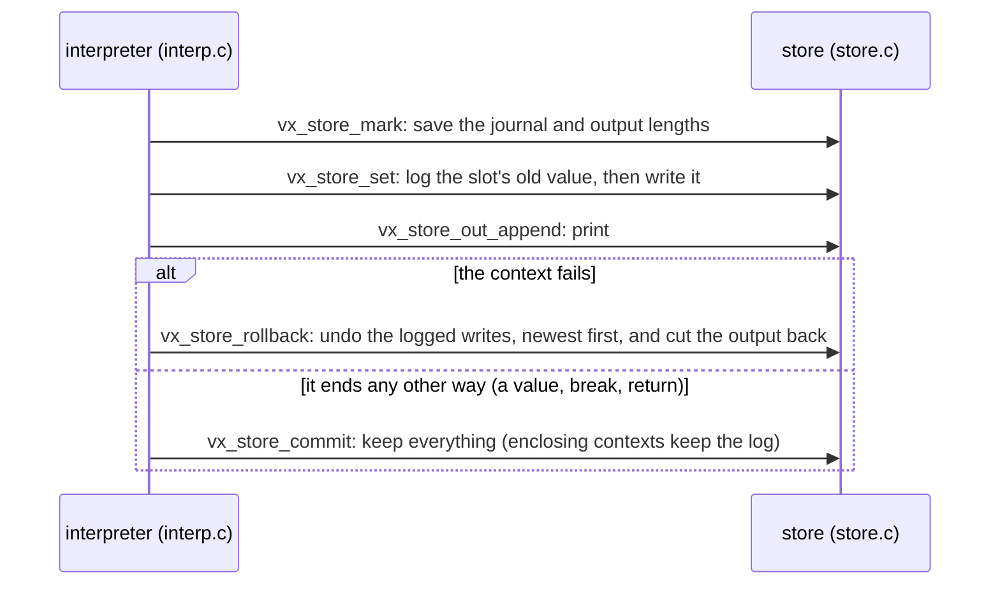
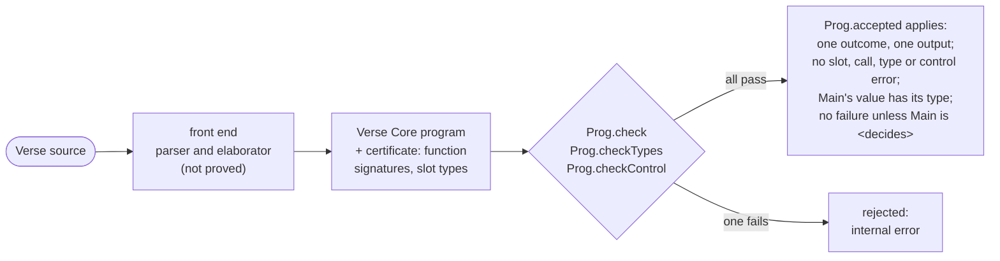
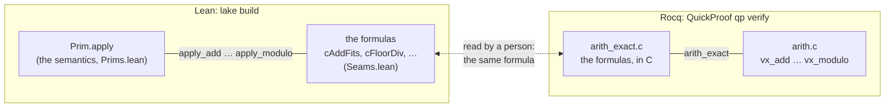

# Design of openverse

openverse is a reference implementation of Verse. "Reference" means the
meaning of every accepted program is fixed by a definition that can be read,
proved about, and run. That definition is the big-step semantics of Verse
Core in Lean. Everything else, the front end and the C runtime, is checked
against it. This page records the decisions behind the shape of the code.

**Contents**

- Semantics: [Two languages, one semantics](#two-languages-one-semantics) · [Failure and rollback](#failure-and-rollback) · [Fuel](#fuel)
- Front end: [Translation validation](#translation-validation-instead-of-a-verified-front-end) · [Modules](#modules-a-renaming-before-elaboration) · [Floats](#floats-canonical-bits) · [Rationals](#rationals-helpers-written-in-verse) · [Generic functions](#generic-functions-polymorphic-verse-core) · [Concurrency](#concurrency-suspends-functions-as-frames)
- Classes and the heap: [Classes as references](#classes-as-references) · [Typing the heap](#typing-the-heap) · [Typed defaults](#why-every-slot-starts-with-a-typed-default)
- C runtime: [The binary format and the loader](#the-binary-format-and-the-loader) · [Two semantics, one seam](#two-semantics-one-seam) · [Objects in the C runtime](#objects-in-the-c-runtime)
- [Readings of the Book](#readings-of-the-book)

## Two languages, one semantics

Surface Verse is large and changing (the Book of Verse tracks a development
branch). Verse Core (`OpenVerse/Core/Syntax.lean`) is small: literals, slot
reads and writes, sequencing, 59 primitives, calls, `if`, single-generator
`for`, `loop`, `break`, `return`, `Print`, and five heap operations (`new`,
field `get` and `set`, `tag`, `isTag`). Every surface construct is a
*derived form*:

- `not`, `or`, `and`, `option{}` and `logic{}` are built from `if`
  (`Core/Derived.lean`), and the rollback laws the Book states are theorems
  about these definitions;
- multi-generator `for` is nested single-generator `for` plus `flatten`;
- comparison chains use temporaries, so each operand is evaluated once;
- structs are tuples, enums are ints, and maps are arrays of pairs in
  insertion order;
- a generic function is one Core function with type variables, and a
  hidden argument per type parameter.

Keeping Core small keeps the proofs and the C runtime small. All 59
primitives are one Lean function (`Prim.apply`) and one C file
(`runtime/src/prims.c`).

## Failure and rollback

Verse's failure is not an exception. A failable expression in a failure
context either succeeds, or fails and leaves no trace. The semantics makes
this literal. The state is the current frame together with a global part
that calls share, the output and the heap (#20), and the rules for a failure
context (`Eval.ite_fail`, `EvalFor.skip`) restart from the state *before* the
context. So writes to slots and to the heap, and allocations, are rolled back
by the same rule, with no journal in the semantics.

Output is rolled back as well. A `Print` in a condition that fails is not
observed, which is the reading of "nothing changes" in Book §6.3.

Because Verse has no closures and frames are not shared, a callee cannot
write its caller's frame. So rollback only ever restores slots of the frames
that are live. The C runtime implements this with one value stack and an
undo journal (`runtime/src/store.c`):

- writes are logged only inside failure contexts;
- a mark is a pair of lengths, journal and output;
- rolling back undoes entries newest first and truncates the output.

The QuickProof law `store_rollback_model` proves this against a naive
copy-the-whole-state model, for every sequence of 32 operations on up to 3
nested contexts (the bounds a VST proof needs; the code has no depth limit
of its own).

## Fuel

The interpreter `eval` takes fuel and spends one unit per nested
evaluation, so Lean accepts it as structural recursion. The relational
semantics needs no fuel. Two theorems connect them:
- `eval_complete` is stated for *all* fuels above a bound, not just one.
- So `eval_fuel_irrelevant` follows: fuel decides whether the interpreter
  finishes, never what it returns.

Determinism of the relation (`Eval.det`) is then a corollary rather than a
separate induction.

Fuel also gives a well-founded measure for proofs where structural
recursion on derivations does not work. The prime example is type
preservation, where a call's body must first run its initialisation prefix
(`TypeSafety.lean`, strong induction on fuel).

The C runtime counts fuel exactly as Lean does. On every program of the
test suite, the smallest fuel that does not run out is the same in both
implementations.

Fuel bounds the *depth* of an evaluation, not its length: each recursive
call gets one unit less, and both sides of a `seq` get the same fuel. So the
native recursion of the compiled interpreter grows with the fuel, and with
`openverse run`'s default fuel (10^8) a program that recurses forever would
overflow the machine stack (1 GiB, or `LEAN_STACK_SIZE_KB`) long before
running out (#97). `openverse run` therefore runs `evalB`
(`Core/Bounded.lean`), which is `eval` with a second budget for the calls the
compiled code really nests (those not in tail position; tail positions are
loops there, as in the C runtime's `eval_node`, and `tests/verse/long_loop`
checks that they stay so). When it runs out, the run ends with
`limit: recursion depth`, exit 3, as `cverse` does past its own bound
(`max_depth`, plus a stack budget). `evalB_sound` proves that whenever
`evalB` does not stop for depth it returns exactly what `eval` returns, so
the bound can only turn an answer into a resource limit; `evalB_complete`,
that with a budget at least the fuel it never stops for depth. The budget is
the stack size divided by 270 bytes (`maxDepth` in `Main.lean`: 4 million
calls on the default stack, just under a million levels of ordinary Verse
recursion), measured against programs that recurse forever in two dozen
ways, the worst of which needed about 147 bytes a call. The primitives that
recursed once per element (`asBytes`, `flattenArrs`) are compiled from
accumulator versions (`@[csimp]`), so that long strings and long `for`s do
not overflow the stack either. The bounds of the two implementations count
different things (the C interpreter evaluates argument lists in a loop and
allows 10 million nested evaluations on a 4 GiB stack), so a program that
recurses deeply enough to reach one of them may get a limit from one
implementation and an answer from the other.

In short:

## Translation validation instead of a verified front end

The parser and elaborator are ordinary code (`partial def`) and are not
proved correct. Each program they produce is checked by decidable functions
that are proved to establish the hypotheses of the core theorems.

The checks, and what each is proved to give:

| Check | Proved to give | Used by |
|---|---|---|
| `Prog.checkEffectSound` | `Prog.EffectSound` | `<decides>` soundness, `Eval.no_fail` |
| `Prog.checkWellScoped` | `Prog.WellScoped` | `Eval.scoped_ok` |
| `Prog.checkTypes S Γs` | `ProgTyped P S` | type safety, `Eval.typed` |
| `Prog.checkControl` | `break` stays in its loop | `Eval.no_control` |

The type check needs a certificate: the signature of every function and the
type of every slot. The elaborator knows both, since it allocates each slot
with a type.

An elaborator bug therefore cannot make a program that runs violate a
theorem: such a program is rejected with "internal error". The front-end
fuzzer (`scripts/fuzz-front.sh`) mutates real sources to look for such
rejections and for crashes. It found one, a stack overflow on recursive
structs, now rejected. The concurrency fuzzer (`scripts/fuzz-conc.sh`, #196)
writes random programs combining the features of the suspends lowering
(generic functions with roots, refined dispatch, spawned dispatches, nested
spawns, events, cancellation) and checks that none is rejected and that
Lean and C agree.

## Modules: a renaming before elaboration

Modules (#112) never reach Verse Core. The parser flattens
`name := module:` into definitions of qualified names (`A::B::F`). It
leaves markers for the modules, their `<public>` members and their
`using{M}`s. `Front/Modules.lean` then rewrites every reference by lexical
scope. It walks from the definition's module outward; at each scope it
looks first at the scope's own definitions, then at the modules opened
there. It also checks visibility, and that no binder shadows a module or a
member. Elaboration's own shadowing check can't do that second check: after
flattening, a local `X` and the member `m::X` have different names. The
elaborator sees an ordinary flat program, so nothing behind it changes:
Core, the checks, the proofs and the C runtime.

## Floats: canonical bits

A `float` (#127) is `Value.float b`, the bits of an IEEE double. Every
operation makes its result canonical (one NaN, `+0` for `-0`), so equality
of values is Verse's equality of floats (NaN equals itself). Arithmetic is
Lean's `Float`, which is C's `double`, so both implementations compute the
same bits. The proofs need only that each operation gives a float. Lean's
`Float` operations rest on `Classical.choice` (that is how Lean defines
them), so the theorems' axioms now include it besides `propext` and
`Quot.sound` (`docs/CLAIMS.md`).

Two things are computed exactly from the bits, in Lean with integers and in
C with integer arithmetic and correctly rounded `printf`/`strtod`:

- the conversions to int (`Floor`, `Ceil`, `Round` with ties to even,
  `Int`), which fail on NaN or an infinity, and raise the overflow error out
  of range;
- `ToString`: for each length `p`, the correctly rounded `p`-digit decimal
  or its neighbour on the other side of the value, the first that reads
  back as it, laid out as Python's `repr`.

`scripts/fuzz-floats.sh` checks both implementations against Python's
doubles. In the binary format a float literal is the primitive `fofBits` of
an int literal of its bits, so the loader (`load.c`, QuickProof-proved) is
unchanged; only its bound on primitive codes grows.

## Rationals: helpers written in Verse

A `rational` (#116) is a front-end type whose Verse Core form is the tuple
(numerator, denominator), in lowest terms with a positive denominator. Tuple
equality is then rational equality, and nothing changes in Core, the proofs
or the C runtime.

`Front/Rational.lean` holds the helpers as Verse source: normalising
`X / Y`, and ordering. A program whose source has `/` or `rational` gets
them added. They are parsed with their names renamed to `$ratMake` etc.,
which no program can write. The ordering compares the continued fractions of
the two rationals rather than cross-multiplying, so no step overflows.

## Generic functions: polymorphic Verse Core

A generic function `F(X:t where t:type)` is elaborated once, with each type
parameter as an opaque type (`Ty.param`), on which only the operations valid
for every type are defined. That is how Verse checks it. The result is one
Verse Core function whose slot types mention type variables (`VTy.var j`).
`Typed.call` lets each call instantiate its callee's signature with any
substitution `θ`, and the substitution lemma `Typed.subst` says that a typing
with type variables holds at every instance. So `Prog.checkTypes` checks a
generic function once, and type safety covers every call. The checker
proposes `θ` at a call by matching, and then checks the arguments against
the instantiated signature, so only that check needs a soundness proof.

The difficulty is the initialisation prefix (next section): a slot of type
`t` has no default value. So a generic function takes one hidden parameter
per type parameter, after its own, holding a value of that type. Its prefix
may store a *default expression* (`DefaultE`): a literal, a parameter, or a
tuple of such, so a slot of type `tuple(t, int)` starts as `(D_t, 0)`. A
caller passes a value of each type argument, built so that the checker can
infer its type exactly (`[]int` is passed as `array{0}`, not `array{}`). The
value is never observed, because Verse code assigns every variable before
reading it. The semantics, the binary format and the C runtime are
unchanged: the hidden arguments are ordinary arguments.

Two simpler designs were set aside. Re-elaborating a generic function at each
instantiation lets inference take different paths at different types (at
`void`, for example). Monomorphising the generically checked body is sound,
but checks each instance separately, multiplies code, and cannot express
polymorphic recursion.

## Concurrency: suspends functions as frames

Verse Core has no suspension, and giving it one would change the evaluator,
every preservation case, and a C interpreter that recurses on the C stack.
So the front end lowers concurrency into ordinary Verse Core (#156), the
classic coroutine transformation. A `<suspends>` function `g` becomes:

- a frame class: the suspension point it is at, its `?result`, one `?frame`
  per suspension point for the callee's frame, and one field per slot;
- `g$new(params…)`, which allocates a frame, `g$reset(frame, params…)`, which
  readies it for another call, and `g$resume(frame, sched, params…)`, which
  runs from the frame's suspension point to the next one (result 0) or the
  end (result 1). The parameters are passed again only so that the slots'
  initial values (`DefaultE`) can refer to them.

`Front/Suspend.lean` turns `g`'s elaborated body into `g$resume`'s:

1. **Slots and returns.** The slots move up two places, for the frame and the
   scheduler, and `return e` stores `e` and returns 1.
2. **A-normal form.** Each call of a suspends function becomes a statement of
   its own. Values computed before it in the same expression go to
   temporaries first, typed by Core's checker (`tc … none`).
3. **Resume guards.** While seeking the suspension point to resume at, a flag
   is set, and a statement that cannot contain that point is skipped. An
   `if` picks the branch that holds it instead of testing its condition
   again, and a `loop` stays a loop. A `for` whose body suspends becomes a
   loop over an index.
4. **Slots in the frame.** The slots whose values must outlive a suspension
   point live in the frame: their reads and writes become the frame's.
   These are the function's own and the pass's temporaries. The slots used
   only within one resumption stay real slots: the seeking flag, a branch
   choice, a callee's status, a `for`'s element. (A `for` whose element is
   a reference becomes a loop over an index, so that its element lives in
   the frame too: as a real slot, its initial value would be a new
   placeholder object at each resumption.) Each generated function
   keeps only those, renumbered after its parameters, so there is nothing
   to store or reload, and code size grows linearly with the function.

At a suspension point, the caller resumes the callee's frame and returns 0
if the callee is pending. Failure contexts never contain a suspension, so a
rollback never spans one, and the frame's fields roll back with the heap
like any object's. The result is ordinary Verse Core, which
`Prog.checkTypes` checks, and Lean and C run.

**`sync` and `race`.** In the elaborated Core, a `sync` or `race` is a call
of the marker `$syncMark` or `$raceMark` on the array of its arms. Each arm
is a statement that leaves the arm's value in a slot (for `race`, the one
slot of the arms' common type). The pass makes each arm a function of its
own over the same frame, with its own suspension point and done flag in
fields of the frame. The enclosing code resumes the arms in order; as the
variables live in the frame, the arms share them. A `race`'s winner cancels the arms that started and are pending,
last first. A `return` in an arm stores the result and makes the arm give
2. The code around the arm then cancels the other pending arms, runs the
defers active there, and returns from the function (or, in an arm, gives
2 in turn).

**Tasks.** A `spawn` gets a root: a suspends function `$spawnK(T, args…)`
that the pass makes from the spawned call. It runs the call and fills the
task `T` (a `task(t)`, below a non-generic `$taskBase` with a done flag).
The scheduler is its class's prototype, a literal any code can name, so
an immediate function can spawn too. The spawn site calls
`$spawnK$start(sched, $spawnK$new(sched, T, args…))`,
which adds the root's frame to the scheduler's `Roots` and runs it up to
its first suspension point. A spawned method with several implementations
is a dispatch on the receiver's class rather than one call (#173): its
chain of tests becomes a suspends function `$dispatchK` of the slots the
chain uses (the receiver, the arguments, and the slots each test binds the
narrowed receiver to, which start as the caller's, so the function needs
no initial values), and the root calls that.

Each pass resumes `Main`'s frame, then every root whose suspension point
is not -1 (done). It reaches a root through a test of its class
(`Typed.dispatch` again, at a type that covers every root frame) and a
trampoline that passes the root's parameters from its frame. A root that
ends makes the scheduler pass again in the same tick. `T.Await()` is a
helper written in Verse: it waits at the leaf `$WaitDone` (whose frame
tests the done flag, non-generically), then takes the result.

A `branch` is an arm over the enclosing frame, run as a root through a
wrapper `[pc, frame]`. The wrapper's trampoline resumes the arm unless the
function stopped it. Every exit of the function, and its cancel function,
stops its branches: it marks each wrapper done (through a test of its
class, kept in a frame field) and cancels each arm still pending. A frame
reused for another call so never shares an arm with an old wrapper. They
are stopped last started first: each branch and `rush` arm records a
start number (a counter in the frame) when it starts, and the stop is a
loop that picks the highest recorded number, stops that one and clears
it (#187), as a nested branch starts only when its parent's code reaches
it. A
`rush` is a `race` whose arms each get such a wrapper: when the first arm
ends, the others that are pending are registered as roots (not run again
at once) instead of cancelled.

`T.Cancel()` reaches the task's root (recorded in the task when it starts)
through `$cancelRoot`, which calls the root's cancel function. That unwinds
it as a race's loser is unwound, and marks the task cancelled. A task that
cancels itself is marked running by its trampoline, so it only asks the
scheduler, which cancels the root after its resumption returns. The same
request is how cancellation spreads: the leaf `$WaitDone`, seeing a
cancelled task, asks the scheduler to cancel the root that awaits it.

An `event(t)` keeps a list of waiter records (each an `$evrec(t)`, also
below `$taskBase`). `E.Await()` first drops the records at the head that are
done (woken, or of waits that were cancelled, which mark their record in a
`defer:`), then appends one and waits at `$WaitDone`. `E.Signal(X)` gives
`X` to every record in the list, marks it done, and empties the list. A record learns the scheduler on its first poll, so
`Signal`, which has no scheduler of its own, can make the scheduler pass
again in the same tick.

The roots are a list of cells `[root, next]` (adding one costs a cell; an
array would be copied at each spawn, and C keeps every copy). A pass follows
the list, reading each cell's next after its root ran, so a root added
during the pass runs in it. After a root ended or was stopped, the cells of
the roots that are done are unlinked between ticks. In C, what a task or a
branch allocates (its frame, wrapper, cell, task object, waiter record)
stays in memory, a few hundred bytes each.

**Cancellation.** Every region, a function body or an arm, also gets a
cancel function. It cancels what the region waits at (a callee's frame,
through the callee's own cancel function, or a `sync`'s or `race`'s
pending arms), then runs the `defer:` blocks active there. The elaborator
records those blocks at each suspension point in a branch that never runs
(`if (false) defers`), and the pass moves them into the cancel function. Failure contexts never contain a suspension, so a
rollback never spans one. The result is ordinary Verse Core, which
`Prog.checkTypes` checks, and Lean and C run.

**Avoiding allocation and journaling.** The C runtime never frees an object
and journals every write made in a condition (for rollback). So:

- A frame is kept per call site and reset rather than replaced. The result
  field holds the value itself, not an option, so a loop of 300,000
  suspending calls runs in constant memory in C.
- A non-generic callee's frame sits in a field of type
  `ref [callee, sched] []`, first set to the scheduler. A call site copies
  it into a slot of that type, whose initial value is the scheduler
  parameter, so it costs no allocation. It then resumes the callee after a
  test of its class (`if (isTag [callee] Y) then resume(Y, …)`), the shape
  `Typed.dispatch` types (#154), so the callee runs outside any condition.
  The call's arguments stay in the caller's slots for each resumption.
- A generic callee's frame has type arguments that this narrowing cannot
  recover. It sits in an option field, unwrapped in a condition, so C
  journals what a generic suspends function writes during one resumption,
  until that resumption returns.
- A method called under a refinement (a class that fixes the receiver's
  type arguments, see "Pins and dispatch") needs `Typed.dispatch` on the
  receiver wherever the refinement matters: passing the arguments and
  taking the result. The callee gets helpers whose first parameter is the
  receiver, `arrive(self, args…, frame, sched)` (reset the frame or make
  one) and `take(self, frame)`. The rule's shape needs the receiver in a
  slot, and the caller's receiver slot is a frame field by then, so each
  call site gets two small helpers of its own whose first parameter is the
  receiver, `arriveVia` and `takeVia`, which make the test and the call.
  (A slot holding a copy would need an initial value at each resumption,
  which for a class can be a new object: C would allocate one per tick.)
  The callee is resumed and cancelled through `resumeOwn(frame, sched)`
  and `cancelOwn(frame, sched)`, which read its parameters from its frame,
  as the caller has no slots of the callee's (refined) parameter types.
  A generic override (`ipair(b) := class(pair(int, b))`, or one with a
  type parameter of its own) keeps its frame in an option field like any
  generic callee's, at the type arguments the dispatch gives: the
  receiver's, refined by the pins, matched against its parameters as the
  checker does. It is resumed and cancelled like any generic callee's;
  arriving and taking the result go through `arriveVia`/`takeVia` again;
  its `take(self, frame?)` fails without a frame, so the caller takes the
  result in a condition, into a slot kept in the frame (covariant results
  check through the rule's subtyping).
- A refined call that does not suspend (an immediate method, or a #157
  field accessor) has the same problem once its receiver's slot is a frame
  field. Before the slots become fields, each such test gets a helper of
  its own, `via(recv, args…) = if (isTag us [local 0]) then f(local 0,
  args…) else userErr`, typed at the type its value is checked against
  (#179).

Values stored in a frame, such as strings or arrays in slots, are kept
like any object's fields (see "Objects in the C runtime"). Each pass
resumes a whole chain of suspended calls from its root, so a recursion of
depth N that waits at every level costs O(N²) calls per tick.

**The scheduler.** The scheduler and `Sleep` are helpers written in Verse
(`concPrelude`, added to a program with a suspends function, as the
rationals' are). A suspends `Main` starts a loop of passes, one per tick,
each resuming `Main`'s frame. A sleeping frame reports the tick it waits
for, and the clock then moves to the earliest of them, so idle ticks cost
nothing.

The scheduler only ever holds non-generic task roots. Core has no
existential types, so a queue of frames whose type arguments it has forgotten
could not be typed; generic frames are always resumed by their callers, who
know their type arguments.

**Specialising generic functions with roots.** A generic function whose
roots would depend on its type parameters (a `branch` or `rush`; a
`spawn` whose call's arguments or task have such types, also as the type
arguments of a class or of the task itself (a spawned `E.Eval()` on an
`expr(t)` whose classes all fix `t`, #204), or a spawned dispatch reading
values of such types; any `spawn` in an immediate one,
whose roots are made only for non-generic functions; or a call of such a
function at such types) is specialised before the lowering (`specialise`, #174). Verse Core
is first-order and a generic call passes one witness argument per type
argument, built so that the checker infers exactly that type, so each
call's instantiation is read off its last arguments. A call at closed types
goes to a copy at those types: the same body, its slot types and signature
substituted. The copies' own calls are handled the same way, from a
worklist. In a copy, a refined dispatch test (#142) whose classes' pins
its closed types rule out is dropped, as the checker types such a test
only when the pins can agree. The generic originals are then never called;
they keep only their parameters and are not lowered. Bounds on the number
of copies (500) and on the size of the types (2000 parts, which types that
double at each call reach quickly) turn polymorphic recursion into an
error.

## Classes as references

Verse classes are references (#34). A class or interface `T(args)` is
`VTy.ref ts args` in Verse Core, where `ts` are the tags of the concrete
classes at or below `T`; a class's tag is its index in definition order,
and the class table of the certificate gives each tag its fields' types,
in terms of its type parameters (#39).
Fields are laid out with the inherited ones first, so a field has the same
position in every class below the one that declares it.

- **Operations.** Construction is `new`, a field `get` or `set` at the
  field's position, a cast `T[X]` an `isTag` of the classes below both, an
  upcast nothing at all (Verse Core subtyping, #32). A field of an interface
  can sit at different positions in the classes implementing it; reading
  or writing it tests the object's class first.
- **Dispatch.** When every concrete class below the receiver's type shares
  one implementation of a method, the call is direct. Otherwise one `isTag`
  per distinct implementation picks it.
- **Mutation.** `set` on a path writes the object it reaches in place and
  rebuilds only the values (structs, arrays, maps) between it and the leaf;
  rollback is the heap's (#20).
- **Initial values.** A slot of a class type starts as a reference to a
  *prototype* (#37): `Main` becomes a prelude that allocates one object per
  concrete class, in an order where each refers only to earlier ones, then
  calls `Main`. Literals are typed against the prototypes (`Sigs.protos`),
  which every heap starts with (`HeapOK`), and `Runs.typed` evaluates the
  prelude before preservation takes over. A class without a prototype
  falls back to a parameter of a subtype or a new placeholder object
  (`DefaultE.new`). The generic witness of a class type argument is a slot
  of exactly that type, so that the checker infers the instantiation
  exactly.
- **Parametric classes** (#39) are references with type arguments. Their
  objects record no type arguments; the heap typing of the proofs does
  (`HeapTy`). A construction goes through a temporary of its type, so that
  the checker takes the type arguments from it rather than inferring them
  from the fields. A parametric class has no prototype (a prototype has
  fixed type arguments), so a slot of its type starts as a new placeholder
  object, built from defaults at the slot's type arguments: one allocation
  per call.
- **Parametric hierarchies.** A class's Verse Core type arguments
  (`TyEnv.coreArgs`) are its parent's, then its own type parameters that
  are not among them: a `swap(a, b) := class(pair(b, a))` is `ref … [b, a]`,
  an `intcell := class(cell(int))` is `ref … [int]`, and a
  `named(t, n) := class(cell(t))` is `ref … [t, n]`, a `cell(t)` by Core's
  prefix subtyping. A class's table entry
  gives each field the type the topmost class that has it gives it, at
  that class's variable positions (`TyEnv.coreVars`), so a field has one
  type through every reference of the hierarchy. Dispatch passes the
  receiver as an instance of the implementing class at the arguments it
  has there (`upArgs`, `argsBelow`). From code generic over `cell(t)`,
  an `intcell`'s implementation needs `t = int`: the elaborator matches
  the receiver's type arguments against the ones `intcell` fixes, checks
  the call with the matched variables replaced by them, and emits a
  dispatch that `Typed.dispatch` types under that refinement (see "Pins
  and dispatch" below, #142). One test covers the classes that share an
  implementation and fix the same arguments; a class whose fixed
  arguments the receiver's rule out (an `intcell` from code over
  `cell(string)`) gets none. Every group of classes sharing an
  implementation in which one class needs the refinement is dispatched
  this way, as the rule takes the receiver as narrowed by the test: the
  ordinary dispatch would need a temporary of the implementing class's
  type, which has no initial value when every class below it fixes other
  arguments. (`tc` proposes a `new`'s type arguments so that they agree
  with the pins, so that a prototype holding an object of a subclass of
  the fixed class is typed at the fixed type.) A chain with such a test is assigned to a
  slot of the method's result type, as the rule needs an expected type.
  A field of an interface that sits at different places in its classes is
  reached the same way in a class that fixes the interface's type
  arguments: through an accessor pair `get`/`set` generated for the class
  and the field (`TyEnv.fieldAcc`), called under the refinement (#157).
  So is a field that such a class types otherwise than a class or
  interface above it (`TyEnv.fieldTyAgrees`), as two unrelated interfaces
  may declare it, `x(t)`'s `F:t` and `y(t)`'s `F:int`, and the class table
  takes the type of the first one the class lists (`TyEnv.fieldSrc`): in
  `class(x(int), y(int))` it is the type argument, pinned to `int`, while
  code over `y(t)` reads an `int`. A concrete class with a class below it
  that types one of its fields otherwise gets accessors for it too, whose
  receivers are of exactly its class, as a temporary of its type would
  also hold the classes below it (#205).
  Only the classes at or below one whose implementation fixes arguments
  its declaring class leaves open record pins (`TyEnv.pinned`): every
  object agrees with its class's pins, and a placeholder of another class
  may have any type arguments.
  When every concrete class below a generic class or interface records
  pins, a variable of its type at other type arguments (a receiver read
  from a field or an array, in code generic over the class) would have no
  initial value. So the front end adds a hidden abstract class below it,
  `n$placeholder`, with its fields and no pins (#157). Its tag is in every
  reference type the class is in, a slot starts as one of its objects, and
  no dispatch test names it. Below a class that records pins it records
  the same. A read of an interface's field goes straight to it when every
  concrete class below the interface has it at one place (which need not
  be its place in the interface: a class can list another parent first),
  with one type (#205), and tests the class first otherwise. So an interface's placeholder puts
  each of its fields, inherited ones too, where every concrete class below
  it has it, when they agree, and the others after those, with padding
  between. A read through an interface above it goes straight to a field
  only when all of that interface's classes agree, and those include
  these, so it finds the field in the placeholder too. A placeholder
  nests: `slot(slot(u))`'s holds `slot(u)`'s. One that would hold itself
  (an interface `node(t)` with a field `Next:node(t)`) cannot be built, so
  a variable of its type is refused there.
  A class that repeats type arguments cannot override yet (that would
  need unification), nor can one that adds its own, as a `named`'s
  implementation needs an `n` the caller does not have.

## Typing the heap

Phase 3 (#20) adds a heap of objects, each with a class tag and fields
(`HeapOp`). Its typing (#29) keeps the class hierarchy out of Core:

- **Reference types are tag sets, with type arguments.** `VTy.ref ts args`
  is a reference to an object whose tag is in `ts` and whose type
  arguments start with `args` (#39; `[]` for classes without type
  parameters). The front end uses the concrete classes below a static
  class. A subclass's type parameters come after its parent's: a
  `pair(t, u) := class(base(t))` object has the arguments `[t, u]`, and is
  a `base(t)`; an `intbox := class(base(int))` object has `[int]`. A cast
  `isTag us` fails when the tag is not in `us`, and has type `ref us args`
  (it cannot recover a subclass's own arguments, so fields that mention
  them cannot be read after a cast). Field types are compared exactly
  (`FieldTy`), so the front end gives a class's tag sets one canonical
  order: definition order.
- **Subtyping** (#32) is structural (`VTy.sub`): a reference type with
  fewer classes is below one with more, and one with more type arguments
  below one with a prefix of them; the arguments themselves are invariant
  (an object's fields can be written as well as read). Arrays, options and
  tuples are covariant, which is sound because they are immutable values. One rule,
  `Typed.sub`, gives an expression every type above its own, so widening is
  free and needs no node. Preservation peels subsumption off a derivation by
  recursion (`stepE_d`) and handles the last real rule (`TypedR`). The
  checker accepts a subtype wherever it compares an inferred type with an
  expected one (`expect`), joins `if` branches and `+` operands of different
  types (`VTy.join`), and checks `arrSet` against an expected array type.
  It is still incomplete: an array literal's elements must have the first
  one's type unless there is an expected type, a generic call's
  instantiation comes from its last arguments (where the front end passes
  its type arguments), and a `new`'s type arguments come from the expected
  type, else from matching its fields' types against its arguments' (with
  `void` for a parameter they do not determine). References join at the
  common prefix of their type arguments.
- **Value typing sees a heap typing.** `hasTy Ξ v t` takes `Ξ : HeapTy`,
  the class and type arguments of each heap object. Objects do not record
  their type arguments, so `Ξ` is a ghost: no function of the heap gives it,
  and the theorems say that one exists (the standard store typing). Objects
  are only ever appended, and their classes never change, so a typing
  survives every step (`hasTy_mono`, for `Ξ` a prefix of `Ξ'`).
- **The class table** is part of the certificate (`Sigs.classes`): the field
  types of each tag, in terms of its type parameters (`var j`). `HeapOK S Ξ h`
  says `Ξ` has an entry per object, its class, and each object's fields
  have its class's types at its arguments (`VTy.inst`). A field read
  through `ref ts args` has the type that every class in `ts` gives that
  field at `args`, and that mentions no type parameter past them
  (`FieldTy`, so the field has that type in every object whose arguments
  extend `args`, `VTy.inst_prefix`); the field layout of the previous
  section makes the field common. Instantiation puts `void` past the
  arguments, so it commutes with substitution (`VTy.inst_subst`) whatever
  the table says, and `Typed.subst` holds for a generic function that
  allocates or reads objects of its type parameters. Only the prototypes'
  type arguments must be closed (`Sigs.ClosedProtos`), as a literal's
  typing is checked once.
- **Preservation** (`Eval.typed`) says that from a frame and heap typed
  under `Ξ`, evaluation reaches a frame and heap typed under an extension
  `Ξ'` of `Ξ`, with the outcome typed under `Ξ'`. Rollback needs nothing
  new: a failure context restores the heap it started from, which `Ξ`
  types. `Runs.typed` states the result's type in the final heap, under
  some heap typing of it.
- **Pins and dispatch** (#142). A class that fixes some of its parent's
  type arguments to closed types (`int_box := class(box(int))`) records
  them as its *pins* (`Sigs.pins`). Every object of the class agrees with
  them at the type arguments it has (`HeapOK`; `new` checks them): an object
  with fewer arguments than a pinned position is unconstrained there, which
  is harmless, as subtyping only drops trailing arguments, so no reference
  to it has that position. Code generic over `box(t)` cannot call
  `int_box`'s override with the ordinary call rule, since it needs
  `t = int`. `Typed.dispatch` types a dispatch
  `if (isTag us Y) then F(Y, …) else E`, the shape the elaborator emits
  for such overrides, by a substitution `μ` that makes
  `Y`'s type arguments agree with the pins of the classes `us`, applied to
  both sides of the call: the arguments against the parameters, and the
  result against the expected type. When the call runs, the object's
  arguments agree with its pins and start with `Y`'s, so `μ` is the
  identity and preservation is the call's. The substitution lemma holds
  because every substitution that makes the arguments agree with the pins
  factors through `μ`, whose bindings are closed (`PinRefines.factor`);
  when none does, the call cannot run (`Typed.dispatch_none`). The checker
  (`tcDispatch`) tries the plain `if` typing first, and types a dispatch
  only against an expected type, since `μ` relates the call's result to
  it: a dispatch chain is assigned to a slot of the method's result type.
  The semantics, the binary format and the C runtime are unchanged.
- **Defaults.** No literal is a reference, so a slot of class type starts as
  a new object of one of its classes with default fields (`DefaultE.new`),
  or as a parameter of a subtype (`DefaultE.sub`). Placeholders cost an
  allocation per call; a parameter is preferred when there is one.

The front end produces heap operations for classes (#34); `HeapExamples.lean`
also checks hand-written programs at build time.

## Why every slot starts with a typed default

The semantics starts a call's non-parameter slots as `void`, which keeps the
Core and the binary format free of types. A type invariant of the form
"every slot holds a value of its type" is then false at function entry. The
alternative, a flow-sensitive definite-assignment analysis, would have to
model rollback.

Instead, the elaborator begins every body with an initialisation prefix that
stores a value of each slot's type (`initPrefixE`): the default literal of a
closed type, a default expression built from the hidden parameters of a
generic function, or a placeholder object (previous sections). The type checker recognises the prefix
(`stripPrefix`). This needs no change to the format or to the C runtime. It
costs a few stores per call.

## The binary format and the loader

The C runtime does not parse Verse; it loads OVBC (`docs/FORMAT.md`). Each
function is a post-order node table, so every child index is smaller than
its parent's. One forward pass can then check the whole program, and the
loader needs no recursion, which matters for a VST proof. Compound literals
are emitted as the primitives that build them, so every node is flat.

The loader's acceptance conditions are exactly `Prog.WellScoped`. By
`Eval.scoped_ok`, a program it accepts never raises a slot or call error.
So the interpreter needs no slot checks of its own (it keeps cheap ones
anyway).

## Two semantics, one seam

The C runtime is proved under CompCert's semantics of C, with QuickProof.
Lean cannot reason about C, and Rocq does not know the Lean definitions.
Following LeanOS (ADR 0030), each seam is a formula that both sides state.

The arithmetic seam is the tightest. `Seams.lean` restates the C law's
formulas symbol for symbol and proves in Lean that each one is `Prim.apply`.
QuickProof proves in Rocq that the C functions compute those formulas. The
remaining trusted step is reading that the two texts are the same formula
(`docs/SEAMS.md`).

The interpreter itself is not proved. It is a transcription of
`Interp.lean`, and it is compared with the Lean interpreter on the Verse test
suite, on thousands of random Core programs that exercise every node and
every outcome kind (`OpenVerse/Core/Gen.lean`), and on front-end mutants. It
also runs under ASan/UBSan.

## Objects in the C runtime

The C runtime keeps two heaps. The value heap (`value.c`) holds arrays,
tuples and options. They are immutable, so a call's garbage is freed when it
returns, except what its result reaches. The object store (`objects.c`)
holds class instances, which are mutable and outlive calls. It is `Glob.heap`
of the Lean state: objects are appended, never moved or freed, and a REF is
an object's index, the address Lean gives it. A failure context marks the
object store along with the slots and the output. Rollback undoes the field
writes logged since the mark and drops the newer objects, so the next object
gets the same index as in Lean.

The two heaps meet when an object field holds an array. A callee can store a
fresh array in an older object, and then its result no longer reaches
everything that must survive. So an object cell that holds a value-heap
reference has one entry, in the list of an active call at least as deep as
the call whose region holds the value (`vx_objs_remember`; the owner is the
deepest call whose heap mark is at most the reference, and a value older
than every call needs none). When a call returns, its compaction takes as
roots its result and the cells in its list, updates them, and hands the list
to its caller: the values it keeps now lie in the caller's region (#50).
The lists are buffers from a pool, and on a return the smaller of the
callee's and the caller's moves into the larger, which then serves the
caller, so an entry moves O(log n) times. A call also skips its compaction
when its region is less than twice the largest block a callee's compaction
kept for fields (`dmax`, counted while marking from the fields before the
result). Objects are never reclaimed, so such a block stays live until a
field that held it changes or a rollback restores fields or drops objects,
and each of those zeroes the block of the call whose region it is in. A block
only a result kept does not count, since a caller may drop it. Skipping keeps
more, never less, and what it keeps is mostly live; it is what keeps the work
linear, since a recursion building a linked structure would otherwise
re-compact all its survivors at every level. A compaction scans its list,
whose entries the writes during the call made. An
entry leaves only when its cell no longer holds a reference and no failure
context is open, or when a rollback drops its object: what a rollback
restores was written before its context, so its entry is in a list at least
as deep as its owner. Old values in the field log need no root, since what
a rollback finally restores predates the context. As with any call-scoped
reclamation, a field's array replaced over and over keeps every old copy in
the caller's region until the caller returns (as a loop that replaces a
local's array already does), so memory can run out where Lean, which has no
limit, would finish. The object store is unproved, like the
value heap, and kept out of the proved `store.c`, whose law
(`store_rollback_model`) is unchanged.

## Readings of the Book

Where the Book of Verse is silent or contradicts itself, openverse takes
one reading and records it in `docs/LANGUAGE.md`. The most consequential:

- `int` is 64-bit with overflow as a runtime error, as on BPVM. The other
  choice, VerseVM's unbounded integers, would need bignums in the C runtime.
- comparisons return their left operand;
- a failing `for` body makes the `for` fail, as in the Verse Calculus.
