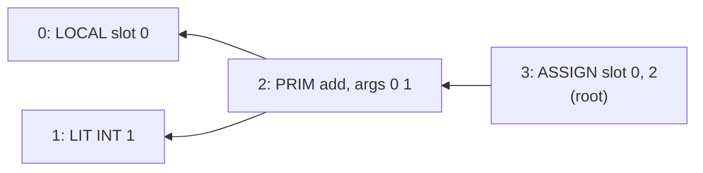

# OVBC: the binary format of a Verse Core program

The Lean front end (`openverse emit`) writes this format; the C runtime
(`cverse`) loads it. It is a direct serialisation of `OpenVerse.Core.Prog`
(`OpenVerse/Core/Syntax.lean`), defined by `OpenVerse/Core/Encode.lean`.

All integers are little-endian. `u8`, `u32` are unsigned; `i64` is two's
complement.

```
File   := "OVBC" version:u32(=1) nfns:u32 main:u32 Fn[nfns]
Fn     := arity:u32 nslots:u32 decides:u8 namelen:u32 name:u8[namelen]
          nnodes:u32 Node[nnodes] root:u32
Node   := tag:u8 payload
```

Each function has its own node table, numbered from 0 in file order. A node
refers to its children by index **into the same table**, and every child
index must be **smaller than the index of the node** that refers to it. So
the table is in post-order, every reference points backwards, and the loader
can check the whole program in one forward pass. `root` is the body of the
function.

| tag | node | payload | Verse Core |
|---|---|---|---|
| 0 | LIT | `Lit` | `.lit v` |
| 1 | LOCAL | `slot:u32` | `.local slot` |
| 2 | ASSIGN | `slot:u32 e:u32` | `.assign slot e` |
| 3 | SEQ | `a:u32 b:u32` | `.seq a b` |
| 4 | PRIM | `prim:u8 k:u32 n:u32 args:u32[n]` | `.prim op args` (`k` is the index of `tupGet`, else 0) |
| 5 | CALL | `fn:u32 n:u32 args:u32[n]` | `.call fn args` |
| 6 | ITE | `c:u32 t:u32 e:u32` | `.ite c t e` |
| 7 | FOR | `slot:u32 it:u32 filt:u32 body:u32` | `.forE slot it filt body` |
| 8 | LOOP | `b:u32` | `.loop b` |
| 9 | BRK | — | `.brk` |
| 10 | RET | `e:u32` | `.ret e` |
| 11 | PRINT | `e:u32` | `.print e` |
| 12 | HEAP | `op:u8 k:u32 n:u32 args:u32[n]`, or for `op` 4 `op:u8 m:u32 us:u32[m] n:u32 args:u32[n]` | `.heap op args` (`op`: 0 `new k`, 1 `get k`, 2 `set k`, 3 `tag` with `k = 0`, 4 `isTag us`) |

```
Lit := 0 INT  i:i64
     | 1 LOGIC b:u8 (0 or 1)
     | 2 CHAR c:u8
     | 3 STR  n:u32 bytes:u8[n]       -- .arr of n chars (also the empty array)
     | 4 NONE                         -- the empty option (`false`)
     | 5 VOID                         -- .tup []
     | 6 REF  a:u32                   -- .ref a: the prototype at address a (#37)
```

A literal that is not one of these (a non-string array, a non-empty tuple,
`some v`) is encoded as the `PRIM` node that builds it (`mkArr`, `mkTup`,
`mkSome`) applied to literal children. That evaluates to the same value
(`Prim.apply .mkArr vs = .ok (.arr vs.toArray)`), and it keeps every node flat, so the
loader needs no recursion. A float (#127) is `fofBits` of an INT literal of
its bits: the bits of a canonical double are their own float, so this too
evaluates to the literal (the front end emits only canonical bits; a
hand-written Core literal of other bits, such as -0, would differ), and the
literal kinds stay as they are.

### An example

The function body `.assign 0 (.prim .add [.local 0, .lit (.int 1)])`, which
is `set X = X + 1` with `X` in slot 0, is this node table (arrows go from a
node to its children, always to a smaller index):



| node | bytes | meaning |
|---|---|---|
| 0 | `01 00000000` | LOCAL, slot 0 |
| 1 | `00 00 0100000000000000` | LIT, INT 1 |
| 2 | `04 00 00000000 02000000 00000000 01000000` | PRIM `add` (code 0), k 0, 2 args: nodes 0 and 1 |
| 3 | `02 00000000 02000000` | ASSIGN slot 0, node 2 |

followed by `root:u32` = 3. These are the bytes `Encode.encFn` writes after
the function's header (whose `nnodes` is 4).

## Primitive codes

| code | prim | code | prim | code | prim |
|---|---|---|---|---|---|
| 0 | add | 10 | le | 20 | index |
| 1 | sub | 11 | gt | 21 | len |
| 2 | mul | 12 | ge | 22 | arrSet |
| 3 | neg | 13 | eq | 23 | flatten |
| 4 | abs | 14 | ne | 24 | range |
| 5 | floorDiv | 15 | query | 25 | tupGet (k) |
| 6 | ceilDiv | 16 | mkArr | 26 | toStr |
| 7 | quotient | 17 | mkTup | 27 | fail |
| 8 | modulo | 18 | mkSome | 28 | userErr |
| 9 | lt | 19 | concat | | |

`eq` (13) and `ne` (14) are Verse's equality of values (`Value.veq`):
structural, except that the empty values `.logic false`, `.tup []`, `.none`
and an array of no elements are all equal, at every depth. Their operands
may be of any two kinds, and an array or a tuple may hold values of several
kinds: a `comparable` is Verse Core's `dyn`, the type of every value, and a
`[]comparable` an array of boxes (`OpenVerse/Core/Comparable.lean`). The
format carries no types, so `dyn` adds nothing to it.

Codes 0 (`add`), 1 (`sub`), 2 (`mul`) and 7 (`quotient`) also have a
four-int rational form (#489): arguments `(a,b,c,d)` denote `a/b` and
`c/d`, and the result is the reduced tuple `(numerator,denominator)`.
Operand denominators must be positive; otherwise the result is the
overflow error. `quotient` fails on `c = 0`; the other forms never fail.
Final parts must fit int64 with a positive denominator. Intermediate
products and sums are exact and may exceed int64. The existing two-int
forms are unchanged. Four-argument arithmetic requires a runtime with
this extension; opcode numbers and the loader's accepted format are unchanged.

Floats (#127):

| code | prim | code | prim | code | prim |
|---|---|---|---|---|---|
| 29 | fadd | 35 | fmin | 41 | fofInt |
| 30 | fsub | 36 | fmax | 42 | ffloor |
| 31 | fmul | 37 | flt | 43 | fceil |
| 32 | fdiv | 38 | fle | 44 | fround |
| 33 | fneg | 39 | fgt | 45 | ftrunc |
| 34 | fabs | 40 | fge | 46 | fofBits |

The mathematical functions (#132): 47 fsqrt, 48 fexp, 49 fln, 50 fsin,
51 fcos, 52 ftan, 53 fasin, 54 facos, 55 fatan, 56 fpow, 57 fatan2,
58 fisFinite.

The hyperbolic functions (#490): 59 fsinh, 60 fcosh, 61 ftanh,
62 fasinh, 63 facosh, 64 fatanh. These take one float and return a float.
Existing codes retain their values;
older runtimes reject programs using these new codes. `Lerp` uses the
existing floating arithmetic primitives and needs no new code.

## What the loader accepts

`vx_load` (`runtime/src/load.c`) accepts a buffer exactly when it parses to
the end with no bytes left over and:

1. the magic is `OVBC`, the version is 1, `nfns ≥ 1`, `main < nfns`;
2. every function has `arity ≤ nslots`, `nnodes ≥ 1` and `root < nnodes`;
3. every child index of node `j` is `< j`;
4. every slot (LOCAL, ASSIGN, FOR) is `< nslots` of its function;
5. every CALL names a function `< nfns` whose `arity` equals the call's `n`;
6. every PRIM code is `≤ 64`, `k = 0` unless the code is 25, every LIT
   tag is `≤ 6` with LOGIC `≤ 1`, and every HEAP op is `≤ 4`, with `k = 0`
   for `tag`;
7. the counts stay within the limits in `runtime/include/openverse.h`.

Conditions 2, 4 and 5 are `OpenVerse.Prog.WellScoped`
(`OpenVerse/Core/Scoping.lean`). By `Eval.scoped_ok`, a program the loader
accepts never raises a slot or call error and never changes the size of a
frame.
Condition 3 means every node's children come before it, so the node graph is
acyclic. The loader does not check the number of arguments of a HEAP node,
nor the number of fields of `new` against a class: like a PRIM applied to
the wrong values, those are type errors at run time (`HeapOp.apply`), which
typed programs never have. Class tags, field indices and REF literals are
`u32`: `Prog.encode` writes a larger number modulo 2^32, so the encoding of
a Core program with one is not that program. The front end numbers classes
and fields from 0, and a REF literal is the address of a prototype, so no
compiled program needs more. The QuickProof law `loader_wellscoped`
(`proofs/quickproof/loader`) proves that the C loader enforces conditions 1–7
for every input buffer, and reads only inside the buffer.

## Exit protocol (both implementations)

| exit | meaning | stderr |
|---|---|---|
| 0 | `Main` succeeded | — |
| 1 | `Main` failed (only a `<decides>` `Main` can) | `failure` |
| 2 | runtime error | `error: overflow` / `type` / `slot` / `call` / `control` / `user` |
| 3 | resource limit (fuel, recursion depth, memory) | `limit: …` |
| 4 | the program could not be loaded or compiled | the reason |

stdout is exactly the bytes the program printed.

Memory is the one limit the two implementations do not share. `cverse`
reports `limit: memory` (exit 3) when an allocation fails. The reference
interpreter (`openverse run`, `Prog.runB` in `Core/Bounded.lean`) bounds the
steps (fuel) and the nesting (recursion depth) of a run, not the size of its
values, so it has no memory limit of its own: when the Lean runtime cannot
allocate, its allocator calls `lean_internal_panic_out_of_memory`, which
prints `INTERNAL PANIC: out of memory` and calls `exit(1)`, with no exception
or hook a Lean program could catch. So under an address-space cap (`ulimit
-v`, as `scripts/check.sh` sets) a program that runs out of memory ends with
**exit 1 and `INTERNAL PANIC: out of memory`** in `openverse run`, and with
exit 3 and `limit: memory` in `cverse`. This is a limit of the reference
interpreter, not a result of the program: the scripts that compare the two
(`scripts/fuzz-front.sh`, `tests/conformance/book/booktests.py`) read that
exit and message as the resource limit, exit 3 (where the two run in
different amounts of memory, the cap may stop one and not the other).

The format does not carry `Fn.writes` (#35): it is a fact the front end
proves about a program (`Prog.checkWriteSound`), not part of its meaning,
and the runtime never needs it.
