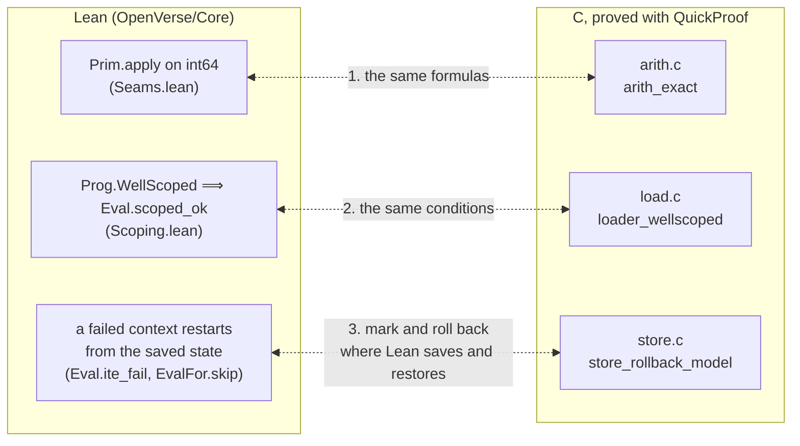

# Seams between Lean and the C runtime

openverse has two semantics: Lean's (`OpenVerse/Core`), which is the
definition of Verse Core, and CompCert's semantics of C, under which
QuickProof proves the C runtime's components. Each seam is a property stated
on both sides, so that the theorems meet. Following LeanOS (ADR 0030), every
seam is a scalar contract with the same formula on both sides. The one step
that no tool checks is reading that the two formulas below are the same.

## 1. Integer arithmetic (`runtime/src/arith.c`)

| | C (law `arith_exact`, `proofs/quickproof/arith/project/harness/arith_exact.c`) | Lean (`OpenVerse/Core/Seams.lean`) |
|---|---|---|
| quotient, remainder | `a / b`, `a % b` (C99 §6.5.5: truncation toward zero) | `cDiv a b := a.tdiv b`, `cRem a b := a.tmod b` |
| `+` fits | `b >= 0 ? a <= INT64_MAX - b : a >= INT64_MIN - b` | `cAddFits a b := if 0 ≤ b then a ≤ maxV - b else minV - b ≤ a` |
| `-` fits | `b >= 0 ? a >= INT64_MIN + b : a <= INT64_MAX + b` | `cSubFits a b := if 0 ≤ b then minV + b ≤ a else a ≤ maxV + b` |
| `*` fits | `b == 0 → 1`; `b == -1 → a != INT64_MIN`; `b > 0 → INT64_MIN / b <= a && a <= INT64_MAX / b`; else `INT64_MAX / b <= a && a <= INT64_MIN / b` | `cMulFits a b` (the same four cases with `cDiv`) |
| unary `-` fits | `a != INT64_MIN` | `cNegFits a := a != minV` |
| `Floor(a/b)` | `q = a / b; r = a % b; (r != 0 && ((r < 0) != (b < 0))) ? q - 1 : q` | `cFloorDiv a b` |
| `Ceil(a/b)` | `(r != 0 && ((r < 0) == (b < 0))) ? q + 1 : q` | `cCeilDiv a b` |
| `Quotient[a,b]` | `r < 0 ? (b > 0 ? q - 1 : q + 1) : q` | `cQuotient a b` |
| `Mod[a,b]` | `r < 0 ? (b > 0 ? r + b : r - b) : r` | `cModulo a b` |
| `(INT64_MIN, -1)` | floor, ceil, quotient: `VX_OVERFLOW`; mod: `VX_OK`, 0 | `apply_min_neg_one` |
| zero divisor | `VX_FAIL` | `apply_div_zero` |

What each side proves:

- **Lean**: each formula is the Verse semantics: `add_seam : inRange (a + b)
  = cAddFits a b`, …, `floorDiv_seam : floorDivInt a b = cFloorDiv a b`, …,
  `modulo_seam : Int.emod a b = cModulo a b`. The corollaries `apply_add`, …,
  `apply_modulo` state `Prim.apply` itself in these terms, for instance
  `Prim.apply .add [.int a, .int b] = if cAddFits a b then .ok (.int (a + b))
  else .err .overflow`.
- **Coq (QuickProof)**: for every pair of `int64_t` values, `vx_add`, …,
  `vx_modulo` return the status and the value that the formula gives, and
  leave `*out` alone when they do not return `VX_OK`.

Together they show that the C function computes `Prim.apply` on every input.
This assumes that the C law's text and the Lean text above are the same
formula, and that CompCert's `/` and `%` on `long` are C99's (`Int64.divs`
and `Int64.mods` round toward zero).

## 2. Scoping (`runtime/src/load.c`)

| | C (law `loader_wellscoped`) | Lean (`OpenVerse/Core/Scoping.lean`) |
|---|---|---|
| every function | `arity <= nslots`, `1 <= nnodes`, `root < nnodes` | `fn.arity ≤ fn.nslots` (`Prog.WellScoped`) |
| `LOCAL i`, `ASSIGN i`, `FOR i` | `i < nslots` | `decide (i < n)` in `Expr.scoped` |
| `CALL f n` | `f < nfns && fns[f].arity == n` | `P.fns[f]? = some fn ∧ fn.arity = es.length` |
| child of node `j` | `< j` (the node graph is acyclic, children first) | structural: `Expr` is a tree |

What each side proves:

- **Lean**: `Eval.scoped_ok` says that in a well-scoped program, evaluation
  never produces `err .slot` or `err .call` and never changes the size of a
  frame.
- **Coq**: for every input buffer, `vx_load` reads only inside it. When it
  accepts, the node tables it returns satisfy the conditions in the C column.

The link between them is `Prog.encode`, which writes each `Expr` tree in
post-order, so children come first. The differential tests check this
encoding on every program they run.

## 3. Rollback (`runtime/src/store.c`)

| | C (law `store_rollback_model`) | Lean |
|---|---|---|
| failed context | `vx_store_rollback` restores the slots, the output length and the output bytes saved at the matching `vx_store_mark` | `Eval.ite_fail` and `EvalFor.skip` restart from the saved state; `ite_rollback` |
| successful context | `vx_store_commit` keeps everything | `Eval.ite_ok` and `EvalFor.step` continue from the new state |

This seam is structural rather than a formula. The interpreter takes a mark
exactly where the Lean rules save a state (an `ITE` condition, each `FOR`
filter), and rolls back exactly where they restore one.
