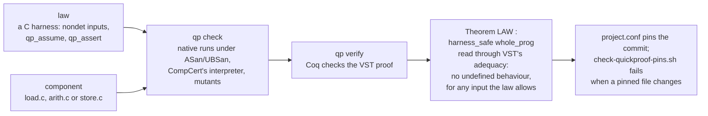

# QuickProof proofs of the openverse C runtime

The C runtime (`runtime/`) has three handwritten components that the rest
depends on for memory safety and for Verse's rollback semantics. Each is
proved with [QuickProof](https://github.com/genproof/quickproof-public)
v0.1.0 (Coq 8.20.1, VST 2.15, CompCert 3.15 Clight), following the evidence
lane of LeanOS ADR 0030. A property is a C program, the *law*: it draws
arbitrary inputs (`nondet_*`, `pick`), restricts them (`qp_assume`) and
checks results (`qp_assert`). QuickProof turns it into `Theorem LAW :
harness_safe whole_prog`. Read through VST's adequacy theorem, this means
that no run of the program has undefined behaviour in CompCert's semantics,
for any input the law allows. So every assertion holds and every memory
access is in bounds.



> [!IMPORTANT]
> A person reviews the laws (the first comment of each harness file is the
> claim), the configuration, and `docs/SEAMS.md`. Nobody needs to review the
> Coq proof; `qp verify` checks it.

| Project | Law | Claim (summary) | Status |
|---|---|---|---|
| `arith` | `arith_exact` | for all `int64` a, b, the nine int operations return exactly `Prim.apply` (via `Seams.lean`) | **PROVED** at 7336cd864b97 — `qp verify` PASS (`arith/VERIFY.md`) |
| `store` | `store_rollback_model` | for any 32 operations on up to 3 nested contexts, 4 slots, and journal and output capacities up to 8, rollback restores the slots, output length and output bytes, and commit keeps them, against a naive snapshot model | **PROVED** at 7336cd864b97 — `qp verify` PASS (`store/VERIFY.md`) |
| `loader` | `loader_wellscoped` | for every buffer of up to 4 KiB, `vx_load` reads in bounds; when it accepts, the program is well formed (HEAP nodes and REF literals included) and `Prog.WellScoped` | **PROVED** at 7336cd864b97 — `qp verify` PASS (`loader/VERIFY.md`) |

Each `STATUS.md` records the result of `qp check` (native runs under
ASan/UBSan, CompCert's interpreter, mutants) and, for a finished proof, the
`qp verify` verdict and axioms. Proof sources live in `<project>/proof/src/`.

## Reproducing

```sh
scripts/check-quickproof.sh --check arith store loader   # qp check, then qp verify of committed proofs
```

This needs Docker and the image `ghcr.io/genproof/quickproof`, pinned by
digest in the script. Each project's `project.conf` pins the openverse
commit its theorems are about.

## What a QuickProof result relies on

As in QuickProof's own `docs/GUARANTEES.md`:
- Coq, VST, CompCert's Clight semantics for x86-64, `clightgen`, QuickProof's
  translation scripts and `qp verify`;
- VST's adequacy theorem, not yet instantiated for QuickProof's environment;
  each theorem rests on the axioms its `VERIFY.md` lists: the standard ones plus the declarations of VST's malloc library;
- the difference between CompCert's C and the GCC build of `cverse`. The
  theorems are about the C source, single-threaded, and partial correctness.

QuickProof is under the PolyForm Noncommercial License 1.0.0. CompCert is
under the INRIA Non-Commercial License. The files in this directory were
written for openverse; running them uses QuickProof under its own license.
